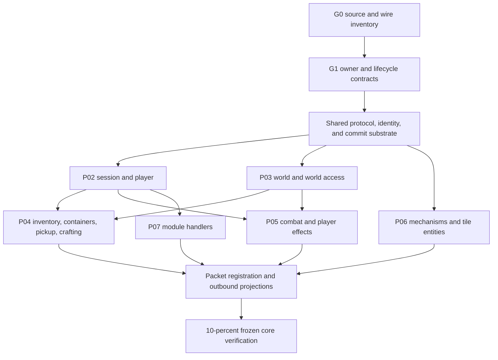

# Version4 Minimal Server Implementation — Master Plan

Status: active execution plan
Strategy: `graph` with per-direction `spec` acceptance gates
Owner: current root session
Target code boundary: `D:\TRbackup\NLTX\src\MinimalImplementation`
Allowed external code API: reviewed public APIs from `D:\TRbackup\NLTX\src\NSSLC.Infrastructure`

## Objective

Build a minimal authoritative server that reproduces the Version4 packet communication and
interactive behavior needed by the selected server paths. Keep every new server implementation
and verification source under `src/MinimalImplementation`. Reuse the repository's own Contracts
and Protocol code in that tree, and call only approved public APIs from `NSSLC.Infrastructure`
outside it. The server uses ordinary OOP state owners and synchronous commits; it does not add ECS
dependencies or reference implementation code from any other project directory.

The target is Version4 behavior. Earlier project snapshots are evidence for locating behavior and
understanding changes. A behavior found only in an older snapshot stays labeled as a candidate
until its applicability to Version4 is recorded. A Version4 empty method establishes an evidence
gap; it does not establish the missing algorithm.

## Fixed scope and constraints

- Implement packet framing, authentication/session admission, authoritative domain state, inbound
  request handling, outbound projections, and lifecycle cleanup for the selected server paths.
- Preserve each packet's exact field order, width, signedness, bounds, and trailing-frame rules.
  Server decisions use server-owned snapshots and policy inputs; client payloads do not become
  authoritative state by decoding alone.
- Keep one writer for each durable state. Cross-owner operations use an explicit prepare/commit
  boundary on the serialized server loop. Do not publish success projections before commit.
- Keep all new source, test harnesses, fixtures, and server-specific adapters within
  `src/MinimalImplementation`. References outside that tree are limited to approved
  `NSSLC.Infrastructure` public APIs and the .NET runtime.
- The root session owns `MinimalImplementation.Server.csproj`, shared contracts, composition,
  common protocol registration, and the serialized build window. Direction agents provide exact
  compile include paths and interface requirements; they do not concurrently edit those shared
  integration files.
- Functional core-test execution is capped at 10% of the frozen core-scenario inventory. The
  inventory and exact selected IDs are frozen below before further functional runs. SC041 is the
  only selected P04 scenario; no other P04 scenario may run. Compilation checks are reported
  separately and do not authorize a broader scenario run.

## Current baseline and gates

- G0 source/version freeze and G1 owner/integration contracts have been accepted by the root
  session for the current implementation wave. Keep provenance beside every extracted wire fact,
  state invariant, and compatibility choice.
- The server project explicitly lists source files. New files are not part of the build until the
  root session adds their compile includes and opens a serialized build window.
- P04 has local packet DTO/codecs, item/container facts, inventory/chest/world-item owners,
  generation and revision tracking, chest leases, reservation state, a chest access service,
  multi-chest slot batches, and a synchronous inventory/chest transaction coordinator. Packet 85
  now has a server-owned candidate provider, atomic transfer coordinator, authenticated handler,
  and a root registration bundle; module 11 adapts the Version4 protocol payload to the local
  crafting domain and registers as the module owner. The affected Server project builds, but SC041
  has not yet run.
- The server project's explicit compile set now includes its P02 `Player` and `Session` sources in
  addition to `Inventory`, so the P04 authenticated packet handler can bind to the shared session
  gate. These files are within `src/MinimalImplementation` and add no external implementation
  dependency.
- Packet 85 is `Int32 count + count × Int16 inventorySlotId + bool smartStack`; its reply is
  `Int32 blockedCount + blockedCount × UInt16 chestId`. The server rereads selected inventory
  slots from its owner.
- Packet 82 module 11 requests contain 7-bit material count, repeated `Int32 itemIdOrRecipeGroup`
  and 7-bit positive stack, then a 7-bit chest count and 7-bit chest IDs. The reply contains only
  one `bool approved`. Negative material/group IDs and negative chest IDs remain intact in the
  wire DTO. Do not add recipe IDs, quick-craft flags, outputs, or consumed-item fields.
- Version4's QuickStack entry points `ReadNetInventory`, `QuickStackToNearbyChests`, and
  `WriteBlockedChestList` are empty in the inspected tree. Their missing algorithm is unresolved;
  compare earlier project snapshots, record the source identity and behavior diff, and have the
  root freeze the selected compatibility rule before claiming parity.

## Dependency graph

P02 and P03 can proceed concurrently after the shared substrate contracts are fixed. P04 inventory
planning can proceed in parallel with P05/P06/P07 contract work, while P04 interaction handlers
wait for P02 identity/session and P03 world/access APIs. Packet registration and shared composition
remain root-owned. Child sessions must inherit the root history, write only their assigned
subplan/source boundary, and report exact source paths, dependencies, unresolved questions, and
verification status.

## Phases and batches

| Phase | Why it exists | Batches and dependencies | Acceptance gate |
| --- | --- | --- | --- |
| 0. Source and wire evidence | Prevents accidental mixing of snapshots or inferred rules. | B0.1 inventory target Version4 packet handlers, writers, DTOs, and source hashes. B0.2 compare earlier project snapshots for missing or changed bodies. B0.3 record approved Infrastructure APIs and forbidden source references. | Every planned behavior has a source/version citation or an explicit `unknown`/compatibility decision. Wire facts have field order, width, signedness, and frame-boundary rules. |
| 1. Shared server substrate | Domain directions need a stable authenticated identity and commit boundary. | B1.1 framing and wire decode/encode. B1.2 session admission and entity identity. B1.3 server-loop commit, owner results, outbound intents, and cleanup contract. | Malformed frames fail before state access; identity/session lifecycle is singular; domain commits are synchronous and have stable success/failure results. |
| 2. Authoritative owners | Domain owners must exist before packet handlers can be trusted. | B2.1 P02 player/session owner. B2.2 P03 world/tile/access owners. B2.3 P04 inventory, item, chest, world-item, and reservation owners. B2.4 P05 combat and P06 mechanisms. B2.5 P07 module state owners. P02/P03/P04 source review can run in parallel where contracts do not overlap. | Snapshots are immutable copies; owners enforce ID, revision, generation, bounds, and lifecycle rules; no direction introduces a second writer. |
| 3. Interaction transactions | Packet handlers must use server-owned state and preserve commit order. | B3.1 P04 chest open/close/slot update and lease checks. B3.2 P04 item transfer, pickup, QuickStack, and crafting material planning. B3.3 P05/P06/P07 handlers consume their owner APIs. B3.4 cross-owner effects use prepare/commit or explicit post-commit intents. | Rejected/stale requests leave all involved durable owners unchanged; accepted requests commit once; downstream projections are formed after commit. |
| 4. Packet integration | Complete packet communication requires both handler registration and outbound encoding. | B4.1 map each supported Version4 packet to authenticated context and owner method. B4.2 register codecs/handlers in root composition. B4.3 produce exact outbound projections and transport intents. B4.4 cover disconnect, world replacement, timeout, and retry boundaries. | Every packet in selected scope has one decode, authority check, owner call, failure result, and response/projection path. No raw transport write bypasses the outbound path. |
| 5. Core verification and handoff | Keep the test budget bounded while still verifying high-risk integration seams. | B5.1 freeze the complete scenario inventory and exactly the selected 10% subset. B5.2 run only selected scenarios; P04 proposes SC041 as its only scenario. B5.3 run root-approved compile checks and record environment and output. B5.4 update handoff and unresolved-risk register. | The selected budget is not exceeded. Evidence records command, exit code, warnings/errors, and scenario IDs. Unrun behavior is reported plainly. |

## Parallel subplan boundaries

Each direction below gets one child session with this master plan in its inherited history. The
child writes its direction plan before implementation and does not edit shared project composition
or compile includes.

| Direction | Owns | Depends on | Handoff to root |
| --- | --- | --- | --- |
| P02 Session and player | Authenticated session binding, player identity/lifecycle, player inventory association, disconnect cleanup. | Shared substrate; identity contracts. | Public owner API, packet context mapping, invalidation order, compile include list. |
| P03 World and access | World scope, tile/container lookup, authoritative player position/access facts, world lifecycle. | Shared substrate. | Read-only access/query APIs used by P04/P06; world replacement cleanup. |
| P04 Items and containers | Inventory, item stack rules, chest access and lease, world item pickup/reservation, QuickStack packet 85, crafting module 11, transfer transaction coordinator. | P02 player identity and P03 world/access for handlers; wire facts from G0. | Owner/service interfaces, compile includes, source provenance, SC041 result, unresolved compatibility facts. |
| P05 Combat | Authoritative combat state and supported combat packets/effects. | P02 identity; P03 world/query; shared effect/outbound contract. | Domain API, effect ordering, packet registrations, compile includes. |
| P06 Mechanisms | Tile entity and mechanism state plus relevant packet paths. | P03 world/tile authority; identity/commit substrate. | Owner/query API, invalidation rules, compile includes. |
| P07 Modules | Version4 module dispatch and each selected module's server owner/codec. The active Packet 82 inventory, root compatibility decisions, owner boundaries, frozen 10% test budget, and current evidence are in [the P07 plan](P07-module-implementation-plan.md). | Shared module protocol and session authority; individual owner dependencies. | Module registration table, module codec facts, response and replay behavior, compile includes. |

Direction plans are authored one at a time in the root's visible plan sequence. Once a plan's
scope, dependencies, and acceptance criteria are complete, the corresponding implementation
session can proceed while other independent child sessions work on their own already-reviewed
plans. Concurrency does not permit concurrent edits to shared contracts, composition, or build
configuration.

P07's current root decision restores Text module 1 Party routing and Ping module 2 broadcast from
the complete historical snapshot `D:\TRbackup\无任何删减通过编译`, because Version4 retains the
matching packet boundaries while its receive methods are empty. The decision and Version4 evidence
gaps are recorded in [P07's compatibility log](P07-module-implementation-plan.md#root-compatibility-decisions).
These are selected compatibility behaviors; they are not claims that the empty Version4 methods
currently execute them.

## Test budget and evidence policy

1. Enumerate the core scenarios by packet/interaction and risk before running any functional test.
2. The current authoritative Chinese master freezes 100 scenarios, SC001–SC100. The fixed
   ten are **SC001, SC002, SC011, SC012, SC026, SC041, SC056, SC071, SC081, SC091**.
   The other 90 scenarios must not run; do not substitute IDs or add scenarios.
3. This 2026-10-16 round requires fresh evidence for all ten, including SC081. Reruns of these
   selected IDs after fixes are allowed. Historical PASS and owner fixtures do not prove current
   production TCP behavior. SC092 is not selected and must not be executed.
4. SC041 is P04's one end-to-end inventory/chest transaction. It must verify server-side
   inventory re-resolution, exact packet 85 reply shape, accepted transfer state, and no partial
   state on an injected stale revision.
5. Run no other P04 scenario. Do not run the remaining P04 scenario matrix or broad solution tests.
6. Build/compile validation is separate from functional scenario execution and occurs only in the
   root's serialized build window after source includes are reviewed.
7. Keep generated output under Build/bin, Build/obj and Build/generated; keep this round's
   reports under `Build/diagnostics/MinimalImplementation/ParallelResume-20261016`.
   Verification source stays under `src/MinimalImplementation/Verification`.

Historical superseded policy: an earlier P04-only acceptance window used a 90-scenario inventory,
selected SC041/SC081 and prohibited rerunning SC081. That policy is retained here as historical
context only; the fixed-ten current-round policy above replaces it. Full packet/module behavior,
readiness and dependency closure remain required independently of the bounded scenario execution.

## P01 protocol and transport implementation checkpoint

Status: protocol source and incremental compile are ready for root integration; runtime acceptance
is still pending.

The exact P01 API boundary, changed paths, build evidence, and root integration contract are recorded
in [P01-protocol-transport-handoff.md](P01-protocol-transport-handoff.md).

- `src/MinimalImplementation/Protocol/` now contains bounded TCP frame assembly, a Version4 frame
  codec, queued TCP send/receive with byte and frame budgets, connection lifecycle reporting, the
  listener adapter, `Version4PacketConnection` for client-to-server decode and server-to-client
  intent encoding, the runtime facts input/factory, module 82 codecs, and the direction-aware
  binding over the generated Version4 packet catalog.
- `src/MinimalImplementation/Tools/WireCompiler/` generates the packet codec source into
  `Build/generated/MinimalImplementation.Protocol/<Configuration>/<TargetFramework>`. The
  standalone generator initializes schema dependencies only in its own process; generated codec
  constructors read production values from `ProtocolInputs.Instance`, and the Server project does
  not reference the generator executable. Stale generated `.g.cs` files are removed from that
  dedicated output directory after successful generation.
- The required Infrastructure codec corrections are limited to packet 85 request/response,
  tile-entity payloads 8/9/10, and packet 20 liquid/color/frame presence handling. Packet 85 is
  represented as `Int32 count + count × Int16 slot + bool smartStack` in the client-to-server
  direction and `Int32 count + count × UInt16 blockedChestId` in the server-to-client direction.
- Verification performed with SDK `10.0.400`:
  - `dotnet build src/MinimalImplementation/Protocol/MinimalImplementation.Protocol.csproj --no-restore`
    exited 0, generated 166 codec source files, and reported 0 warnings and 0 errors. Output:
    `Build/bin/MinimalImplementation.Protocol/Debug/net10.0/MinimalImplementation.Protocol.dll`.
  - `dotnet build src/MinimalImplementation/MinimalImplementation.Server.csproj --no-restore`
    exited 0 and reported 0 warnings and 0 errors. Output:
    `Build/bin/MinimalImplementation.Server/Debug/net10.0/MinimalImplementation.Server.dll`.
- A stale generated-source check placed one temporary `.g.cs` file in the dedicated output
  directory, rebuilt Protocol successfully with 0 warnings and 0 errors, and confirmed the
  generator removed that stale file before compilation.
- No functional scenarios were run. In particular, SC001 and SC002 were not run, and no listener
  was started. These builds prove source/project integration only; they do not prove runtime packet
  behavior or end-to-end server readiness.
- Root integration remains open: initialize the protocol facts from real content directories,
  connect `TcpListenerAdapter` and `PacketTcpConnection` to the root composition, register packet
  handlers and outbound projections, then run only the pre-frozen 10-percent scenario selection.
  This checkpoint does not claim full packet interaction coverage or server completion.

## Definition of done

- All selected Version4 packet paths have a source-backed contract, authoritative owner, handler,
  response/projection, and lifecycle behavior.
- Every remaining source uncertainty is listed with its Version4 and historical evidence and a
  root-approved compatibility choice.
- New server code and verification source stay within `src/MinimalImplementation`, with only
  approved Infrastructure API references outside the tree.
- Shared owners have one writer, cross-owner operations have an explicit commit boundary, and
  outbound intents describe already-committed state.
- The frozen 10% functional scenario budget is respected; SC041 is the only P04 core scenario run.
- Root integration includes have been reviewed, the serialized build gate has a recorded result,
  and each child handoff lists changed files and open risks.
