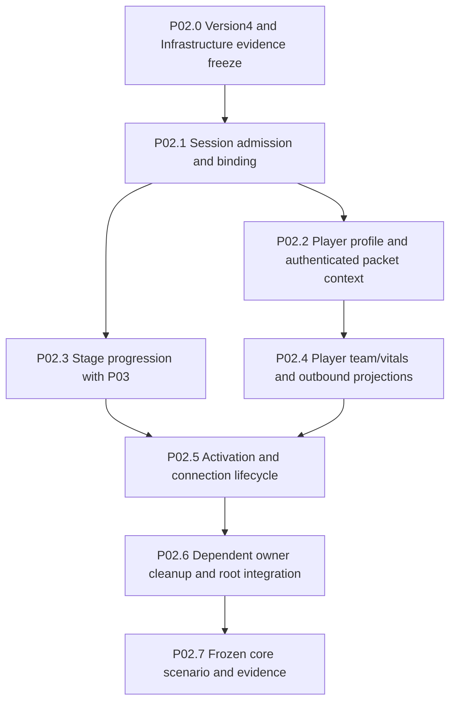

# P02 Session and Player — Implementation Plan

Status: subplan for root integration  
Strategy: `graph` with per-batch acceptance gates  
Master plan: `docs/plans/minimal-implementation/MASTER-execution-plan.md`  
Implementation boundary: `D:\TRbackup\NLTX\src\MinimalImplementation`  
Allowed external code APIs: reviewed public APIs under `D:\TRbackup\NLTX\src\NSSLC.Infrastructure`  
Owner: P02 child session; root owns composition and build integration

## Objective

Complete the authenticated session and player lifecycle required by the Version4 server paths:
connection admission, password handling, server-assigned player slots, validated player profile,
session-stage progression, authenticated player-to-owner mapping, player status/team updates,
post-commit synchronization, disconnect/timeout retirement, and cleanup of session-scoped state.
All new server and verification source remains in `src/MinimalImplementation`. Use ordinary OOP
owners, one writer per state, and the shared serialized server commit loop. Packet handlers must
resolve the actor from the authenticated session binding; an embedded player index is never an
authority source.

P02 owns the session identity and common player lifecycle seam. It does not own transport framing,
root packet registration, world or tile data, inventory contents, combat movement/effects, or
direct socket writes. Those responsibilities stay with P01/root, P03, P04, and P05/P07 as listed
in the master plan.

## Scope and packet responsibility

| Packet | P02 responsibility | Direction and handling rule |
| ---: | --- | --- |
| 1 Hello | Validate protocol version, ban/slot policy input, and current session stage; prepare admission response. | Client to server; only valid in `AwaitHello`. |
| 2 Kick | Encode a server rejection and request connection closure after its response. | Server to client. Version4's client-to-server case is a no-op; transport closure is reported separately. |
| 3 PlayerInfo | Return the server-selected slot and admission result. | Server to client; never accept this packet as an admission request. |
| 4 SyncPlayer | Validate and store the sender's profile; ignore the embedded slot when identifying the writer; publish an authoritative profile projection. | Bidirectional codec, but the server receive path binds sender to authenticated slot. |
| 6 RequestWorldData and 8 SpawnTileData | Let P03 own world data and section delivery; P02 checks the session stage and commits the associated stage transition. | Client to server requests are handled only at the expected stage; world contents remain P03-owned. |
| 12 PlayerSpawn | Bind the request to the authenticated player, validate the stage and player-owned fields, and commit the synchronization-to-active transition once. Delegate spawn location/world effects to P03. | Client to server; embedded player ID is not trusted. |
| 13 PlayerControls | Supply authenticated actor context to P05; P02 does not own movement state. | Client to server; accepted only for a bound session in the allowed gameplay stage. |
| 14 PlayerActive | Produce authoritative active/inactive projections for other sessions after admission or close. | Server to client output. The Version4 server receive body reads the two bytes and exits before changing state. |
| 16 PlayerLifeMana and 42 Unknown42 | Resolve the authenticated player's vitals and apply the source-backed life/mana policy; create any required committed projection. | Client to server upload and server-to-client sync. |
| 45 TeamChange and 157 TeamChangeFromUI | Resolve the authenticated player, validate team range, update the single player owner, and project the canonical team change. | Bidirectional codec; both client requests use the connection-bound player. |
| 37 RequestPassword and 38 SendPassword | Request a password after a valid Hello and compare a response only in `AwaitPassword`; close after rejection. | 37 server to client; 38 client to server. |
| 49 InitialSpawn and 129 FinishedConnectingToServer | Produce the Version4 connection-complete output at the P03/P01 join boundary. | 49/129 are server-to-client in the Infrastructure catalog; do not treat them as client admission proof. |
| 161 HostToken | Verify optional host-token authorization against the bound player; keep it independent of gameplay-host policy. | Client to server; only after a player binding exists. |

P02's packet inventory must be reconciled with the root's selected packet scope before final
registration. The Infrastructure catalog is a codec contract, not evidence that a packet is
accepted by Version4's server receive path. In particular, packet 14 is bidirectional in the
catalog but Version4's server branch exits before applying the supplied active state.

## Evidence baseline and compatibility limits

The Version4 source inspected for this plan has these SHA-256 identities:

| Source | SHA-256 | Relevant Version4 locations |
| --- | --- | --- |
| `D:\TRbackup\Version4\Terraria\MessageBuffer.cs` | `0F474225FA9D98C539F61249619273A44E73F69A4CF388B44258433A2D15D5EE` | `GetData`: packet gate and Hello at 145–214; SyncPlayer at 219–325; world request/state progression at 375–597; PlayerSpawn activation at 604–650; PlayerActive at 740–769; life at 771–787; password at 1736–1749; mana/team/host token at 1788–1842, 3331–3336. |
| `D:\TRbackup\Version4\Terraria\Netplay.cs` | `95F8D53F9FC466B2FBB9B8F67DF4AD9A77E2CD4ACD04E77859FEE650CE6DF67B` | `MaxConnections`/client state at 31–43; connection initialization at 260–305; timeout/connection cleanup at 323–364. |
| `D:\TRbackup\Version4\Terraria\NetMessage.cs` | `87B596BD8467B9C470DD1F2AD6963EBADE257689F87395163AB136C149BEBC9A` | Packet 3 response at 128–143; kick at 2313–2319; connected/disconnected sync at 2535–2561; `SyncOnePlayer` outputs packet 14 and profile/state at 2631–2660. |
| `D:\TRbackup\Version4\Terraria.ID\MessageID.cs` | `C911F86D932D6A23AC4FCB23149226CEE4993B7652AC2D2D530FF79DA9B944EC` | Stable IDs for the packet table above. |

Evidence findings and limits:

- The Version4 handshake is: packet 1 in state 0 validates `"Terraria" + 319`; no password
  advances the connection to state 1 and sends packet 3, while a configured password advances
  to the password-wait state and sends packet 37. Packet 38 either advances to state 1 and sends
  packet 3 or sends packet 2. Before player admission, packet-state gates reject out-of-sequence
  messages (`MessageBuffer.cs:145–171, 180–214, 1736–1749`).
- Packet 3 contains the selected byte player slot and a Boolean admission result
  (`NetMessage.cs:140–143`). The server chooses the slot; the requester's profile packet 4 is
  associated with `whoAmI`, not the packet's embedded player byte (`MessageBuffer.cs:219–228`).
  Version4 allocates 256 connection records (`Netplay.cs:31, 276–282`) but its player sync and
  recipient loops cover slots 0–254 (`NetMessage.cs:2548–2554, 2507–2514`). Keep connection
  capacity separate from playable slot capacity; the current `SessionBindingStore` reserves
  255 player slots and therefore must not bind slot 255.
- Packet 4 trims the player name, checks duplicate active names, maximum name length, empty names,
  and Journey/non-Journey difficulty compatibility, then relays a canonical profile
  (`MessageBuffer.cs:244–325`). The complete profile includes appearance, voice, accessory flags,
  colors, difficulty, biome/cart flags, permanent-upgrade flags, and other fields. A P02
  `PlayerProfile` snapshot must preserve every wire-visible field required by the selected join
  synchronization; storing only name/team is insufficient for full profile relay.
- Request packet 6 moves the legacy state from 1 to 2 and returns world data
  (`MessageBuffer.cs:375–384`). Packet 8 progresses state 2 to 3 while sending requested world
  sections and initial world projections (`MessageBuffer.cs:387–597`). P02 owns stage admission;
  P03 owns the data and section authority.
- Root's 2026-10-16 packet 6 delivery boundary authenticates the epoch, stage, sequence, binding
  and live player before invoking a synchronous optional delivery callback. Host first encodes
  the complete packet-7 projection through the actual Version4 wire profile, then calls the
  existing section owner `BeginWorld`. Only Applied allows accepted sequence/stage progression
  and publication of the captured intent. The callback explicitly initializes section delivery
  state; rejection must leave that state unchanged.
  Existing ledger validation precedes its writes, and there is no further expected rejection
  after successful initialization. No callback I/O, reentry or packet/other-owner mutation is
  permitted. Session commit-version reservation can leave gaps on preparation failure. Existing
  two-argument callers remain compatible. This orders local acceptance effects; it does not add
  rollback for unexpected exceptions or a world-replacement lifecycle.
  Root's subsequent 2026-10-16 packet-7 delivery increment shares the actual single-target
  encoding/capture and receipt sender with packets 12/147. The captured output is exposed only
  after Applied and submitted outside the commit loop. Submission requires exactly one receipt
  for the requesting epoch with Queued or LocallySent certainty. Empty, mismatched or unsuccessful
  receipts record message id, commit version, target and certainty; the router then requests
  connection shutdown, letting the existing close callback retire the session and section state.
  This is a Host reliability choice consistent with the existing packet-8 delivery-failure policy.
  A close request does not synchronously retire domain state. Transport exceptions and cancellation
  still propagate into the existing connection lifetime/cleanup path. Failed delivery does not
  undo acceptance or automatically retry/replay the output. Client acknowledgement and global
  commit-to-transport ordering remain open. Version4's additional packet-6 conditional invasion
  synchronization through Main.SyncAnInvasion also remains unimplemented; stored last-progress
  snapshots or persisted event flags do not establish all current event predicates.
- Root's subsequent 2026-10-16 packet-8 output boundary constructs the complete 9/provider/49
  projection batch inside the authenticated commit callback, using a reserved session version.
  An optional synchronous preparation callback encodes the final packet wrappers through the
  actual Version4 profile and captures the complete pending join layout before accepted sequence
  or AwaitSectionRequest-to-Synchronizing progression. Host retains 7/9 before sections and 49
  after all remaining snapshots. Existing three-argument calls remain source-compatible.
  Preparation must not mutate inputs/owners, perform I/O or reenter sessions. Capture still opens
  a section transfer; it is an explicit effect, not a pure read. On rejection or exception before
  exposing pending output, Host's finally retires the captured transfer through the existing
  owner API. Retirement removes the associated ledger rather than restoring its previous state;
  session stage/accepted sequence remain unchanged on preparation rejection. Internal capture
  failure cleanup remains with the existing section coordinator. Reserved versions may have
  gaps; no general rollback, retry or network transaction was added. The existing receipt/49
  completion barrier and delivery-failure closure continue to apply after acceptance.
- Packet 12 is bound to the sender. Once the legacy state is 3, Version4 transitions to state 10,
  announces the connected player, broadcasts spawn state, and sends packet 129
  (`MessageBuffer.cs:604–650`). Session and player activation must commit once before submitting
  active-player projections; output preparation may precede the commit.
- Root's 2026-10-16 packet 12 output boundary prepares the proposed joining-player snapshot,
  all typed lifecycle projections, and actual Version4 wire encoding before PlayerOwner writes
  or the authenticated session advances. The synchronous callback is preparation only: no owner
  writes, input mutation, network I/O or reentry. Preparation rejection leaves player state,
  session stage and accepted sequence unchanged; reserved player commit versions may have gaps.
  Captured output becomes publishable only after Applied. Existing initial-sync delivery remains
  a prerequisite, and 129 stays last in initial-join output. Active-stage respawn uses the same
  preparation boundary and emits canonical 12 without repeating the initial-join projections.
  Host shares its single-target encoding/capture and receipt sender with packet 147. Each send
  requires exactly one matching-epoch Queued or LocallySent receipt. Returned failures record
  message id, commit version, target and certainty (empty receipt is NotSubmitted), and remaining
  projections continue; 129 is skipped for a target with an earlier failed projection. Transport
  exceptions and cancellation still propagate. Delivery failure does not undo the committed
  player/session state or replay captured output. This is local submission evidence, with no
  client acknowledgement, automatic recovery, or global commit-to-transport ordering guarantee.
- Root's 2026-10-16 spawn choice follows Version4 `Player.Spawn` (`Player.cs:21798–21930`)
  for the currently modeled player state: preserve positive life, revive nonpositive life to
  `max(100, max(baseMaximumLife, effectiveMaximumLife) / 2)`, restore base maximum life after a
  pending PvP death, and set general immunity to 300/180/60 for PvP/revive/other contexts.
  SpawningIntoWorld (context 1) retains a preexisting death flag or a positive uploaded respawn
  timer, without applying revival or immunity. The death flag is owned independently of life:
  packet 16 sets it from life, while packet 66 changes life without clearing death. Spawn clears
  spectating and resets the modeled fall-start value. Version4's spawnMax has no true assignment
  in the inspected source and is not synthesized from missing equipment facts.
  `AdjustRespawnTimerForWorldJoining` is empty in Version4 (`Player.cs:26459`); the complete
  historical body (`无任何删减通过编译/Terraria/Player.cs:56378–56395`) only adjusts the
  local player's persisted timer. Root selects retaining the remote server player's uploaded
  timer and death state, with no wall-clock or player-file lookup. This is an explicit remote
  server compatibility choice, not an implementation of the missing Version4 helper. The world
  spawn fallback, collision/clearance, wall scan, and other unmodeled spawn effects remain open.
- Version4 `Netplay.UpdateConnectedClients` approves reset for terminated or disconnected clients,
  emits the disconnected-player synchronization, clears activity, and invokes disconnect hooks
  (`Netplay.cs:323–364`). Connection close and timeout therefore need the same idempotent P02
  retirement path.
- Version4 accepts packet 16 life as signed 16-bit values, floors maximum life to 20, and derives
  death from life at or below zero (`MessageBuffer.cs:771–787`). Packet 42 stores both signed
  16-bit mana values directly (`MessageBuffer.cs:1788–1797`). Root's compatibility choice on
  2026-10-16 is to preserve those signed values in `PlayerVitals.WithManaUpload`, including
  negative values and mana above the uploaded maximum. Packet 42 produces no immediate relay,
  matching that receive body; join projection retains the stored values. Authentication, stage
  and accepted-sequence checks still precede the player write. This source-backed choice is not
  a build or functional verification result.
- Version4 packets 45 and 157 replace the embedded player byte with the sender slot, update team,
  and broadcast packet 45 (`MessageBuffer.cs:1810–1842`). Team range/index safety and the
  additional section request for packet 157 on team-spawn worlds must be resolved with P03.
- Packet 161 sets a token-authenticated host flag (`MessageBuffer.cs:3331–3336`). Current
  `Player` already separates `IsHost` from `CountsAsHostForGameplay`; retain that distinction.
- `MessageBuffer.cs:740–769` reads packet 14's two bytes and immediately exits before changing
  active state. The `Version3` excerpt at the same location has the same early exit. The
  `无任何删减通过编译` snapshot contains a client-mode active-state projection, which is not
  evidence that a Version4 server should trust packet 14 from a client. Keep server activity
  derived from the authenticated lifecycle unless a root-approved Version4 artifact proves
  otherwise.
- `Netplay.cs` is byte-identical between Version3 and Version4. The `MessageBuffer.cs` hashes
  differ, so historical source can help locate a complete method but must be compared field by
  field. Version1, Version2, Version3, and `无任何删减通过编译` remain candidate evidence only;
  no body from them is automatically Version4 behavior.

Packet field widths/directions should come from the reviewed public Infrastructure API, including
`PacketDefinitions.cs` graphs for Hello, PlayerInfo, SyncPlayer, PlayerSpawn, PlayerActive,
PlayerLifeMana, SendPassword, TeamChange, TeamChangeFromUI, FinishedConnectingToServer,
InitialSpawn, and HostToken. Do not reference or compile the Version4 implementation source.

## Root compilation checkpoint — 2026-10-16 11:20

The former P04 `WorldItemDropCoordinator.cs:336` blocker changed externally to SHA-256
`01C90A813F7FB07471CE4C5FA897E1ADFADEF5DF2C32F3FE1813C8DA72B835C2`.
Root did not edit P04. A new serialized Server build reached four Host errors; root added the
missing packet-compiler namespace in the close partial and used the public `PacketRgb` type for
the existing team-notification colors. The subsequent incremental Server build and existing P02
verifier build both exited 0 with 0 warnings and 0 errors, with artifacts under `Build/bin/`.
Only SC011 and SC012 ran, using `--no-build --no-restore`; both passed as P02 owner-level fixture
evidence. These runs do not cover the production TCP router, section receipts, actual inventory
transactions, runtime/world adapters, or the full join packet inventory. No tests were added or
changed. P02 remains active and incomplete.

Commands, logs, artifact identities, source hashes and scenario results are retained under
`Build/diagnostics/MinimalImplementation/ParallelResume-20261016/P02-current-build-20261016-111640/`.
Earlier entries retain the compilation status at their own capture time.

The after-run audit at that checkpoint observed 13 changed source paths: the two Host repairs
and 11 external changes, preserved by this session. No complete source capture was taken at
each individual build boundary. The recorded command times and artifact hashes establish the
process results, without proving that every live file matched the compiled inputs. The evidence
directory now includes `concurrent-source-audit.json`, `verification-state.json`, and
`implementation-evidence.md` explaining that limit.

## Root team output boundary — 2026-10-16

Packets 45/157 now use an optional synchronous output-preparation callback in the shared
`PlayerTeamChangeCoordinator`. After authenticated Active-stage, sequence, binding, live-player,
team-range and optional P03 preparation validation, the coordinator reserves a player version
and constructs the proposed canonical projections and localized-notification audience. Host
encodes actual 45/158 bytes with the existing Version4 profile and packet-82 localized text
with the existing producer before either the section preparation or player team commits.
Packet 157 also prepares its pending section/158 layout before those writes. The proposed
commit is returned as committed only after both owner calls complete.

Preparation rejection leaves the player's team/version and session accepted sequence/revision
unchanged and publishes no projections or pending output. Player version reservation may leave
gaps. The callback must only encode/capture synchronously: no input/owner mutation, I/O, or
reentry. Existing calls omitting the callback retain their source call shape; the production Host
uses it for both packets. This provides no rollback for arbitrary exceptions or callback misuse.
P03 section preparation remains read-only until its existing Commit call, so an encoding rejection
does not open or retire the current transfer. Existing post-commit failure retirement/close
handling remains in place.

Successful delivery retains canonical 45 and localized feedback before sections, followed by
self-only 158 after the existing section submission/queued-section barrier. Generic team and
text output still uses the existing sender without receipt settlement; this change adds no
delivery guarantee, client acknowledgement, replay, or global commit-to-transport ordering.
The Version4 rule remains `MessageBuffer.cs:1810–1850`, including sender-bound identity,
localized text selection, and conditional team-spawn sections. Notification colors remain the
six existing values from `Main.cs:3433–3438`.

The Server and existing P02 verifier incremental builds both exited 0 with 0 warnings and
0 errors. SC011 and SC012 each passed with `--no-build --no-restore`, with no test source changes.
They provide owner fixture regression evidence and do not directly exercise the new 45/157
preparation callback or production TCP/Host receipts. Each build's before/after audit captured
662 MinimalImplementation source/project and existing root build files, with no observed hash
changes at those endpoints; this was an observation, not an exclusive source snapshot. The
verifier's copied Server DLL matched the successful Server build, and both DLL hashes remained
stable across the scenario runs. Exact commands, logs, artifact hashes, audits and scoped
before/after evidence are retained under
`Build/diagnostics/MinimalImplementation/ParallelResume-20261016/P02-team-output-boundary-20261016-112521/`.
P02 remains active; the previously listed dependency and production acceptance gaps remain open.

The later source audit at 11:52:47 observed 664 paths and 15 external changed/added paths
relative to the verifier build's after-capture: Combat/Npcs, Inventory world-item files, and
Protocol framing/connection files. Those edits are preserved and are not this session's
implementation. `post-scenario-source-capture.json` and `post-scenario-source-audit.json` retain
the exact paths and hashes. The successful builds and fixture runs therefore do not establish
compilation or runtime acceptance of the current shared tree. This increment's three production
files are checked separately against the recorded compiled input hashes.

## Root team output receipts — 2026-10-16

The subsequent team-output increment routes committed 45/82 intents through the existing
single-target receipt sender. Host encodes localized 82 once and captures one intent per target;
canonical 45 and optional 158 reuse the existing session-output capture helper. Rejected team
changes expose no output. The private sender accepts an optional failed-target set, retaining
the previous 7/12/147 call behavior and diagnostics. Success requires exactly one matching-epoch
Queued or LocallySent receipt. Empty, mismatched, multiple, NotSubmitted, Failed and OutcomeUnknown
receipts are recorded as submission failures; transport exceptions and cancellation still propagate.

For accepted 157 with pending team-spawn sections, a returned failure for the requesting epoch
retires the pending transfer, suppresses sections/158, and requests connection shutdown through
the existing close path. A failure for another player is diagnostic and does not suppress the
requester's sections/158. Packet 45 and 157 without pending sections record failures without
introducing closure. Successful order remains canonical 45, localized 82, sections, then self158.
This is a Host reliability policy, not a Version4 network transaction. Committed state is not
rolled back; no retry, replay, client acknowledgement or global submission ordering was added.
Receipt handling here covers team output only, not all packet-82 or generic sends.

The serialized incremental Server build at 12:37:09–12:37:22 and P02 verifier build at
12:45:08–12:45:19 +08:00 both exited 0 with 0 warnings/errors and artifacts under Build/bin.
Server SHA256 at its build was
`94A398B591342FD4B1FCD053A6083E807C4E4ACC5A1FBB23D98BDEAEE78B4780`.
The verifier rebuild produced Server SHA256
`DAB69253B262A23F6F3EB0C7CA00839929014999D9111B5AB983F32321EB0EC9`, matching
its copied Server DLL. SC011/SC012 passed at 12:46:14–12:46:17 with --no-build --no-restore;
the three relevant DLL identities stayed stable across both runs. No tests were added or changed
by this session. These are owner fixture regressions without direct 45/157 preparation or Host
receipt/closure coverage, production TCP, actual inventory transactions or controls adapters.

Build endpoints observed 671 stable paths for Server and 672 stable paths for verifier.
Between those builds six external paths changed: NpcManager.Population, CreativePermissionDeliverySettlement,
P08BServerRuntime, and Integration CreativePermissionProbe (new), project and Program. The later
12:49:21 capture observed two further external edits, to CreativePermissionDeliverySettlement and
CreativePermissionProbe. These shared edits are preserved and are not this session's work. Endpoint
hashing is not exclusive and does not cover all transitive inputs; current shared-tree compilation
is not established. All three own production paths match the verifier's after-capture; all 14
reviewed references are unchanged. Exact hashes, commands, results, audits and five scoped
before/after snapshots are under
`Build/diagnostics/MinimalImplementation/ParallelResume-20261016/P02-team-output-receipts-20261016-123523/`.
Full P02 remains active with the previously listed dependency and production acceptance gaps.

## Root player inventory and controls slot boundaries — 2026-10-16 13:03

Host composition now sizes InventoryStore from the public P04 `InventorySlotLayout.Count`
(990), covering equipment, banks and three loadouts. The former `ProtocolInputs.SlotCount`
is the 40-entry travel merchant table, explicitly checked by ProtocolFactsBootstrap, and
cannot supply the complete player layout required by InventoryLoadoutCoordinator. This only
changes the configured capacity; production admission still lacks inventory hydration and
the persistent identity/transfer lifecycle. It does not establish working packet-5 integration.

Host packet 13 now accepts selection 0–58 via `selected <= InventorySlotLayout.Mouse`.
Version4 Player.cs:1083 allocates 59 inventory entries, PlayerItemSlotID.cs:183–184 allocates
58 regular entries then the mouse item, and MessageBuffer.cs:685 passes the received byte to
SelectedItemState.Select (Player.cs:375–416). Remote selection there is unchecked; rejecting
59–255 is this Host's explicit array-range safety policy. Main inventory count 50, selection
count 59, complete storage 990 and merchant count 40 have distinct purposes. The existing
runtime facts service still uses `< Mouse` for held-item/pickup facts: accepting mouse slot 58
here does not supply missing runtime facts or claim mouse-slot pickup support.

Only ServerComposition and Version4InboundRouter production source changed. Serialized
incremental Server (13:01:11–13:01:18) and existing P02 verifier (13:01:31–13:01:36 +08:00)
builds exited 0 with 0 warnings/errors and outputs under Build/bin. Server and its verifier
copy share SHA256 `0012E763C02D0FA10D211F4C7B5E8E8E5D2DA713D436CBD1F04E2AAC465F0D2A`.
Unchanged SC011/SC012 passed with --no-build --no-restore at 13:01:52–13:01:55. These are owner
fixture regressions: SC012 supplies its own selection predicate and selects 0; neither scenario
executes the changed Host composition/predicate or proves 990-slot inventory transactions.
No tests were added or changed. The four build endpoint captures observed the same 679 paths
and hashes, and 12 reviewed reference files were unchanged. Endpoint observations are not an
exclusive snapshot or every transitive compiler input. Scoped snapshots, diffs, commands,
artifact identities and evidence limits are under
`Build/diagnostics/MinimalImplementation/ParallelResume-20261016/P02-inventory-slot-boundaries-20261016-130042/`.
The complete P02 lifecycle and previously listed production dependency gaps remain open.

## Root life upload output boundary — 2026-10-16 13:31

Packet 16 now accepts an optional synchronous output-preparation callback through
`PlayerOwner.ApplyLifeUpload` and `PlayerStatePacketHandlers.HandleLifeMana`. Inside the
authenticated session callback, P02 computes the proposed vitals/death ticks, reserves the
player commit version, captures the active recipients excluding the sender, and constructs
canonical packet-16 projections before assigning any player field. Preparation rejection
leaves Vitals, IsDead, DeadTicks, Player.Version and the session's accepted sequence unchanged;
the owner version allocator may have gaps. The callback may encode/capture output only, with
no input/owner mutation, I/O or session reentry. Existing callers can omit it.

Host uses the existing Version4 encoding/capture helper during preparation and exposes captured
intents only after Applied. It submits them outside the serialized commit loop through the
existing per-target receipt sender: success requires exactly one matching-epoch Queued or
LocallySent receipt. Returned failure diagnostics identify packet, commit version, target and
certainty; an empty receipt is NotSubmitted. This packet-16 increment adds no peer-failure
closure, rollback, automatic retry/replay, client acknowledgement or global submission order.
Transport exceptions/cancellation retain the existing connection-lifetime propagation.

The packet policy is preserved from Version4 MessageBuffer.cs:771–787: actor from the binding,
signed life, maximum life floored to 20, and death derived from life <= 0. Existing DeadTicks
reset rules are retained. This upload path does not implement packet-118 death/respawn policy.
Packet 42 remains a signed mana upload without an immediate relay.

Serialized incremental builds used `--no-restore -m:1 -v:minimal`: Server at
13:27:58–13:28:13 and the existing P02 verifier at 13:29:39–13:29:45. Both exited 0 with
0 warnings/errors and artifacts under Build/bin. Server and its verifier copy SHA256 are
`63C7FB115C679099ECD3627E12FE482F70EF58EE4102E8D6656A0CEF5B30B863`;
the verifier SHA256 is `80AD21C841E32165B55B1536E708A0141D8E5D877232D0670779B938560A63DF`.
Only unchanged SC011/SC012 ran with `--no-build --no-restore` at 13:30:16–13:30:19; both
passed and the three recorded DLL hashes were stable across each run. The fixtures omit the
new callback and do not execute Host receipt handling. They provide owner fixture regression
only, with no direct preparation-rejection invariant or TCP/receipt runtime evidence. No tests
were added or modified.

All four build endpoints observed 681 paths. Each individual build's before/after hashes
matched; World/WorldOwner.cs changed between builds. A later 13:31 source capture observed
683 paths and 11 external Projectile path differences, including new ProjectileLiquidFacts.cs
and ProjectileLiquidState.cs. The four production paths in this increment still matched the
verifier after-capture; all 12 reference hashes were unchanged. Endpoint observations are not
an exclusive source freeze or a capture of every transitive compiler input, and do not prove
the current shared tree compiled. Shared changes were preserved and are not this increment's
implementation. Exact comparisons, commands, logs, metadata, scoped snapshots/diffs and review
are under
`Build/diagnostics/MinimalImplementation/ParallelResume-20261016/P02-life-output-boundary-20261016-132659/`.

Supplement to the prior inventory-slot increment: its later audit observed 680 paths with six
external differences after the four matching 679-path build endpoints: ProjectileMovementService.cs,
the Integration verifier project and Program.cs, new RuntimeStartupProbe.cs, WorldOwner.cs and
WorldTickCoordinator.cs. Its recorded production files still matched that verifier endpoint;
the prior evidence remains historical and does not establish a subsequent whole-tree build.

The full P02 objective remains active. Production join80/5, conditional78, 134 environment,
player tick adapters/output receipts, 118 death policy, positive150 spatial/section facts,
NPC23/54 clean population projection, pet metadata, spawn fallback/collision, world replacement,
global submission ordering/slot reuse, and direct output-preparation/Host receipt runtime
coverage remain open as previously recorded.

## Root profile upload output boundary — 2026-10-16 14:14

Root changes five production files: `SessionAdmissionCoordinator`, `PlayerOwner`,
`PlayerStatePacketHandlers`, `Version4InboundRouter`, and its `PlayerOutput` partial.
Packet 4 now prepares actual Version4 output before either accepting the profile or entering
Closing. Both owner/handler entry points have an optional synchronous `prepareOutput` callback.
The accepted branch reserves a player version, captures other Active recipients, and constructs
the canonical profile from the authenticated binding and normalized appearance before assignment.
Preparation rejection leaves appearance, Player.Version, accepted sequence and session revision
unchanged. With no recipients, the callback receives an empty projection list and acceptance
remains possible. Existing callers may omit the callback.

The invalid-profile branch uses `BeginClosing`'s optional synchronous version callback to prepare
packet 2 before stage, sequence or revision writes. Successful closing keeps the existing business
Rejected result with `CloseAfterResponse` and the actual closing response version. Host explicitly
preserves this committed rejection's captured kick; it does not discard output merely because
the profile was rejected. Failed output preparation produces no kick or close request, leaves
the session in its prior stage and preserves the player's appearance/version. Player and session
version reservations may leave gaps. Callbacks may encode/capture only: no input or owner mutation,
I/O or session reentry. This is not rollback for unexpected exceptions or callback violations.

Host continues to capture the actual world mode before profile handling. Validation/normalization,
recipient selection and literal rejection messages are unchanged; the source remains Version4
`MessageBuffer.cs:219–325`. Committed packet 4 or packet 2 output uses the existing single-target
capture and receipt sender outside the commit loop. Each target requires exactly one matching-epoch
Queued/LocallySent receipt. Returned failures record packet/version/target/certainty. Valid profile
peer failures do not introduce closure; a committed invalid-profile kick still requests closure
after its send attempt, including returned submission failures. Exceptions/cancellation continue
through the existing connection lifetime. No retry, replay, rollback, client acknowledgement or
global commit-to-transport ordering was added. Close requests do not synchronously complete cleanup.

Serialized incremental Server build at 14:01:55–14:02:08 and P02 verifier build at
14:11:15–14:11:20 both exit 0 with 0 warnings/errors. Both commands use `--no-restore -m:1
-v:minimal`; outputs are under Build/bin. Server and verifier's Server copy SHA256 are
`2E8995C4EF3CE9274FD54E293BCF202BC493BF01D53B781E5AE7A9AAB188B602`; verifier SHA256 is
`5245343525597A7C05D44BE1F618801ECB4EA409FCBAB1C3EF81A580BADCD37D`.
Only authorized SC011/SC012 ran with `--no-build --no-restore`, at 14:12:12–14:12:14;
both exit 0 PASS and all three recorded DLL hashes were stable across each run. No tests were
added or modified. Fixtures exercise accepted appearance with the callback omitted; they do not
execute preparation rejection, invalid-profile Closing/kick, Host receipt failures or actual TCP.

Four build endpoint captures each observed 683 identical paths/hashes. A later capture observed
one external change to `Verification/World/Program.cs`; it is preserved and not attributed to
P02. All five production files still match the verifier endpoint and 13 reference hashes are
unchanged. Endpoint captures do not establish an exclusive freeze or all transitive compiler
inputs, and do not prove current shared-tree compilation.
Evidence: `Build/diagnostics/MinimalImplementation/ParallelResume-20261016/
P02-appearance-output-boundary-20261016-134608/`, including seven scoped before/after paths,
diffs, hashes, build/scenario commands/logs/metadata, source review and verification state.
All previously listed full P02 dependencies and runtime evidence gaps remain open; the goal
continues active.

## Root controls and admission output boundary — 2026-10-16 20:51

Packet 13 now exposes an optional synchronous `prepareOutput` through ApplyControls and
HandleControls. Existing authentication, selected-slot and movement/runtime validations run
first. The owner reserves a player version, captures other Active recipients and materializes
the canonical packet from the proposed movement before writing Movement, RuntimeSpatial or
Player.Version. Host encodes through the actual Version4 profile and captures single-target
intents in that callback. Preparation rejection preserves those player fields and the session
accepted sequence/revision; version reservations may leave gaps. Empty recipients still pass an
empty projection list through preparation. Existing callers may omit the callback. Callback
contracts prohibit input/owner mutation, I/O and session reentry; no general rollback is added.
Host preserves its existing selected-slot policy (0–58), client-position policy and missing
runtime-adapter behavior. Source: Version4 MessageBuffer.cs:652–738. This is output preparation
for the modeled controls path, not completion of world collision or portable-stool adapters.

Committed controls output uses the existing receipt sender outside the commit loop. Hello and
password responses, already encoded before admission commit, now use that same sender rather
than discarding receipts. Success requires exactly one matching-epoch Queued/LocallySent
receipt. Empty, mismatched and unsuccessful returned receipts record packet/version/target/
certainty. Admission submission failure requests connection shutdown; a committed Kick still
requests shutdown after its send attempt. Controls peer failure records diagnostics without a
new sender closure. Transport exceptions/cancellation propagate through the existing connection
lifetime. No state rollback, automatic retry/replay, client acknowledgement or global output
ordering was added. Requesting close does not synchronously finish session cleanup.

The first Server attempt at 20:39 exited 1 (0 warnings, 1 error), blocked by external P05
ProjectileManager.LocalArrow.cs:102 CS0165. This session did not edit P05; the later shared
source contained its repair. The failed attempt and source endpoints remain in server-attempt01.
Serialized incremental Server retry at 20:48:44–20:48:58 and P02 verifier at 20:49:37–20:49:42
both exited 0 with 0 warnings/errors, using `--no-restore -m:1 -v:minimal`; artifacts are under
Build/bin. Server and verifier's Server copy SHA256 are
`D428176E3A2358B3AFFC26B5E12B3F1D9DA204351F7C7B44B33A2DB21A2785F0`; verifier SHA256 is
`2C542DB2BDFF0A26F202FE1BB83D25EDEB9ECDD3CA9E8A8CC950A5B53EC674FC`.
Only SC011/SC012 ran with `--no-build --no-restore`; both exited 0 PASS, with all three DLL hashes
stable across each run. Existing SC012 omits prepareOutput; these are owner fixture regressions,
without direct controls preparation rejection, Host admission/controls receipts or TCP evidence.
No tests were added or changed.

Four successful-build endpoints and the post-scenario capture observed 695 identical paths/
hashes; all four production paths match the verifier endpoint and all ten reference hashes
remain unchanged. Endpoints do not establish an exclusive freeze or all transitive compiler
inputs. Scoped before/after copies, hashes, diffs, build/scenario metadata, source review and
verification state are under `Build/diagnostics/MinimalImplementation/ParallelResume-20261016/
P02-controls-admission-output-20261016-203641/`. Full P02 remains active and incomplete, with
the previously recorded dependency and runtime evidence gaps still open.

## Root PvP and buff upload output boundary — 2026-10-16 21:24

The packet30/50 increment changes only PlayerOwner, PlayerStatePacketHandlers and the two
existing Host router partials. `ApplyTogglePvp`/`ApplyBuffUpload` and their handler facades expose
an optional synchronous `prepareOutput` callback. Authentication, sequence, allowed stage,
binding and live-player checks precede preparation; buff validation/merge still uses the existing
`PlayerBuffs.TryReplaceClientTypes` policy. Each path reserves a player version, captures other
Active recipients, constructs a canonical bound-slot packet and proposed result, and lets Host
encode through the real Version4 wire profile before assigning PvpStatus/Buffs and Player.Version.
Preparation rejection leaves those fields and accepted session sequence/revision unchanged and
publishes no output. Reserved versions may leave gaps. Empty audiences still invoke preparation
with an empty list. Existing callers may omit the callback. The callback contract prohibits input
or owner mutation, I/O and session reentry; it is not general rollback for unexpected exceptions.

Host exposes captured single-target intents only after Applied and submits them outside the
commit loop through the existing receipt sender. Exactly one matching-epoch Queued/LocallySent
receipt is required. Empty, mismatched or unsuccessful receipts produce message/version/target/
certainty diagnostics. Peer submission failure introduces no sender-close policy, retry, replay,
rollback, client acknowledgement or global submission ordering. Exceptions/cancellation retain
the existing connection-lifetime behavior.

Version4 MessageBuffer.cs:1455-1468 binds packet30 to whoAmI, writes hostile, relays30, and also
broadcasts localized PvP text. This increment preserves the existing state/relay scope; the PvP
text announcement remains missing. MessageBuffer.cs:1926-1945 binds packet50, replaces client
buff types with 60-tick durations and clears the remainder before relay. Existing server-owned
buff duration preservation/merge remains the previously documented authority extension.

Server build at20:59:48-21:00:03 and P02 verifier at21:16:48-21:17:05 both exited0 with0 warnings/
errors using `--no-restore -m:1 -v:minimal`, outputs under Build/bin. Initial Server SHA256 was
24F551952E8A3C5D8E8F3467C42EA5DC0B286B72C2E196810EECB278E50498F4. Verifier rebuilt Server;
its Server copy/current Server SHA256 was4E441751C97202C3BC6A97618E1411E5A9A01E4FD7D6FEEFF9B8E65BF18C10FF,
and verifier SHA256 was56638A9340B24E391D2CB21C2C7B79B2F517E9CB7BF190175979CB5529B4E767.
Only existing SC011/SC012 ran at21:24:09-21:24:13 with `--no-build --no-restore`; both exited0 PASS
and all three related DLL hashes remained stable per run. No test source changed. Fixtures omit
the buff callback and do not directly execute PvP, preparation rejection or Host status receipts.

All four build endpoints observed695 paths. Each build's own before/after endpoint was unchanged;
between builds four P04 paths changed externally: P04InventoryPacketCommandSurface.cs,
WorldItemRuntime.cs, WorldItemStore.cs and WorldItemTickCoordinator.cs. Their exact hashes are in
build-inputs-audit.json. These changes were preserved and are not this increment's work. The
post-scenario capture matched the verifier endpoint; all four P02 production paths matched it,
and ten reference hashes were unchanged. Endpoints are observations, not an exclusive freeze or
all transitive compiler inputs. Before/after, scoped diffs, hashes, commands/logs/metadata,
source-review and verification-state are in
`Build/diagnostics/MinimalImplementation/ParallelResume-20261016/P02-status-output-20261016-205823/`.
Full P02 remains active; previously listed production dependencies and direct runtime evidence
gaps remain open.

## Root PvP localized announcement — 2026-10-16 21:57

This increment closes the packet30 localized text omission recorded in the21:24 increment.
Only `Host/Version4InboundRouter.PlayerOutput.cs` and `.TeamSpawn.cs` production files change.
The existing owner preparation callback first encodes canonical30, then Host reads the bound
player's current name/team, encodes the packet82 text module through the actual
`Version4WireProfile.Encode(ServerToClient, ...)`, and snapshots every Active session including
the sender. Author is255, text is `LegacyMultiplayer.11` for hostile or `.12` otherwise, and the
player name is a literal substitution. A shared private color helper preserves the six exact
Version4 team colors already used by team notifications. Every accepted upload announces,
including an unchanged hostile value; an empty peer audience still yields the sender's text.

Expected preparation errors reject before PvpStatus/Player.Version or accepted session sequence/
revision writes and expose no output. After Applied, packet82 intent wrappers receive the actual
committed player version and prepared bytes/recipients. No placeholder-version intent is created.
All canonical30 intents precede all packet82 intents for this request. Submission remains outside
the commit loop through the existing per-target receipt sender. Failure diagnostics include
packet/version/target/certainty; failed30 does not suppress82. No new sender-close, retry/replay,
rollback, client acknowledgement, global submission or close/slot-reuse ordering is introduced.

Version4 provenance: MessageBuffer.cs:1455-1468 for30 and localized broadcast;
Terraria.Chat/ChatHelper.cs:36-66 for author255, no excluded sender and State10 recipient predicate;
Lang.cs:301-304 for `LegacyMultiplayer.m`; Main.cs:3433-3438 for exact colors. Reference identities
and the source effects/rejection review are retained in the evidence directory below.

Serialized Server build21:52:39-21:52:55 and P02 verifier build21:53:18-21:53:29 both exited0,
0 warnings/errors using `--no-restore -m:1 -v:minimal`, with outputs under Build/bin. Server and
its verifier copy SHA256 are F90670387EA49F0BFFD772F3A87839F8A6F1AB8E7CFEC612A4F5766E4FEE9AFC;
verifier SHA256 is A8DBAE4F427E2A2239D6E7019BE6ACB2B89CF7D4D32046DDA218E89A2B0FB2BE.
Only existing SC011/SC012 ran21:56:41-21:56:44 with `--no-build --no-restore`; both exited0 PASS
and the three relevant DLL hashes remained stable per run. No tests changed. These fixtures do
not directly execute PvP announcements, self recipients, localization/color encoding, preparation
rejection, Host status receipt failures or TCP delivery; these behaviors have source review only.

All four build endpoints observed696 paths with matching hashes. The post-scenario capture
observed one external `Host/ServerComposition.cs` change, preserved and excluded from this work;
its exact hashes are in the audit. Both own production files match the verifier endpoint and all
15 references remain unchanged. Endpoints do not prove an exclusive source freeze or all
transitive compiler inputs, and do not establish the current shared tree was compiled.
Four changed paths have before/after copies, scoped diffs/hashes, commands/logs/metadata,
source review, implementation evidence and verification state under
`Build/diagnostics/MinimalImplementation/ParallelResume-20261016/P02-pvp-announcement-20261016-214122/`.
The earlier21:24 section remains historical. Full P02 dependencies and direct runtime evidence
gaps remain open; the full goal stays active and this is not full acceptance.

## Root zone and stealth output preparation — 2026-10-16 22:40

This increment changes PlayerOwner, PlayerStatePacketHandlers and the existing router and
PlayerOutput partial. ApplyZoneUpload/ApplyStealthUpload and HandleZones/HandleStealth now
accept an optional synchronous prepareOutput callback. Authentication, sequence, Active stage,
binding/live-player and finite-stealth checks precede preparation. The owner captures proposed
zones/stealth, reserves a player version, snapshots other Active recipients and materializes a
canonical bound-slot packet and proposed mutation. Host uses the existing real Version4 encoder
to prepare per-target intents. Empty audiences still invoke preparation with an empty list.

Only Applied preparation permits Zones/Stealth and Player.Version assignment and session
accepted sequence/revision advancement. Expected preparation failure rejects without those
writes, committed output or a Faeling trigger. Version reservations may leave gaps. The callback
contract forbids input/owner mutation, I/O and packet handling reentry; existing callers can omit
it. This is not arbitrary callback/exception rollback. After Applied, Host submits captured intents
outside the commit loop through the existing player status receipt path, requiring one matching
epoch Queued/LocallySent receipt. Failures are diagnosed without adding sender-close, retry/replay,
rollback, client acknowledgement or global/close-slot ordering behavior.

Version4 MessageBuffer.cs:1717-1734 binds36, copies five zone bytes and town NPC count, detects
zone5 bit0 rising edge, spawns Faelings and relays36 excluding sender. The existing
PlayerZones.ShouldSpawnFaelings/TriggeredFaelingSpawn result is preserved on Applied, including
empty audiences. Host has no Faeling-spawn consumer: this effect remains an explicit P02 gap,
and this increment does not claim complete36 parity or change P05. MessageBuffer.cs:2527-2536
binds84, stores raw float stealth and relays84 excluding sender. The existing finite-value guard
remains a documented validation extension; no clamp was introduced.

Server built22:13:31-22:13:46 and P02 verifier22:35:50-22:36:03 (+08:00), serialized with
`--no-restore -m:1 -v:minimal`; both exited0 with0 warnings/errors and outputs in `Build/bin`.
Server and its verifier copy SHA256 are
296C1F6382194D2BEBE258026317E3D8C86DB9B5835D4CFD9AF99C1C5EECA47E;
verifier SHA256 is 5EC651CFA90E169DB2856806E34A7722E37A80057DFD0323E921B6E4881131ED.
Only existing SC011/SC012 ran22:38:37-22:38:41 with `--no-build --no-restore`; both exited0 PASS,
with three related DLL hashes stable within each scenario. No tests changed. These fixtures do
not execute36/84, their preparation callbacks/rejection, Faeling spawn, Host receipts or TCP.

All four build endpoints observed696 paths. Each build's endpoints matched; between builds,
external World/LiquidSimulation.cs and Verification/ServerTick/Program.cs changes were observed.
They were preserved and excluded from this increment. Post-scenario capture matches the verifier
endpoint; all four own production paths match and10 reference hashes are unchanged. These
endpoints are not an exclusive freeze or complete transitive compiler-input capture. Six changed
paths have saved before/after copies, scoped diffs/hashes, commands/logs/metadata, source review,
implementation evidence and verification state under
`Build/diagnostics/MinimalImplementation/ParallelResume-20261016/P02-zone-stealth-output-20261016-221203/`.
Full P02 remains active and incomplete, including the newly explicit Faeling effect gap and all
previous dependency/policy and direct runtime evidence gaps.

## Root minion target output preparation — 2026-10-16 23:04

ApplyMinionRestTarget/ApplyMinionAttackTarget and their handler facades now accept optional
synchronous prepareOutput callbacks. The owner resolves the authenticated live player and
validates the existing target policy before reserving a version, capturing recipients, proposed
TargetRelation and canonical bound-slot99/115 output. The attack NPC index is captured once;
the real NPC manager/identity resolver and active generation checks remain in use. Host prepares
actual Version4 bytes through the existing CaptureSessionOutputIntents helper, including an
empty-list callback when no recipients exist. Only Applied permits TargetRelation/Player.Version
assignment and session accepted sequence/revision advancement. Preparation rejection exposes
no output and preserves those fields/sequence/revision; reserved versions may leave gaps.
The callback contract forbids input/owner mutation, I/O and handling reentry. Existing callers
can omit it, and no arbitrary exception/callback-violation rollback is provided.

Host replaces the old AddMutation routes with prepared-intent handlers and reuses the existing
post-commit player status receipt sender outside the commit loop. Each target requires one
matching-epoch Queued/LocallySent receipt; returned failures are diagnosed without adding sender
closure, retry/replay, rollback, client acknowledgement or global/close-slot ordering. Transport
exceptions and cancellation retain their existing connection-lifetime behavior.

Version4 MessageBuffer.cs:2765-2780 binds99/115 to whoAmI, assigns the Vector2/Int16 target and
relays excluding sender; NetMessage.cs:1340-1347 writes these values. The existing P02 coordinate
and live-target guards are stricter than those raw assignments. This increment retains
CaptureBoundRecipients, excluding sender and Closing/Closed sessions but potentially including
non-Active bound recipients. Default legacy broadcast selection at NetMessage.cs:1791 is not
proved equivalent, so no exact audience parity is claimed. No dependent-owner policy changed.

Server built23:03:03-23:03:27 and P02 verifier23:03:46-23:03:55 (+08:00), serialized with
`--no-restore -m:1 -v:minimal`; both exited0 with0 warnings/errors and outputs in `Build/bin`.
Server and its verifier copy SHA256 are
8940339C9472CC3666803219537730390DF72C4128385D067D283F65011A8B31;
verifier SHA256 is DD92E796C39414E4C311E30563E44940E7CD9C5FD134E45A36C9E7559FC5A117.
Only existing SC011/SC012 ran23:04:06-23:04:09 with `--no-build --no-restore`; both exited0 PASS
and the three related DLL hashes stayed stable per scenario. No tests changed. The fixtures do
not execute99/115, minion preparation/rejection, Host receipts or TCP; evidence is compilation,
source review and existing owner fixture regression only.

All four build endpoints and post-scenario capture observed696 matching path/hash entries;
the four own production files match the verifier endpoint and13 reference hashes are unchanged.
This is not an exclusive freeze or a complete transitive compiler-input capture. Six changed
paths have before/after copies, scoped diffs/hashes, commands/logs/metadata, source review,
implementation evidence and verification state under
`Build/diagnostics/MinimalImplementation/ParallelResume-20261016/P02-minion-output-20261016-224210/`.
No new production file/type, project entry, P03/P04/P05/P07, Infrastructure or test change was
made. Full P02 remains active and incomplete; previous dependency/policy/evidence gaps remain.

## Current MinimalImplementation baseline and gaps

Existing files are useful foundations, not a complete or accepted P02 path:

- `Session/SessionAdmissionCoordinator.cs` implements Hello/password preparation and commit,
  authenticated player packet gating, recipient capture, and player identity creation/binding.
- `Session/SessionBindingStore.cs`, `Session/SessionBinding.cs`, and `Session/SessionStage.cs`
  provide protocol slot/epoch lookup and admission stage types.
- `Session/SessionHostAuthorization.cs` checks packet 161 and updates the bound player's host
  authorization flag.
- `Player/PlayerOwner.cs`, `Player/Player.cs`, and `Player/PlayerVitals.cs` own active player
  identity, basic vitals, host flags, and life/mana packet handling.
- `Identity/EntityIdentityRegistry.cs` and `Identity/EntityHandle.cs` provide generation-checked
  handles; `Contracts/ConnectionClosed.cs` carries transport close facts.
- The Server project currently explicitly includes `Identity/*.cs`, but does not include
  `Session/*.cs` or `Player/*.cs`. Root owns updating the project include list and the serialized
  build window.

Before integration, P02 must close these gaps:

1. Add one idempotent close API that accepts the transport close fact, prevents further packet
   dispatch for that epoch, clears P02 binding/player state, retires player identity, and returns
   the authoritative inactive-player projection and dependent cleanup context.
2. Add explicit transitions for player profile, packet 6 world request, packet 8 section request,
   and packet 12 initial spawn. Define stage transitions from Version4 evidence and ensure rejected
   stale/out-of-order requests cannot advance the session.
3. Add immutable validated player profile state and update paths for packet 4 and team packets 45
   and 157. Preserve server-owned slot identity and source-backed profile validation.
4. Freeze the client-owned vitals policy against Version4; resolve the current negative-mana
   divergence, life/max-life limits, upload stage range, and whether each accepted update emits an
   intent or is intentionally server-local.
5. Provide a lifecycle API for P04 inventory association and P07 per-session replay/rate-limit
   retirement. Capture epoch, slot, and entity handle before removing the binding so dependent
   owners can revoke state without resolving a now-stale identity.
6. Resolve world replacement semantics. `EntityIdentityRegistry.BeginWorldScope()` retires all
   handles in its current design; active session bindings must either be atomically rebound to new
   player handles or player identity must be made process-scoped so replacing the world does not
   strand connected sessions.
7. Ensure all mutations happen on the serialized server loop. The session stage, sequence,
   binding store, player owner, and entity identity registry must not have independent writers.

The existing `ExecuteAuthenticatedPlayerPacket` advances the accepted packet sequence/revision
after the callback returns, even when that owner callback returns a rejection. Specify whether this
is the intended anti-replay policy and test it consistently; do not accidentally let a failed
domain mutation advance any durable player/world state.

## Dependency graph and batches



| Batch | Dependencies | Work | Acceptance gate |
| --- | --- | --- | --- |
| P02.0 Evidence freeze | None | Record Version4 and historical source identities; freeze each supported packet direction, field shape, session stage, player slot source, validation rule, response, and unresolved rule. Review the corresponding Infrastructure APIs. | Each accepted rule cites a source and exact location. Version-only differences stay labeled `unknown` until root chooses compatibility. No implementation begins on inferred behavior. |
| P02.1 Admission and binding | P02.0; P01 session/frame contract | Complete bounded Hello/password/admission flow; maintain a single epoch-to-slot-to-player handle binding; reject wrong stage, stale epoch/sequence, capacity, and duplicate bind; encode response before committing and emit response intents after commit. | Valid admission assigns exactly one server slot and player identity. Failed admission creates no live binding/player. No packet-supplied slot selects the actor. |
| P02.2 Profile and authenticated context | P02.1 | Implement immutable profile storage and packet 4 validation/relay. Define `AuthenticatedPlayerContext` from epoch, binding, and world scope for downstream P03/P04/P05/P07 handlers. | Profile fields required for Version4 sync survive decode/store/encode. Duplicate/invalid names and incompatible difficulty are rejected without publishing profile state. |
| P02.3 Stage progression | P02.1; P03 request/section APIs | Guard packet 6 and packet 8 stage transitions while delegating world/section data to P03; prepare final output before acceptance and retire failed captures through the existing transfer owner. | Rejected output preparation does not advance stage/accepted sequence or expose output. World bytes, section authorization, and client-provided coordinates are not owned or trusted by P02. |
| P02.4 Player team/vitals | P02.2 | Implement packets 16, 42, 45, 157, and 161 using bound identity; preserve exact Version4 signedness, clamp/validation decisions, host-token separation, recipients, and post-commit outbound intents. | A request mutates only its bound player. Rejection leaves player state and projections unchanged, except explicitly frozen anti-replay bookkeeping. Broadcast recipient order is stable and excludes the sender where required. |
| P02.5 Activation and lifecycle | P02.2–P02.4; P03 spawn boundary | Implement packet 12 active transition and server outputs 14/129 plus required existing-player profile projections. Prepare and encode output before owner writes; derive active state only from the accepted P02 lifecycle. | Activation commits once and submits active/profile projections only after commit; returned per-target submission failure suppresses that target's 129. Duplicate spawn and late requests cannot reactivate a closed/stale epoch. |
| P02.6 Close cleanup and root integration | P02.5; P04/P07 cleanup contracts | Make close idempotent for orderly close, kick, timeout, and transport failure; gather P04/P07 cleanup identifiers before invalidating the binding; emit inactive projection to remaining active sessions; hand required includes to root. | One close event retires binding/player exactly once, retires dependent epoch state, and cannot affect a later epoch reusing the same slot. Root alone changes shared composition/project files. |
| P02.7 Verification and evidence | P02.6; root has frozen the global scenario selection | Run only the one P02 scenario selected below if it remains within the root's frozen 10% budget. Compile only in the root's serialized window. | Exact selected scenario count is respected; evidence records command, exit code, warning/error counts, output path, and unrun scenarios. |

P02 can develop session/profile code in parallel with P03's world owner only after the authenticated
context and stage APIs are fixed. P02.3/P02.5 must coordinate with P03 on request/section/spawn
commit order. P04 and P07 may consume the P02 close contract but may not add a second session
binding or player writer. The root retains Server project includes, packet registry, composition,
and global test selection.

## P02 core scenario inventory and 10% proposal

The P02 core inventory contains ten scenarios, `SC021`–`SC030`. SC021 was the P02 candidate, but it
is not included in the frozen global selection. No P02 scenario may run under the current test
budget. A compile check is separate from functional scenarios. No P02 scenario has been run as part
of this plan.

| Scenario | Core assertion | Planned status |
| --- | --- | --- |
| SC021 | End-to-end Hello/password admission binds the server-selected slot, profile sync and stage transition are tied to that binding, a forged embedded slot is ignored, and orderly close retires the epoch once. | Not selected globally; not run. |
| SC022 | Wrong version, ban, full capacity, wrong-stage Hello, and wrong password reject with the expected Kick/close response and no leaked player identity. | Not run. |
| SC023 | Packet 4 profile bounds, name normalization, duplicate-name check, and world-mode/difficulty mismatch. | Not run. |
| SC024 | RequestWorldData and section request stages accept only in order and do not publish world state owned by P03. | Not run. |
| SC025 | Initial spawn activates once; packet 14 client input cannot author server active state; packets 14/129 are emitted from committed lifecycle state. | Not run. |
| SC026 | Life/mana uploads use the frozen signedness/range policy and emit only permitted committed projections. | Not run. |
| SC027 | Team packet 45 and UI packet 157 resolve the authenticated player, validate team, and produce deterministic recipient projections. | Not run. |
| SC028 | Host token grants `IsHost` without implicitly changing `CountsAsHostForGameplay`; invalid or unconfigured tokens fail. | Not run. |
| SC029 | Concurrent connections receive distinct slots/handles; capacity is enforced; disconnect and slot reuse do not revive a stale epoch. | Not run. |
| SC030 | Timeout, repeated close, and world replacement retire P04/P07 ephemeral state and player identity without leaving stale binding or leases. | Not run. |

If root's already-frozen global list assigns SC001/SC002 or another ID to the admission lifecycle,
root should keep its selected ID and update this table before any run; scenario IDs are not owned by
the P02 child in isolation. Failed or unavailable selected scenarios must not be replaced with
additional tests.

## Acceptance and handoff

P02 is ready for root acceptance when:

1. Admission, profile, stage, activation, team/vitals, host authorization, and close paths have
   Version4-backed contracts, with every historical-only rule recorded as a compatibility choice.
2. Every inbound actor is derived from the epoch binding and every response/projection is encoded
   through the approved Infrastructure API and published as an outbound intent after commit.
3. Player identity/profile is owned once; player inventory association is a lifecycle edge to P04,
   not a second P02 inventory store.
4. Disconnect, timeout, kick, and world replacement are idempotent and cannot leave live binding,
   player, lease, reservation, or per-session replay/rate-limit state.
5. All production and verification source stays under `src/MinimalImplementation`; no Version4,
   Version1–3, or other external implementation source is referenced or added as a project source.
6. Only the root-selected 10% functional scenarios run. Root controls the compile include list,
   build window, packet registry, and composition.

Handoff to root must list exact new/changed paths, public APIs and dependencies for P03/P04/P07,
required compile includes, per-packet source/provenance and compatibility decisions, world-replace
semantics, selected scenario/build commands and outputs, and all remaining unrun behaviors.

## Source and implementation references

- Version4 sources and hashes in the evidence table above.
- Historical comparison candidates: `D:\TRbackup\Version1根据log裁剪`,
  `D:\TRbackup\Version2删除多余成员`, `D:\TRbackup\Version3删除多余同时人工审查代码`,
  and `D:\TRbackup\无任何删减通过编译`.
- Infrastructure packet schemas: `src/NSSLC.Infrastructure/Network/Pocket/DataPacketDefinition/Definitions/PacketDefinitions.cs`;
  public packet DTOs under `src/NSSLC.Infrastructure/Network/Pocket/DataPacketDefinition/Packets/`.
- Existing P02 source: `src/MinimalImplementation/Session/`,
  `src/MinimalImplementation/Player/`, `src/MinimalImplementation/Identity/`, and
  `src/MinimalImplementation/Contracts/ConnectionClosed.cs`.
- Root integration boundary: `src/MinimalImplementation/MinimalImplementation.Server.csproj`,
  maintained by the root session.

## packet35/66/125 输出准备与回执（2026-10-16 23:12）

本增量改PlayerOwner、PlayerStatePacketHandlers、Version4InboundRouter及其PlayerOutput partial
四条生产路径。ApplyHealEffect/ApplyHealToPlayer/ApplyTilePickingRelay及facade新增可省略同步
prepareOutput。既有认证、Active sender、sequence/binding/live player检查之后预留owner version，
物化其他Active受众及规范35/66/125。Host用真实Version4 encoder捕获单目标intents；空受众仍准备
空列表。只有Applied才暴露输出并推进session accepted sequence/revision。准备拒绝不推进接受序号，
version可留空号；回调禁止输入/owner修改、I/O与重入，不提供任意异常或违规回调rollback。

35及125仍为纯presentation relay，不写生命、Player.Version或world；规范player使用绑定sender。
66保留packet.Player作为目标：正amount先解析Active live target并调用既有buff-aware effective max，
计算WithHeal，准备成功后才写target.Vitals/Version。amount先捕获为局部值，规范packet使用同一值；
IsDead/death timer不随heal清除。非正66不解析target、不改生命，以空projections准备成功后接受为
无输出操作。所有受众排除sender而非target。保留CaptureActiveRecipients；未证明等同legacy
buffer.broadcast/connected选择，不称精确受众parity。源码为Version4 MessageBuffer.cs:1705-1716、
2377-2393、3051-3061；Player.cs:3478-3485的HealEffect仅combat text；NetMessage.cs:924-927、
1104-1107、1496-1501为encoder布局。

Applied后在commit loop外复用status receipt sender，要求恰好一条匹配epoch的Queued/LocallySent。
失败记录packet/version/target/certainty，不新增sender-close、rollback、retry/replay、client ack或
全局/close-slot排序；异常/取消仍沿既有connection lifetime传播。

Server于23:11:17-23:11:28、P02 verifier于23:11:59-23:12:08串行增量build，均exit0、0 warnings/
errors；参数--no-restore -m:1 -v:minimal，产物在Build/bin。Server与verifier副本SHA256同为
4D3F24C3EDAAE8EEB196119BCFE7BA10DF47C880B612B45A3EC9C0F52F274149；verifier为
41004A7DDA972D74F897B0CD19743288A85F62E9A5DC9211E963D5F27B10B6B8。既有SC011/SC012于
23:12:26-23:12:29以--no-build --no-restore运行且PASS，三份DLL各项前后稳定。fixture不执行
35/66/125、准备/拒绝、Host receipts或TCP；仅源码审阅支持这些新行为。未新增/修改/替代测试。

四个build端点及场景后捕获均696路径/hash相同；四条本次生产路径匹配verifier端点，13条reference
未变。端点不是独占冻结或完整传递输入。六条changed paths的before/after、scoped diff、hash、
命令/log/metadata、source-review、implementation-evidence及verification-state位于
Build/diagnostics/MinimalImplementation/ParallelResume-20261016/P02-heal-tile-output-20261016-230943/。
未改P03/P04/P05/P07、Infrastructure、csproj或测试。此前Faeling、join80/5等依赖/策略及直接运行
证据缺口仍开放；完整P02 goal继续active，本增量不作为完整验收。

## 关闭生命周期输出准备（2026-10-16 23:57）

本增量改SessionCloseCoordinator、PlayerSpectatingCoordinator及Host既有router主文件。
Close新增可省略的同步prepareOutput参数。完成过的epoch仍先返回空输出replay；其余先进入
Closing关闭准入，再捕获inactive14和可选spectating coordinator的成功修复投影。新增内部
TryRepairAfterClose在observer/section写入前提供完整修复批次；公开RepairAfterClose保留既有
调用形状。Host在commit loop内用真实Version4 encoder捕获全部单目标lifecycle intents。

全部准备成功后才运行依赖清理；全部清理成功后才提交observer section/state、fallback stale
handle清理、player/binding退休及CompleteClosing。准备拒绝不运行依赖清理，不写observer或
section，不退休player/binding，不发布lifecycle输出；会话保留Closing，已有received-sequence/
revision推进不会撤回，预留version允许空号。清理拒绝可能保留该清理自身已提交的部分效果，
其战斗29/142继续走既有发送路径，lifecycle批次丢弃。没有任意异常或违规回调回滚。准备禁止
输入/owner修改、I/O和重入；依赖清理须保留已准备的observer及section。Section.Commit沿用
既有同步无业务拒绝契约。仅IsCompleted才发布lifecycle，保持本请求combat输出先于14及修复；
commit loop外沿用close receipts。完成重放不重新准备/清理/发布，没有自动重试、历史输出重放、
client ack或全局/close-slot排序保证。生产仍未接入完整spectating geometry/section adapters。

Version4 Netplay.cs:323-364、NetMessage.cs:2535-2541、2697-2709及507-510支持断线同步及14
编码。该来源另有条件离线公告及disconnect hooks，本增量没有补入，不称完整close行为对齐；
受众等价也未证明。Faeling调查确认NPC.cs:5853-5898依赖677定义、random2..5、shimmer表面搜索、
spawn area和all-player屏幕排除，而当前catalog仅1/2/3，匹配adapter及clean23编码均缺失。
没有裸造677，也没有修改P05。

Server于23:48:29-23:48:46、P02 verifier于23:56:28-23:56:37串行增量build，均exit0、0 warnings/
errors，参数--no-restore -m:1 -v:minimal，产物在Build/bin。Server及verifier副本SHA256同为
D365E22A2DB71673B47E81D15A6DD3560D9A9E32A8922B65114A7BC82FC22F93；verifier为
734BEDEC1780AB79BAEC51E8042B430F65DCD03A0B7C9ECE97F49311FFAEF7EB。仅既有SC011/SC012于
23:57:11-23:57:15以--no-build --no-restore运行且PASS；三份DLL在各项前后稳定。这些fixture
不直接调用SessionCloseCoordinator，也不覆盖close准备/拒绝、spectating repair、Host close
receipts或TCP。没有新增/修改测试，未扩大运行范围。

四个build端点及场景后捕获均696路径/hash一致，三条本次生产路径匹配verifier端点，12条
reference未变；端点并非独占冻结或完整传递输入。五条changed paths的before/after、diff/hash、
命令/log/metadata、source-review、implementation-evidence及verification-state位于
Build/diagnostics/MinimalImplementation/ParallelResume-20261016/P02-close-output-20261016-233812/。
未改P03/P04/P05/P07、Infrastructure或项目文件。先前全部P02依赖/策略和直接运行证据缺口仍
开放，条件离线公告另记为待核对；完整P02 goal继续active，不作为完成或暂停。

## 连接与离开本地化公告（2026-10-17 00:18）

本增量仅改SessionAdmissionCoordinator、PlayerLifecycleCoordinator与SessionCloseCoordinator
三条既有生产路径。SessionRecord按epoch拥有ConnectionAnnouncementCommitted，独立于通用
Stage推进。首次Synchronizing packet12在完整投影准备及PlayerOwner spawn成功后、同一认证
callback内记录事实；外层才推进accepted sequence/revision和Active。无peer仍记录。Active
respawn不重发，直接TryTransition到Active不会伪造公告事实。该事实表示本地提交，不是送达ack。

首次加入批次在玩家同步投影之后、可选139/规范12/最终129之前加入packet82 text module：
author255、LegacyMultiplayer.19、当前accepted name的literal substitution、RGB255/240/20，
只发给其他Active受众。关闭在inactive14之后、可选spectating repair之前，按公告事实条件捕获
同格式LegacyMultiplayer.20，名称在退休前取当前accepted Player.Appearance.Name。Host沿用
现有真实Version4 encoder和prepareOutput，在player/session写入或依赖清理前准备完整批次，
Applied/IsCompleted后才在commit loop外发送。空受众不构造空projection。

spawn准备拒绝不写player、公告事实、stage或accepted sequence；close准备/清理拒绝保留
Closing和公告事实，lifecycle不发布，后续显式尝试可重新捕获。清理自身已有部分效果/战斗输出
沿用前一增量契约。成功CompleteClosing才清除事实；completed close重放不重新准备/发送。
无自动retry/replay、任意异常/违规callback回滚、client ack或跨请求/slot复用发送排序保证。
回调仍禁止输入/owner修改、I/O和重入。Player/binding在world replacement中已失效时缺名称的
情况仍属未完成生命周期。没有增加Version4控制台打印或disconnect hooks。

来源为Version4 NetMessage.cs:2678-2685、2697-2709，MessageBuffer.cs:321-323、604-650，
ChatHelper.cs:36-62与Lang.cs:301-304；16条reference hash未变。
Server于00:12:35-00:12:48、P02 verifier于00:13:21-00:13:29串行增量build，均exit0、
0 warnings/errors；参数--no-restore -m:1 -v:minimal，产物在Build/bin。Server与verifier副本
SHA256为FBB387A363EFD96E5ECCCE18F264E2DF4DB77DD8F1E545D2F713FAA04212B87D，verifier为
831ECB1DAA35B663C3E29362AC032476B5AF4E19E740118AB80DCC17CAC36065。仅既有SC011/SC012于
00:18:08-00:18:11以--no-build --no-restore运行且PASS；三份DLL各项前后稳定。fixture经过
initial-spawn owner路径（SC011无peer，SC012含peer），但省略prepare callback且无公告断言/
编码，不覆盖Active respawn、条件离开、close重试/重放、准备拒绝、Host公告receipts或TCP。
没有新增/修改/替代测试，未扩大运行范围。

四个build端点与场景后捕获均697路径/hash相同，三条本次生产路径匹配verifier端点；端点并非
独占源码冻结或完整传递输入。五条changed paths的before/after、scoped diff/hash、命令/log/
metadata、source-review、implementation-evidence与verification-state位于
Build/diagnostics/MinimalImplementation/ParallelResume-20261016/P02-connection-announcements-20261017-001126/。
未改P03/P04/P05/P07、Infrastructure、Host、项目或测试。此前依赖/策略与直接运行证据缺口仍
开放；本轮补齐公告投影及事实，disconnect hooks另待核对。完整P02 goal继续active，不作完成或暂停。

## Router 按接收 epoch 排序输出（2026-10-17 01:32）

本增量仅改Host/Version4InboundRouter.cs一条既有生产路径，不增公开API、源码文件、项目条目或
测试。ServerLoop以异步continuation完成提交，不保证不同连接的提交后发送按提交顺序开始。
router现于packet/close原始commit callback末尾登记私有OutboundTurn：物化实际target epoch并
排除IgnoreEpoch，按每个target链接前一未完成turn。排序依据是ServerLoop callback次序，不是
不同owner的数字version。普通输出、各player/session输出、module settlement、join及team ack
均纳入；deferred section另纳入请求epoch。ModuleDispatchResult构造时已要求settlement与
返回intents数量、顺序、引用一致，故普通intents包含其完整受众。空目标不登记。

commit loop外等待前序，再走既有发送、receipt、settlement及section路径。using持有完整批次，
正常、失败及取消都释放；等待前序不接受取消，避免中间等待者先完成而让后继越过前序。轮到
本批次后若已取消，通过既有非取消helper退休本次已捕获的join/requested/team transfer，再
传播取消。只在登记/释放时短锁保护tail字典，无I/O或await；释放仅移除仍指向自己的tail，
保留后继登记，completion始终成功并异步唤醒，表示尝试结束而非送达ack。登记前异常沿旧行为
不发送，不提供任意部分domain写入rollback。后续旧发送路径的全部故障恢复并未在此重写。

不相交受众不直接等待彼此，单目标join不会锁住全部连接；多目标完整批次会耦合其受众，传递
依赖也可延迟其他受众，不声称公平或固定等待上界。共享受众上的router旧close/新spawn尝试
受此排序，但ServerOutboundDeliveryPump等独立sender未参与，故完整global/slot复用保证仍
开放；不新增retry/replay、client ack、跨producer排序或world replacement生命周期。

Server于01:07:40-01:07:53以--no-restore -m:1 -v:minimal增量构建，exit1、0 warnings、1 error：
P04 Inventory/State/IWorldItemEmergencyStackingCapture.cs:12的WorldScopeId报CS0246。
该type位于MinimalImplementation.Server.Identity，接口只using Contracts；本轮未改此文件。
与上轮成功捕获相比，当前多出该接口、WorldItemOwnershipChange及WorldItemOwnershipCoordinator
三条P04路径。本次build前后700条path/hash一致；后续审计另观察到5条共享源码变化，详见
post-work-source-audit.json。本轮router hash仍匹配失败build端点，24条reference未变。这些是
观察端点，不是独占冻结/完整传递compiler input。未进入P04改动，也不规避其编译错误。

现存Server DLL仍为上轮FBB387A363EFD96E5ECCCE18F264E2DF4DB77DD8F1E545D2F713FAA04212B87D，
不得作为本增量产物。P02 verifier build和SC011/SC012本轮均未运行，不用旧DLL补报成功；新的
router是否通过编译尚未证明。既有owner fixture本来也不调用router，不能证明并发排序、取消
等待后transfer退休、Host receipt或TCP。没有新增/修改/替代测试，没有扩大运行范围。

依赖调查同时确认：Version4 Player.Hooks的connect/disconnect均调用PressurePlate.ResetPlayer；
完整历史实现维护每plate的bool[255]占用，最后玩家离开时释放plate、置单轮teleport阻断、
HitSwitch及packet59。当前Mechanisms没有occupancy owner/release API，P02未加空hook或
接管其state。conditional78仍缺snow/pumpkin/DD2完整优先谓词与wave事实；LanternNightState虽
存在，但composition未创建/恢复/tick，持久化flag不能充当134/player tick实时权威。

三条changed paths的before/after、scoped diff/hash、build命令/log/metadata、source review、
implementation evidence及verification state位于
Build/diagnostics/MinimalImplementation/ParallelResume-20261016/P02-router-output-order-20261017-010519/。
未改P03/P04/P05/P07、Infrastructure、项目或测试。本轮源码已实现、构建被共享P04错误阻断；
完整P02 goal继续active且未完成，不作完成或暂停。依赖修复后须保存失败证据，再捕获新端点，
串行构建Server和P02 verifier，当前产物齐备后仅运行既有SC011/SC012。

## Router 与 delivery pump 共享输出排序（2026-10-17 01:55）

本增量仅改Host/ServerConnectionHost.cs、Version4InboundRouter.cs和
ServerOutboundDeliveryPump.cs三条既有生产路径。原router私有OutboundTurn及每接收epoch的
tail字典移入同一connection host；router packet/close在原commit末尾登记，pump在既有
TryEnqueue同步owner窗口登记。默认runtime装配的router与pump使用同一host。登记要求
ServerLoop.IsCurrent，按实际target union排除IgnoreEpoch，并包含deferred section requester；
相交受众链接前一turn，依据提交窗口登记次序，不以独立owner数字version排序。空目标不登记；
未附加host且无实际输出/section目标的router保留原空输出行为。

双方在commit loop外等待前序，turn持有到本批次发送、receipts及后续settlement/section提交
结束；后续提交可进入loop，loop内不等待排序或I/O。pump的既有单worker FIFO保留。Dispose
以Interlocked只执行一次；入队拒绝或abandoned turn若前序未完，私有无owner写入/I/O的
continuation先等待再释放，避免A→被拒B→C让C越过A。释放只移除仍指向自己的tail，保留后继；
completion始终成功、异步唤醒，表示尝试结束而非transport成功/client ack。

pump入队成功随PendingDelivery转交turn；满队列/已关闭/worker已结束时仍同步以空receipts
结算原owner，finally释放未入队turn，即使settlement抛错也保留前序依赖。worker using释放当前
turn，外层finally关闭writer并排空/释放待处理turn，防止worker异常留下永久排序占位；
故障仍由Completion传播。该清理仅处理排序资源，不结算abandoned owner、不清其in-flight
状态、不重试输出，也不提供通用故障恢复。没有改既有窄transport异常处理。

不相交router受众不直接相互等待；多目标批次/传递依赖仍可耦合受众，pump仍有单worker FIFO。
任意直接ServerConnectionHost.SendAsync或自定义integration callback不自动加入登记；
不称全局输出或完整slot复用保证，也不新增公平/等待上界、rollback、retry/replay、client ack
或world replacement。现有ServerLoop后续settlement及section路径保持原职责。

本轮未尝试build、verifier build或SC011/SC012，亦未运行server/TCP。P04的
Inventory/State/IWorldItemEmergencyStackingCapture.cs:12仍缺WorldScopeId的Identity using/
qualification，hash与上轮失败build端点相同。上轮01:07:40–01:07:53 Server build为exit1、
0 warnings、1 error（CS0246），原log/metadata保留；它不覆盖本轮三条源码。未改P04或规避错误。
旧Server DLL仍为FBB387A363EFD96E5ECCCE18F264E2DF4DB77DD8F1E545D2F713FAA04212B87D，
不作为本轮产物。新代码的compiler acceptance及runtime行为均未知。既有SC011/SC012 owner
fixture也不覆盖router/pump并发、拒绝入队、worker故障、准备/取消、Host receipts或TCP；
没有新增/修改/替代测试，没有扩大运行范围。

初始/收尾观察均701路径，差异为上述三条及共享WorldItemOwnershipCoordinator.cs一条；
该共享改动非P02所写。WorldOwner.Paint.cs已在本轮初始端点，较上轮700路径端点为共享新增。
继承的27条reference含本轮有意修改的host/pump两条；25条未变、2条有意变化、0条其他变化，
保留原before而不改写基线。端点不是独占冻结或完整transitive compiler input。

五条changed paths（含本计划和P02-handoff）的before/after、scoped diff/hash、源审阅、
implementation evidence、无build尝试的verification-state及可重跑的文件/hash捕获脚本位于
Build/diagnostics/MinimalImplementation/ParallelResume-20261016/P02-shared-output-order-20261017-013943/。
本轮不新增生产文件、公开API、项目条目或测试；未改P03/P04/P05/P07及Infrastructure。
先前hydration/join80/5、conditional78、134/player tick事实、118、正150、NPC23/54、
Faeling/pet、spawn/collision、pressure-plate owner及world replacement等依赖/策略仍开放。
完整P02 goal继续active且未完成。依赖修复后捕获新端点，串行构建Server与P02 verifier，
当前产物齐备后仅运行既有SC011/SC012；本轮源码审阅不作为完整验收。

## 已收齐 module 回执的不可取消结算（2026-10-17 02:12）

本增量仅改Host/Version4InboundRouter.cs一条既有生产路径。DispatchTypedAsync收齐全部
OutboundIntentDelivery后，原先仍用connection cancellation token把settlement callback送入
ServerLoop的有界queue。该token若在WriteAsync接纳前或等待容量时取消，会使真实已返回回执
没有交到owner，可能留下其captured in-flight批次。queue接纳后本来即不可取消地等commit完成；
本轮不改变该既有保证。

完整回执现用SubmitAsync的默认不可取消token入账；读取settlement results后再显式检查并传播
connection取消。现有OutboundTurn持续持有到结算及该取消检查结束，using在取消传播时释放。
全部owner Settle仍只在同步ServerLoop callback内执行，发送与queue等待仍在loop外。与既有
pump及section回执提交保持一致。没有新API、项目条目、源码文件或测试，不改其他owner。

边界仅为完整回执已经收齐后的终端报告。前序等待取消、单次发送中断/异常导致未收齐时仍可能
未进入该块，本轮不制造其结果，不结算abandoned owner，不建立一般取消/故障恢复。loop不可用
或Settle抛错继续传播；callback内前一Settle异常仍会阻止后续Settle。无retry/replay、rollback、
client ack或更广slot/world生命周期保证，正常返回的未完成settlement仍沿既有rejection路径。

本轮未尝试build、verifier build、SC011/SC012、server、TCP或替代harness。P04的
Inventory/State/IWorldItemEmergencyStackingCapture.cs:12仍缺WorldScopeId的Identity using/
qualification，hash与上轮失败build端点相同。01:07:40–01:07:53的Server build exit1、
0 warnings、1 error（CS0246）证据保留且不覆盖本轮源码。旧Server DLL仍为
FBB387A363EFD96E5ECCCE18F264E2DF4DB77DD8F1E545D2F713FAA04212B87D，不作本轮产物；
本增量及前两轮排序代码的compiler acceptance/runtime行为尚未证明。既有SC011/SC012 owner
fixture不覆盖Host回执与结算间取消，没有新增/修改/替代测试或扩大运行范围。

初始/收尾观察均703路径，差异为本轮router及共享WorldItemOwnershipCoordinator.cs一条；
后者非本轮所写。13条reference均未变。较前轮701路径收尾端点，
本轮初始已包含共享Creative两条修改、Mechanisms verifier修改及World temporary-animation
两条新增，见inherited-endpoint-drift.json；这些不是本轮所写。端点不等于独占冻结或完整
transitive compiler input。三条changed paths（含本计划和P02-handoff）的before/after、
scoped diff/hash、source review、implementation evidence、无build尝试的verification-state及
仅做文件/hash捕获的脚本位于
Build/diagnostics/MinimalImplementation/ParallelResume-20261016/P02-module-terminal-settlement-20261017-020800/。

未改P03/P04/P05/P07、Infrastructure、项目或测试。此前全部P02权威依赖/策略及直接运行证据
缺口仍开放，完整goal继续active且未完成。依赖修复后捕获新端点，串行构建Server与P02 verifier，
产物齐备后仅运行既有SC011/SC012；本轮源码审阅不作为完整验收。

## P04 B11 归属专用 Player facts READY（2026-10-17）

按本轮 P04 B11 请求，仅修改 Player/PlayerRuntimeFactsCaptureService.cs、
PlayerPickupSourceFacts.cs 和 IPlayerPickupFactsCapture.cs 三条既有生产路径。
新增 TryCaptureOwnership(binding, player, out IPlayerPickupFactsCapture?)，保持现有
IPlayerPickupFactsCapture 成员、Facts 类型及 P04 构造委托类型，无需新接口或 Inventory
合同变更。它复用 TryCaptureInputs、TryComputeEquipment 与 PickupFactsCapture，提供
Epoch、PlayerHandle、PlayerVersion、完整 PlayerSourceRevision 和同一 Validate。

归属 source capture 不要求 selected-item、item-animation 或 portable-stool 几何就绪。
PreventAllItemPickups、VoidVaultEnabled、GoldRing、ManaMagnet、LifeMagnet、
TreasureMagnet 和 JourneyFarPlacementEnabled 均继续来自真实 inventory、装备元数据、
buff、runtime switch 与 world/creative capture；不复制装备计算，不提供默认 world capture。
VoidVaultEnabled 仍同时要求持有 4131 与 runtime 开关。GetItemGrabRange 的现有规则不变。
缺真实 inventory/metadata/world revision 仍返回原 Unavailable/Conflict，不制造 capture。

selected item 无效或动画未知时，实际输出明确标为 ItemAnimation=-1；无有效 slot 时不再把
fallback Empty 宣称为已知空手。新增只读 ItemUseStateKnown（由非负 animation 判断），
CanAcceptItem 沿该门拒绝未知 item-use。没有默认动画/held item 的假就绪。既有完整
TryCapturePickup 保留全部严格门；ownership 仅供 P04 自己的 PreventAllItemPickups/
IsPickup 与 ItemSpace 归属判断，不能替代实际拾取 preparation。

真实几何继续独立经过 PlayerSpatialFactsService/TryCaptureSpatial，其 stool 清场、
runtime/equipment 一致性检查未放宽。TryCaptureInputs 和 CapturedPlayerFacts 源码区块
与 before 完全相同：Validate 再检查玩家实例/epoch/handle/version/runtime、inventory
revision/slot shape、equipment revision、world revision 及 world.Validate。调用者仍须在
同一独占 ServerLoop 窗口捕获、准备、校验和提交，不能跨 await 持有这些事实。

Version4 Player.cs:19840–19849 的 CanAcceptItemIntoInventory 仅检查 encumbering stone，
22811–22821 的 CanPullItem 再检查 ItemSpace，19994–20042 的 GetItemGrabRange 使用磁铁/
Journey power，不读取 selected item 或动画；本轮据此解除归属 source 的无关前置门。
生产 source adapter、Host 构造与实际 geometry readiness 不由本批补齐。

交付时三份生产源码 SHA256：

| 文件（相对 src/MinimalImplementation/Player） | SHA256 |
| --- | --- |
| PlayerRuntimeFactsCaptureService.cs | 64B7B59EB9DE3E08F612A509F64269324EEDFFA491CA684BB6A4CC6476AB18E2 |
| PlayerPickupSourceFacts.cs | 01787235026790BF1976E9111629CD23B2D23AE8567C50D6DBC7F9399EF4243F |
| IPlayerPickupFactsCapture.cs | 03D35A35D62848F814C748AE8899082E694FDC5210DAD1E517FD10783D029EF0 |

G2 接线时只为 WorldItemOwnershipCoordinator 的既有 captureSources 委托调用
TryCaptureOwnership；仅在返回 Applied 且非空时交给 P04。既有 pickup/attraction 入口
继续使用各自 capture/preparation。P04 仍自行获取真实 spatial capture、ItemSpace 与
owner roster；本批不改 Inventory、Host、World、Infrastructure、项目或任何测试。
三份 Player 源码 READY 后冻结，交 G2 按其独占窗口串行消费受影响入口。

本轮只做源码审阅、scoped diff 与文件/hash/文档审计，没有 build/restore、verifier、
SC011/SC012 或其他场景、server、TCP、DLL 执行或替代 harness。READY 不代表编译或行为
PASS。P04 IWorldItemEmergencyStackingCapture.cs:12 的历史 CS0246 源码 hash 仍为
ECAE3CDBB6793DF0415A4BF391EE69534A72F6449EB6DF8F6A807FF380BEC617，未改其冻结文件，
也没有用旧 DLL 代报本批通过。完整 P02 goal 继续 active、未完成。

五条 changed paths（含本计划及 P02-handoff）的 before/after/hash、scoped diff、
source-review、implementation-evidence、source-guard-audit、verification-state 及仅做
文件/hash 捕获的脚本位于
Build/diagnostics/MinimalImplementation/ParallelResume-20261016/P02-ownership-facts-20261017-023253/。
端点仅是共享工作区观察，不是独占冻结或完整 transitive compiler input。

## P04 B11/P02 ownership facts 实际编译消费回执（2026-10-17）

本节更新前节 READY 后的证据状态。直接读取 P04-handoff 的
“B11/P02 实际消费回执（2026-10-17 02:40–02:41 +08:00）”及
G2-p04-b11-build-23.log，并重新计算实际 DLL、日志和三份冻结 Player 输入的 SHA256；
全部与回执一致。G2 在独占串行窗口实际执行：

```text
dotnet build src/MinimalImplementation/MinimalImplementation.Server.csproj -c Debug --no-restore --nologo --verbosity minimal -p:BuildProjectReferences=false
```

SDK 10.0.400 / net10.0；开始 2026-10-17T02:40:54.2482014+08:00，
结束 2026-10-17T02:41:13.8355677+08:00，native exit 0，0 warnings / 0 errors，
wall 19.587s，MSBuild 18.72s。

| 实际文件 | SHA256 |
| --- | --- |
| Build/bin/MinimalImplementation.Server/Debug/net10.0/MinimalImplementation.Server.dll | 9B6B907DBA47A95CAEEEE148B88A9B1735844C2E1806399452DDA9E8626E3D3C |
| Build/diagnostics/MinimalImplementation/ParallelResume-20261016/G2-p04-b11-build-23.log | 5F84BD41D8988FC539A8B5A5C7B13B1DCD6D75C4B0A1E6F82CDB087324834199 |

PlayerRuntimeFactsCaptureService.cs、PlayerPickupSourceFacts.cs、IPlayerPickupFactsCapture.cs
仍分别为前节的 64B7B59E…、01787235…、03D35A35…，均已被本次 Server 编译消费。
P04 自己在消费前为 IWorldItemEmergencyStackingCapture.cs 补上 Identity using，当前 hash
为 C328F35D7AA067183DBB77BDB2AD65388042911883A5975C401EA78BB24F5BF2；
历史 ECAE3CDB… 的 CS0246 不再是当前 blocker。P02 没有修改这四份冻结源码。

该回执证明 compiler acceptance；ownership tick、emergency stacking、ordered transfer/reuse、
journal/39、JoinSnapshots committed-slot 以及行为场景仍缺生产闭环。它不覆盖下节稍后修改
的死亡入口，也不构成最新 Host 排序/取消/回执行为验收。本轮没有自行启动构建或运行。
核对时的六项完整 hash 与文件时间保存在下节证据目录的 g2-receipt-inputs-observed.json。

## Packet118 已建模死亡状态的提交前输出与重复保护 READY（2026-10-17）

本批只修改三个既有 P02 Player 文件。PlayerLifecycleCoordinator.ApplyDeath 和
PlayerStatePacketHandlers.HandleDeath 新增可省略的同步 prepareOutput 参数；原四参数调用
保持源兼容。唯一内部 ApplyDeathState 调用改为传入输出准备方法，移除仅该调用使用的 out
version。实际生命周期入口先通过 Active stage、epoch、消息号、sequence、binding 和
存活实例检查，再为候选版本创建规范槽位的118投影，交给调用者完成真实编码/捕获，成功后
PlayerOwner 才写入已建模死亡状态，最后 SessionAdmissionCoordinator 才推进接收序号。

首次死亡先计算候选 vitals、计数和 sticky PvP 标记并预留版本。准备拒绝或抛出异常发生在
玩家写入之前：life/dead/timer/DeadTicks/PvE/PvP/待复活标记和 Player.Version 保持原值，
stage/accepted sequence 也不推进；版本分配器允许留下空洞。callback 不得修改输入/owner、
执行 I/O 或重入。只有返回 Applied 后，捕获输出才可提交给传输。空 audience 仍调用准备
callback；返回投影集合复制为只读容器，Reason 为既有不可变 record。

已经死亡的玩家继续允许规范转发，但不再重置 respawnTimer、life、DeadTicks、计数或
sticky PvP 标记，也不分配新的 Player version；准备成功后仍接受这个较新的会话 sequence。
这区分重放旧 sequence（会话拒绝）和新 sequence 的重复死亡通知（保留状态、允许转发）。
首次死亡计数按 HasPendingPvpDeath || pvpDeath 分类，保留原有 short.MaxValue 饱和策略。
转发 DeathFlags 由同一显式 pvpDeath 参数重建为 0/1，避免转发未使用位；调用者须提供与
真实权威死亡决策一致的 PvP 输入。

同版依据：Version4 Player.cs:22572–22603 的 KillMe 在 dead 时提前返回，PvP 参数为 true
时保留 pvpDeath，随后按 sticky 标记增加相应计数。MessageBuffer.cs:2961–2971 绑定 actor
为 whoAmI，并在 KillMe 后继续 SendPlayerDeath；NetMessage.cs:2349–2358 从全零 flags
只重建 bit0。原有当前 Active audience 策略保留，尚未宣称与 Version4 广播范围完全等价。

本批不是完整118实现。creative/practice 拒绝、真实 respawnTimer 计算、掉落/金币/墓碑、
死亡消息、坐骑与 spectating 等依赖及效果仍开放；没有引入猜测计时或空依赖。G2 所有的
Host/Version4InboundRouter.cs 仍在缺权威 combat death policy 时明确拒绝118；本批没有
启用它或修改 Host/组合、P03/P04/P05/P07、Infrastructure、项目及测试。

交付时三份生产源码 SHA256：

| 文件（相对 src/MinimalImplementation/Player） | SHA256 |
| --- | --- |
| PlayerOwner.cs | 57C150BDE6B21DEDA700388B6280C15C359198228CFCB394FBE9D87D5206683E |
| PlayerLifecycleCoordinator.cs | D3CA3D331A1A5A374D7FACF3DFA108764467C18A92BBA5ADA9D8F719DB7A73EC |
| PlayerStatePacketHandlers.cs | 5873D81CD6FA226F0D9CD2A1944371DF8AC63EFF00F702A9F26875268A19CCEF |

本轮只做 scoped source review、before/after/hash 和差异审计；没有 build/restore、测试、
SC011/SC012 或任何其他场景、server/TCP、DLL 执行或替代行为 harness。此批编译与行为
尚未验证，不能引用上节更早产物代报通过。G2 当前持有 Host 集成与串行编译窗口，本批
READY 仅表示源码及交接已准备，不是已被 G2 消费。完整 P02 goal 继续 active、未完成。

三个生产文件及本计划/P02-handoff 的 before/after/hash、scoped diff、源码审阅和未执行
说明保存在：
Build/diagnostics/MinimalImplementation/ParallelResume-20261016/P02-death-output-boundary-20261017-025111/。
这些是共享工作区的 scoped 观察，不代表完整 transitive compiler inputs 的独占冻结。


## 已建模死亡玩家的 tick 状态维护 READY（2026-10-17）

本批仅修改三个既有 Player 文件：PlayerUpdateService.Tick 在独立死亡分支中维护已建模
Player 状态；PlayerBuffs 新增死亡更新，清理非持久 Buff、保留持久 Buff 时长及 authoritative
标志；Version4PlayerBuffCatalog 映射同版死亡持久 Buff 集合。正常存活路径仍使用现有
Buff、免疫、复活计时、空间状态和 luck 计算。

死亡 tick 将 Life 规范为零，DeadTicks 保持现有的饱和递增，respawnTimer 按 int64 中间值
减一并限制到 0–3600。死亡时清空 BrainDodgeAnimationTicks，但保留 General immunity、
HurtCooldowns 和 ShadowDodge cooldown；清除已建模的第一 grapple 与 item animation；
luck/luck factors 原值保留。存活玩家的 respawnTimer 不递减。原有 input/world-facts
捕获与校验、关系和 spectating 准备、先构造完整结果再写 PlayerOwner 的顺序均保留，
未构造默认 DayRate/LanternsUp，也未放宽缺失权威 world facts 的处理。

同版静态依据：Version4 Player.cs:9948–10105 的 UpdateDead 清除所有非 persistentBuff、
将 Life 设为 0、清空 grappling[0] 与 itemAnimation、重置 brain dodge animation，并按
respawnTimerMax=3600 对倒计时限幅；Player.cs:15092–15179 的死亡分支在 UpdateDead 后
返回，故不执行其后的常规免疫/受伤冷却/Shadow Dodge 更新；UpdateLuck 位于存活路径，
ladybug/coin decay 在 UpdateLuckFactors 中。Main.cs:416 与 5937–5944 显示持久化元数据
初始为 false，且唯一赋 true 的来源是 71 与 73–79；全 Version4 树搜索只发现 Main.cs
设置、Player.UpdateDead 读取。引用源码 hash 记录于本节证据目录。

该增量只是已有模型字段的死亡期间维护，不表示完整死/复活模拟：deadTime 的完整死亡
生命周期、hardcore ghost 转换及策略、其他 UpdateDead 副作用、物品/金币/墓碑效果、真实
world tick 输入和 Host tick output consumer 均仍开放。dead timer 到零仅产生既有结果标记，
不自动复活玩家。Server Host 对 packet118 的既有拒绝策略未变；未改 Host、组合根、P03/P04/
P05/P07、Infrastructure、项目或测试，也没有添加空 sink/no-op adapter。

交付时三个 Player 源码 SHA256：

| 文件（相对 src/MinimalImplementation/Player） | SHA256 |
| --- | --- |
| PlayerUpdateService.cs | 1C3B5CF9EC7E2E129DEE4DE517B9D5710FC853C6D3AB6AB350D908D598DEA9C3 |
| PlayerBuffs.cs | E60F6753B46F6697151A965883F8A1A27DA1845FC252033CFB0F3D579302E775 |
| Version4PlayerBuffCatalog.cs | 566C2EEB282724E440D12D1196D2BF66AA5CF9F39E632F0BBAF30FC2AFC07A9B |

本轮只进行 scoped 源码与差异审阅、hash/文件捕获、冻结端点对比；没有启动 build/restore、
SC011/SC012、任何测试/场景、server/TCP、DLL 或替代 harness。此批尚未 compiler acceptance
或行为验收，不能由更早的 Server DLL/编译回执代报通过。G2 正在处理 Host 集成和串行
编译窗口，本批只标记 READY_SOURCE_ONLY；不得与其竞争 Host 文件写入或构建。完整 P02
goal 继续 active、未完成。

before/after 源码与文档、副本 hash、scoped diff、source review、reference/frozen-file
对比及 verification state 位于：
Build/diagnostics/MinimalImplementation/ParallelResume-20261016/P02-dead-player-tick-20261017-030345/。
这些端点是共享工作区观察，不是独占冻结或完整 transitive compiler input。
