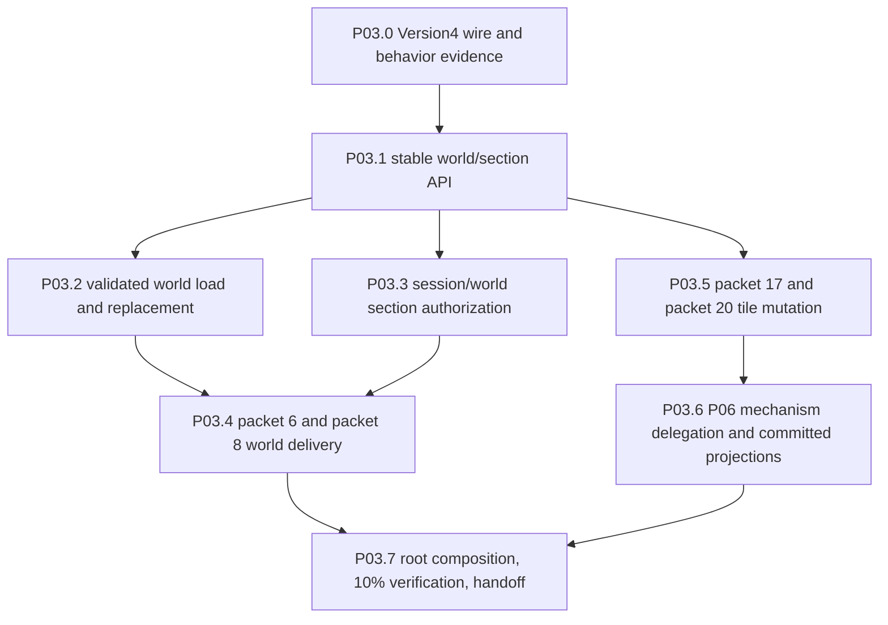

# Minimal Server P03 — World and Access Implementation Plan

Status: direction subplan for the MinimalImplementation master plan; planning evidence only.
Owner: P03 world/access session.
Target implementation boundary: `D:\TRbackup\NLTX\src\MinimalImplementation`.
Permitted external code dependency: reviewed public APIs from `D:\TRbackup\NLTX\src\NSSLC.Infrastructure` and the .NET runtime.

## Goal and boundaries

Complete the server-authoritative world lifecycle and world-data request path for the selected
Version4 server scope. P03 owns the active world snapshot, world epoch, world geometry and tile
facts, tile/section lookup, client section-delivery authorization, world-load publication, and
read-only world/access queries consumed by P02, P04, P05, and P06. It owns the world side of
join-world and section synchronization, plus accepted ordinary tile changes and their outbound
world projections.

P03 does not own session admission, player identity/profile, inventory/chest contents, NPCs,
projectile or combat state, tile-entity state, or module state. P02 owns session stage and player
identity; P03 accepts a trusted session epoch/binding from P02 and returns world data without
choosing or storing the actor. P04 owns chest/item policy and mutations; P03 supplies world bounds,
tile reads, and agreed read-only access inputs. P05 owns validated movement state; P03 must not
create another player-position writer. P06 owns mechanism/tile-entity interaction semantics, but
all changes to ordinary world tiles must still pass through the P03 world owner. The root owns
packet registration, shared composition, project include lists, and the serialized build window.

All production and verification sources remain under `src/MinimalImplementation`. Do not compile
or reference Version4 or other project implementation sources. Any Infrastructure dependency must
be reviewed as a public API and called through its supported contract.

## Evidence baseline

The inspected Version4 source identities are:

| Source | SHA-256 | Relevant locations and facts |
| --- | --- | --- |
| `D:\TRbackup\Version4\Terraria\MessageBuffer.cs` | `0F474225FA9D98C539F61249619273A44E73F69A4CF388B44258433A2D15D5EE` | Packet 6 at 375–384 requests world data; packet 8 at 387–597 computes spawn/client section sets, sends progress and sections, then requests join projections; packet 17 at 789–943 edits tiles/walls/wires and delegates mechanism operations; packet 19 at 944–978 handles doors/trapdoors/tall gates; packet 20 at 979–1078 applies a tile-square payload; packet 12 at 604–650 is the P02-bound spawn transition. |
| `D:\TRbackup\Version4\Terraria\NetMessage.cs` | `87B596BD8467B9C470DD1F2AD6963EBADE257689F87395163AB136C149BEBC9A` | Packet 7 world header at 221 onward; packet 9 progress at 410–417; packet 10 tile-section projection at 418–420; `SendSection` and per-client section bookkeeping at 2432–2456; NPC/chest section sync at 2457–2493. |
| `D:\TRbackup\Version4\Terraria\Netplay.cs` | `95F8D53F9FC466B2FBB9B8F67DF4AD9A77E2CD4ACD04E77859FEE650CE6DF67B` | Section mapping is `x / 200` and `y / 150` at 497–509; connection initialization clears section-delivery state at 141. |
| `D:\TRbackup\Version4\Terraria\WorldGen.cs` | `A06A8463E39EA065441FF1EF702A787D3450ADAE5CD3065CF30BF76784D3EA1D` | Candidate evidence for tile-operation validation and change effects. Every operation to be supported must be traced to its caller/callee and compared with Version4 before claiming behavior parity. |
| `D:\TRbackup\Version4\Terraria.GameContent\PortalHelper.cs` | `294EB80777CFDB1A182B184E09064BE7B4E230A3CB686557939CD01F3E1C33CC` | Packet 8 portal-related section additions and portal synchronization; determine whether this is in the selected minimal join scope. |
| `D:\TRbackup\Version4\Terraria.GameContent\ExtraSpawnPointManager.cs` | `2D5547B5D63AE497C7951C7AE6D0CA12A0DA5F625A27A21AFE804F736D711625` | Team-based extra spawn lookup used while selecting packet 8 section coverage. |

These sources establish call flow and field reads, not that every operation is a required minimal
server feature. The Infrastructure packet catalog is the wire DTO/codec authority for this
implementation; Version4 receive/send branches remain the behavior authority. Keep the two
separate in the evidence notes.

### Packet and response responsibilities

| Path | P03 responsibility | Ownership rule |
| --- | --- | --- |
| Packet 6 `RequestWorldData` | On a P02-approved session stage, capture one active world snapshot and return the Version4 world header plus required world-state projections. | P02 owns the stage transition and anti-replay decision. P03 owns world content. No world response is sent before a published world exists. |
| Packet 8 `RequestTileData` | Validate request coordinates and team input, derive an in-bounds section set from the server world and configured spawn facts, authorize/send each section once per session epoch, and return the exact progress/result path. | The request is a subscription hint, not authority to select arbitrary world state. P02 gates stage; P03 owns the per-epoch section-send ledger. P04/P05/P06 own their respective join projections. |
| Packet 10 `TileSection` (S2C) | Encode a captured, versioned 200-by-150 section (clipped at world edges) using the reviewed Infrastructure API and approved world facts. | Capture from one immutable world snapshot; only mark a section sent after its outbound intent is successfully accepted by the root's outbound queue. |
| Packet 17 `TileManipulation` | Decode exact fields; validate action, bounds, loaded-section authorization, policy inputs, and current tile revision; commit supported ordinary tile/wall changes through `WorldOwner`; publish accepted result only after commit. | Mechanism actions route through a narrow P06 API. P03 does not duplicate mechanism state or skip the world owner. |
| Packet 19 `DoorUse` | Validate the coordinate and session/world scope, then delegate the supported door/trapdoor/tall-gate action to P06. | P06 owns operation semantics; P03 supplies authoritative tile and section facts and applies resulting tile changes. |
| Packet 20 `TileSquare` | Decode a bounded rectangle, verify the complete rectangle is in-world and authorized, validate every decoded tile before any write, and commit the entire batch once through `WorldOwner`. | Never partially apply a malformed or stale rectangle. Exact acceptance policy for client-supplied tile state must be reconciled against Version4 and the approved minimal compatibility rule. |
| Packets 7/9/17/20 (S2C where applicable) | Produce exact world header, progress, and committed tile update/section projections through outbound intents. | The root owns routing and final transport writes. P03 does not write to sockets directly. |

Packet 8 reads `Int32 tileX`, `Int32 tileY`, and `byte team`; negative or too-near-edge
coordinates do not create arbitrary section access. It always includes the server's spawn-area
sections, may include the client-requested area, and conditionally includes a team extra-spawn
area. Version4 computes section origins using a 5-by-3 footprint around each selected point and
deduplicates overlap by the player's per-connection `TileSections` state. The exact inclusivity at
world edges, status count, portal behavior, and compatible minimum scope must be frozen from the
Version4 call path and Infrastructure packet definitions before implementation.

Packet 17 reads `byte action`, `Int16 x`, `Int16 y`, `Int16 editData`, and `byte style`. Version4
requires the point to be in-world with a three-tile margin and uses the per-connection section
state when deciding whether a tile operation is forced. Its action values include ordinary tile
and wall changes as well as wires, actuators, slopes, tracks, logic gates, and related mechanisms.
The P03/P06 action table must explicitly assign every recognized value; unknown values are
rejected without mutation. Packet 19 reads `byte action`, `Int16 x`, `Int16 y`, and a direction
byte. Packet 20 starts with `Int16 x`, `Int16 y`, `byte width`, `byte height`, and a change-type
byte followed by conditional per-tile data; use the Infrastructure codec for exact optional-field
presence and reject trailing or truncated payloads according to the selected frame contract.

P03 must not claim full Version4 parity for complex `WorldGen` placement/drop rules until those
rules have source evidence, required content facts, and an explicit supported/unsupported action
decision. If a minimal compatibility rule is selected for an action, record it as such in the
master plan and in the handler result; do not silently approximate it.

## Existing MinimalImplementation foundations and gaps

The current `src/MinimalImplementation/World/` contains `WorldOwner`, immutable world/header/tile
and section snapshots, world preparation/publication results, tile-delta commits, dirty-section
capture/acknowledgement, world geometry, Version4 world facts, a world-file tile decoder and
factory, liquid simulation, and an unbreakable-wall query. These are foundations, not proof that
the network paths are connected or correct.

Current gaps to close:

1. There is no P03 packet handler/codec adapter for packets 6, 8, 17, 19, or 20 and no response
   projection table that connects them to the common dispatcher/outbound-intent path.
2. The world owner does not expose a reviewed P03 API for per-session section-send authorization,
   world-scope validation, or read-only tile access used by P04/P06. Define these seams without
   creating a second world or player-position owner.
3. A section-send ledger must be keyed by session epoch and active world epoch. It must be cleared
   on disconnect, world replacement, and failed/uncertain delivery; stale epochs cannot authorize
   packets in a later world.
4. Packet 8 join projection must be composed with P02 session stage and P04/P05/P06/P07 sync
   responsibilities. Avoid implementing their item/NPC/projectile/module state in the world
   owner. The root needs an ordered join-intent contract and per-direction owner APIs.
5. `WorldOwner` serializes its internal access with a lock and supports prepare/commit revisions,
   while the server plan requires one serialized loop writer. Document the actual mutation
   scheduling contract and ensure tile owner commits, dirty-section capture/ack, world replacement,
   and outbound publication cannot race or publish a stale section image.
6. `EntityIdentityRegistry.BeginWorldScope()` currently retires world-scoped handles. P02 and P03
   must settle whether session/player handles are world scoped or process scoped before replacement
   semantics are accepted. World replacement must not strand authenticated sessions or let stale
   section subscriptions survive.
7. World-file loading must remain prepare/validate/publish. Reject malformed, oversized, or
   fact-mismatched candidates without replacing the currently published world. Identify exactly
   which public Infrastructure world-storage API is used; do not depend on an implementation
   namespace outside the allowed API boundary.
8. The section-boundary policy for tile mutation and player access is not yet frozen. Include
   negative coordinates, edges, cross-section rectangles, stale section authorization, range,
   and failed world epochs in the decision record.

## Target API and interaction flow

P03 should provide a narrow API with the following responsibilities; concrete type names are left
to implementation review, but the contracts must be stable before P04/P06 integrate:

- `WorldSnapshot` / `WorldSectionSnapshot` reads expose immutable copies tagged with world epoch
  and `CommitVersion`.
- A tile-access query accepts a `WorldScopeId` and coordinate and returns an explicit ready,
  out-of-bounds, stale-world, or unavailable result. The query never returns a mutable tile
  reference.
- A section authorization query is keyed by `SessionEpoch`, world epoch, and section coordinate;
  it reports whether packet 17/19/20 may act in the requested area. P02 close and root world
  replacement invoke an idempotent revoke API.
- A world access query accepts an externally sourced player spatial snapshot and target coordinate
  and returns facts needed by P04 (world membership, distance/range inputs, obstruction/tile
  facts). P03 does not own or persist player position. Exact chest-open/range policy stays in P04;
  any shared geometric rule is version-cited and agreed by the owners.
- A prepared tile mutation contains the world epoch, expected commit version, bounded coordinate
  set, and complete validated deltas. The owner either applies all deltas at one version and marks
  affected sections dirty, or returns a rejection with no state change.
- Outbound world intents are formed from committed results and a captured recipient set. A failed
  queueing/uncertain send must not clear dirty-section state or grant section authorization.

Processing order for inbound world changes:

1. Root protocol dispatch verifies the complete bounded frame and supplies authenticated session
   context, sequence, and session epoch. P02 confirms the expected session stage.
2. P03 decodes with the reviewed Infrastructure API, validates world/session epochs and all
   coordinates/shape bounds, then loads authoritative tile and section state.
3. P06 receives recognized mechanism-only commands through its owner boundary. Ordinary edits
   become a complete versioned mutation candidate; no mutation occurs during validation.
4. The serialized server loop invokes the sole `WorldOwner` commit. A stale world/revision or
   rejected policy leaves every tile unchanged.
5. P03 creates exact outbound tile/state intents from the committed snapshot/version. The root
   queues them and owns the actual transport send. Per-session section ledgers and dirty batches
   are acknowledged only against the exact queued epoch/version.

Processing order for join/section delivery:

1. P02 accepts packet 6 or packet 8 only at the source-backed stage and passes its bound session
   epoch to P03.
2. P03 captures one published world epoch and calculates a deterministic, clipped, deduplicated
   section list from the validated request and configured spawn facts.
3. Capture each section from that world epoch and create its outbound intent. Capture and encode
   must not mix tiles from different world commits.
4. After queue acceptance, mark that section delivered for the same session/world epochs and
   advance P02's join stage only at the contractually agreed commit point.
5. Root coordinates the remaining join projections with P04/P05/P06/P07 and P02 emits connection
   completion only after required owners have accepted their state snapshot.

## Dependency graph and batches

| Batch | Dependencies | Work | Acceptance gate |
| --- | --- | --- | --- |
| P03.0 Evidence freeze | None | Reconcile Version4 and Infrastructure contracts for packet 6/7/8/9/10/17/19/20; record direction, every field width/signedness/presence rule, frame boundary, packet stage, section geometry, action matrix, side effects, and unknowns. Compare historical implementations only as candidate evidence. | Each accepted behavior cites source/hash/location or is explicitly marked unresolved. No handler implements an inferred rule. |
| P03.1 World and access contract | P03.0; root shared session/outbound contracts | Define immutable world/tile/section query APIs, world epoch/version behavior, section authorization ledger API, access-query inputs, and `WorldOwner` commit schedule. Agree the input player-position contract with P02/P05 and chest-access semantics with P04. | Exactly one world writer and no P03 player-position store; consumer APIs are read-only and versioned. |
| P03.2 Load, publish, replace | P03.1; persistence/public Infrastructure API review | Build candidate world from validated load DTOs; enforce dimension/tile-count/fact fingerprints; prepare and atomically publish; revoke subscriptions and notify root/dependent owners on replacement/unload. Resolve identity-handle scope before replacement. | Invalid/stale load leaves current world and dependent state unchanged. Replacement produces one new epoch and deterministic invalidation. |
| P03.3 Section subscription | P03.1; P02 session epoch/close contract | Track section access per `(session epoch, world epoch)`; calculate packet 8 requested, spawn, extra-spawn and any selected portal sections; authorize only successfully queued sections; revoke idempotently. | Duplicate requests do not produce conflicting ledgers; stale epoch or failed send grants no access; coordinate math is bounded and deterministic. |
| P03.4 World join and section response | P03.2–P03.3; P01 wire codecs; P02 stage API | Implement packet 6/8 handlers and packet 7/9/10 projection path; capture world state at one version; return exact progress and section response; expose required join projection intents without taking P04/P05/P06/P07 state. | Correct join order and exact wire shape; no mixed-version section; session stage advances only after agreed world response acceptance. |
| P03.5 Ordinary tile edits | P03.1 and P03.3; P01 codecs; P06 action classification | Implement supported packet 17 and packet 20 ordinary tile/wall operations with complete prevalidation and all-or-nothing owner commits. Apply bounds, authorization, stale-revision, tile-fact, and rate/size limits from frozen rules. | Rejected operation leaves tile state, revision, dirty set, and outbound intents unchanged; accepted operation commits once and its projection matches committed state. |
| P03.6 Mechanism delegation | P03.5; P06 stable API | Route packet 17 mechanism action values and packet 19 door/gate actions to P06. Accept resulting tile deltas only through the P03 commit API and maintain a single tile writer. | Every recognized code has one owner; no duplicate mechanism state, direct tile mutation, or partially committed cross-owner action. |
| P03.7 Root integration and handoff | P03.4–P03.6; root owns build/registry | Provide exact source include list, public interfaces, packet registration requirements, ordering with P02/P04/P05/P06/P07, selected scenario evidence and unresolved list. Root integrates shared composition and runs compile window. | Every selected P03 packet has decode, session/world validation, owner decision, response/projection, and lifecycle revocation documented. |

## Core scenario inventory and 10% proposal

The P03 core inventory contains ten scenarios, `SC031`–`SC040`. SC031 was the P03 candidate because
it exercises the highest-risk join-to-section authorization seam, but it is not included in the
frozen global selection. No P03 scenario may run under the current test budget. Do not replace a
failed/unavailable selected scenario with another. Compilation is separate and occurs only in the
root's serialized build window.

| Scenario | Core assertion | Planned status |
| --- | --- | --- |
| SC031 | Authenticated packet 6 then packet 8 returns the expected world data/section intents, clips and deduplicates section coordinates, and grants access only to sections queued for that session/world epoch. | Not selected globally; not run. |
| SC032 | Packet 8 at wrong stage, with stale epoch, invalid team, negative coordinates, and extreme coordinates cannot advance P02 or create section authorization. | Not run. |
| SC033 | World-file candidate with mismatched dimensions, invalid tile facts, excessive tile count, or wrong facts fingerprint cannot replace the active world. | Not run. |
| SC034 | World replacement/unload revokes section authorization and P04/P06 world references once, while preserving the authenticated session lifecycle according to the approved identity-scope contract. | Not run. |
| SC035 | Packet 17 ordinary tile placement/break obeys bounds, section authorization, tile operation policy, and exact post-commit outbound projection. | Not run. |
| SC036 | Unknown or P06-owned packet 17 action is rejected or delegated exactly once, with no direct P03 tile mutation. | Not run. |
| SC037 | Packet 20 truncated, oversized, out-of-bounds, cross-boundary, or stale-revision tile square is all-or-nothing and creates no dirty section on rejection. | Not run. |
| SC038 | A valid bounded tile-square batch commits once, increments one world revision, marks each affected section dirty, and projects the exact committed tile set. | Not run. |
| SC039 | Dirty-section acknowledgement for an older queued version cannot clear a newer mutation; a failed or uncertain outbound queue retains dirty state. | Not run. |
| SC040 | P04 access query reads a versioned world snapshot and externally validated player-position value; it cannot access another world epoch or mutate world/player state. | Not run. |

## Acceptance and handoff

P03 is ready for root acceptance when:

1. Packet 6/8 and selected tile mutation paths have Version4-backed wire and behavior contracts;
   all historical-only rules and compatibility limits are explicit.
2. The world owner is the only writer for world tiles and world lifecycle; P03 exposes immutable,
   epoch/revision-tagged read models to other directions.
3. Section authorization is scoped to session epoch and world epoch, follows queue acceptance,
   and is revoked on close, world replacement, unload, and failed lifecycle transitions.
4. Packet 17/19 ownership is classified per action value; P06 interactions pass tile changes through
   P03 rather than creating a competing tile store.
5. Packet 20 batches validate completely before commit; malformed, stale, unauthorized, or rejected
   requests cannot change any tile, revision, dirty marker, or success projection.
6. Player position remains owned by the agreed P02/P05 state provider. P03 world queries consume
   immutable position facts and do not cache an alternate authoritative position.
7. World replacement cannot invalidate live session identity without a coordinated P02/root
   lifecycle transaction. Dependent P04/P06 state is revoked against the captured old epoch.
8. New implementation and verification files remain under `src/MinimalImplementation`; no
   external implementation source or unreviewed Infrastructure surface is referenced.
9. Only the root-frozen 10% functional scenario selection is run; compile validation remains in
   the root's serialized build window.

Handoff to root must include exact changed paths and compile includes; all public P03 APIs and
consumer dependencies; packet registration and outbound projection requirements; action-by-action
P03/P06 ownership; Version4 source hashes/locations and compatibility decisions; world-replacement
ordering; the frozen selected scenario ID and result; build command/result if the root runs it; and
all unverified packet behaviors.

## References

- Version4 sources and hashes recorded in the evidence table above.
- Reviewed Infrastructure wire contracts: `src/NSSLC.Infrastructure/Network/Pocket/DataPacketDefinition/Definitions/PacketDefinitions.cs` and the corresponding public packet DTOs/codecs. The catalog defines wire shapes; it does not establish Version4 server acceptance policy.
- Existing world implementation: `src/MinimalImplementation/World/WorldOwner.cs`, `WorldSnapshot.cs`, `WorldPreparation.cs`, `WorldGeometry.cs`, `WorldTile.cs`, `WorldFacts.cs`, `WorldDocumentWorldFactory.cs`, and `WorldFileTilePayloadDecoder.cs`.
- Shared contracts: `src/MinimalImplementation/Contracts/IdentityContracts.cs`, `SessionEpoch.cs`, `OutboundPacketIntent.cs`, and `WorldStorage/`.
- P02 stage/session and close contract: `docs/plans/minimal-implementation/P02-session-player-implementation-plan.md`.
- P04 world/chest access consumer: `docs/plans/minimal-implementation/P04-quickstack-implementation-plan.md` plus P04 crafting/inventory plan as maintained by the root.
- P06 mechanism boundary: `src/MinimalImplementation/Mechanisms/` and the corresponding P06 direction plan.
