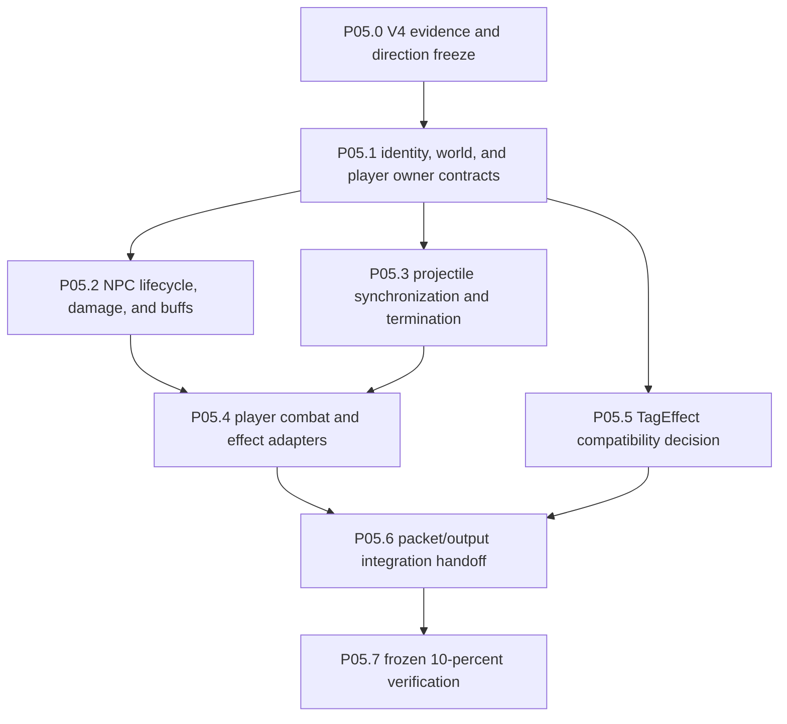

# P05 Combat and Player Effects — Implementation Plan

Status: draft subplan for root acceptance  
Strategy: `graph` with per-batch acceptance gates  
Master plan: `docs/plans/minimal-implementation/MASTER-execution-plan.md`  
Implementation boundary: `D:\TRbackup\NLTX\src\MinimalImplementation`  
Allowed external code APIs: reviewed public APIs under `D:\TRbackup\NLTX\src\NSSLC.Infrastructure`  
Owner: P05 child session; root owns shared composition, packet registration, project references, and serialized build integration

## Objective

Complete the Version4 combat paths that have an authoritative server receive or send contract:
authenticated player controls, NPC damage and status, projectile synchronization and retirement,
combat-related player state, and their committed outbound projections. P05 owns combat state and
combat decisions; it does not own session identity, world/tile state, inventory, socket writes, or
the canonical player-vitals lifecycle. Keep one writer per durable state and resolve every actor
from P02's authenticated session context. Use P03 world and position queries where authorization
depends on world scope or location.

All implementation and verification source stays under `src/MinimalImplementation`. Version4
source is read-only behavioral evidence. Calls to Infrastructure are limited to reviewed public
packet/codec APIs. Do not add ECS, Version4 implementation, or another project directory as a
source/build dependency. Root adds any new project references and explicit compile includes.

## Ownership boundary

| Area | P05 responsibility | Boundary |
| --- | --- | --- |
| NPC state | Own NPC slot state, generation identity, supported NPC facts, combat damage application, buffs, status, and packet-23/54 projections. | Spawn and damage behavior without migrated authoritative facts must be rejected or deferred; do not manufacture content rules. P03 owns world tiles and location queries. |
| Projectile state | Own active projectile identity, owner mapping, revisions, bounded slot allocation, synchronization, termination, and packet-27/29 projections. | Bind client-owned projectiles to the authenticated P02 player. World-scoped objects are invalidated with P03 world changes. |
| Player combat/effects | Apply combat commands to P02-owned player state through an agreed owner API; own only distinct combat state such as target selection or hostile/PvP state if P02 confirms it is not already its writer. | P02 remains the sole writer of authenticated identity, player lifecycle, and canonical life/mana values. Damage/death requires an explicit prepare/commit API from P02 or an owner-boundary decision by root. |
| Packet 82 module 12 | Supply a narrow TagEffect command/state adapter only after root freezes whether this Version4 path is supported. | P07 owns module dispatch and root owns registry. The Version4 `Deserialize` body is empty and the server writer helper for NPC changes is also empty; current local acceptance behavior is a compatibility candidate, not established Version4 parity. |
| Output | Return immutable packet bodies/intents only after the corresponding state commit. | P01/root owns framing, recipient transport, packet registry, and direct connection writes. |

The current source already contains NPC, projectile, entity-identity, and TagEffect owners. P05
must audit and finish these existing slices instead of adding parallel owners. Existing code is not
assumed to be compiled, integrated, or behaviorally verified: `MinimalImplementation.Server.csproj`
does not currently reference `Combat/MinimalImplementation.Combat.csproj`, and there is no combat
verification project in `src/MinimalImplementation/Verification`.

## Version4 evidence and scope

The inspected Version4 source identities are:

| Source | SHA-256 | Relevant locations |
| --- | --- | --- |
| `D:\TRbackup\Version4\Terraria\MessageBuffer.cs` | `0F474225FA9D98C539F61249619273A44E73F69A4CF388B44258433A2D15D5EE` | Receive cases 13 (652–738), 23–30 (1182–1467), 35 (1705–1715), 50/53/54/55 (1926–2028), 62 (2249–2268), 99/115 (2765–2779), 117/118 (2944–2972), 137 (3167–3176), 153 (3287–3294), and Packet 82 dispatch (2524–2525). |
| `D:\TRbackup\Version4\Terraria\NetMessage.cs` | `87B596BD8467B9C470DD1F2AD6963EBADE257689F87395163AB136C149BEBC9A` | Outbound packet writers for the supported combat IDs, including NPC sync, projectile sync/kill, player damage/death, and their field serialization (cases 13, 23–30, 35, 43, 50, 53–55, 62, 99, 115, 117–119, 137, 153; see lines 440–1760). |
| `D:\TRbackup\Version4\Terraria.ID\MessageID.cs` | `C911F86D932D6A23AC4FCB23149226CEE4993B7652AC2D2D530FF79DA9B944EC` | Packet IDs 13, 23–30, 35, 43, 50, 53–55, 62, 82, 99, 115, 117–119, 137, and 153. |
| `D:\TRbackup\Version4\Terraria\NPC.cs` | `29869B0390D85CB0E627552ECBED929D90508C8EF0DA55D9660133F91DA42D17` | NPC damage, buff immunity/removal, death, and entity lifecycle methods called from `MessageBuffer`. |
| `D:\TRbackup\Version4\Terraria\Projectile.cs` | `97C3D68586AEF862411699E428F5C4B18CEE1F8051B684BE9F86FA7B60FAE83B` | Projectile identity, owner, lifecycle, and despawn semantics used by packets 27/29. |
| `D:\TRbackup\Version4\Terraria\Player.cs` | `E5B301E3401F61E37BF3291754670BCC123D6593EDD94597C4E9109C4030FE86` | Player combat, hurt/death, buffs, dodge, minion targets, and TagEffect state callbacks. |
| `D:\TRbackup\Version4\Terraria.GameContent.Items\TagEffectState.cs` | `14C287E967739D5407A70086FD0475BA0262D62F422FC53022F4EB049146C74F` | Nested NetModule methods at lines 10–91; `WriteNPCChange` returns an empty packet and `Deserialize` returns the default Boolean. |

The table distinguishes wire direction from authority. Infrastructure packet codecs establish field
shape only; they do not establish that Version4 accepts a client-authored state change.

| Packet/path | Version4 direction and observed behavior | P05 plan |
| --- | --- | --- |
| 13 PlayerControls | C2S controls, selection, position/velocity and optional state; server replaces the embedded player byte with `whoAmI`, applies state, then relays packet 13 while restoring the prior position for the relay. | Bind to P02 actor and stage. Preserve all fields exposed by the codec; P05 owns the movement/control projection only if P02 confirms the single-writer boundary. Ignore the claimed player ID for authority. |
| 23 SyncNPC | S2C NPC snapshot is emitted for active NPCs during join and state updates. The server receive case exits at line 1184 before reading or applying a client snapshot. | Treat as server-produced state. Reject client mutation explicitly; produce snapshots from P05's committed NPC owner. |
| 24 UnusedMeleeStrike | C2S case reads an NPC slot, then replaces the supplied player index with the sender and applies damage derived from the selected server inventory item. | Audit whether this legacy path is reachable/selected in Version4. Do not import inventory internals into P05; either delegate damage inputs to P04/P05 contracts or explicitly reject with root approval. |
| 27 SyncProjectile | C2S/S2C. Version4 replaces claimed owner with authenticated sender except projectile type 949, rejects hostile projectile input, resolves `(owner, identity)`, updates/spawns a runtime slot, and relays the canonical packet. | Retain sender-bound ownership, entity generation, migrated-definition checks, finite/range validation, bounded allocation, and post-commit output. Keep any stricter rejection policy labeled as defensive compatibility policy. |
| 28 DamageNPC | C2S/S2C. Server identifies the interacting player from the connection, applies damage to the NPC, broadcasts the result, then sends NPC snapshots when the target or its real-life root dies. | P05 owns the NPC damage decision and resulting NPC commit. Do not trust embedded attacker identity. Validate NPC slot/generation and all fields before commit; no response on rejection. |
| 29 KillProjectile | C2S/S2C. Server replaces the owner byte with the sender, kills the matching active `(owner, identity)` projectile if present, then relays the packet. | Use authenticated owner and generation-scoped lookup; stale or foreign identity cannot retire another projectile. Emit only after retirement or defined idempotent no-op. |
| 30 TogglePVP | C2S/S2C. Server replaces the player byte with sender, stores the hostile flag, relays state and broadcasts a chat notification. | P05 owns combat hostile/PvP state unless P02 reports an existing canonical writer. P02 supplies actor/name/team snapshots and P07/root routes presentation. |
| 35/43 HealEffect/ManaEffect; 42 Unknown42 | C2S effect packets relay a player-owned heal/mana visual; packet 42 uploads mana values. | Keep canonical vitals with P02. P05 may create effect intents only from a P02-approved committed event; do not let display-effect packets change life or mana. |
| 50 PlayerBuffs | C2S buff list is associated with the authenticated player and relayed. | Coordinate a single buff/status writer with P02. Preserve exact wire list and termination rules; reject excessive or semantically unknown entries under a frozen policy. |
| 53/54 AddNPCBuff/NPCBuffs | C2S packet 53 has NPC index, buff type, and duration; server applies the buff and broadcasts packet 54. Packet 54 is the server snapshot output. | P05 owns bounded NPC buff state, immunity decisions, timers, and packet-54 projection. Packet 54 from a client must not write state. |
| 55 AddPlayerBuffPvP | C2S player/buff/time request; server relays only when the buff is marked PvP-capable by Version4 facts. | Use authenticated sender and target authorization; obtain buff applicability facts from approved migrated definitions. Delegate actual canonical player buff mutation to the agreed owner. |
| 62 dodge event | C2S actor and dodge kind are read; actor is replaced by sender; recognized dodge effects are applied and packet 62 is relayed. | Accept only recognized actions, bind actor from authentication, and produce output after owner decision. |
| 99/115 minion target state | C2S target point or NPC slot; player byte is replaced with sender and state relayed. | Bind to authenticated player; target NPC references require P05 generation validation, and location target requires P03 world policy if applicable. |
| 117/118 PlayerHurtV2/PlayerDeathV2 | C2S player hurt checks sender/self or mutual PvP authorization; death binds the target player to sender. Server applies hurt/death and relays canonical result. | P05 validates combat/PvP rules; P02 remains the canonical player-vitals and life-cycle owner. Require one atomic P02 commit/result seam before broadcasting. |
| 119 CombatTextString; 135 DeadPlayer | Version4 server receive bodies are no-ops. | Do not accept them as authoritative combat state. Keep outbound presentation output in P01/P07 pathways if needed. |
| 137 RequestNPCBuffRemoval; 153 NPCDebuffDamage | C2S requests target an NPC slot and buff type or target slot/damage kind; Version4 applies the NPC operation then relays. | Bind to current NPC generation, validate definition and bounds, commit through P05's NPC owner, and project the committed result. |
| 82 module 12 TagEffect | `TagEffectState.NetModule` assigns actions 0–4, but its receive `Deserialize` is empty/default false and the NPC-change writer is empty. `Player.cs` has local TagEffect gameplay callbacks. | Root must decide whether module 12 remains explicitly unsupported or a compatibility extension is approved. Until then, P07 dispatch must not report unsupported mutations as handled. Current `TagEffectStateOwner` acceptance is not evidence of Version4 network parity. |

Packet 23 and module 12 are material evidence gaps, not permission to copy an older algorithm.
Historical snapshots may be inspected only as candidates; record source identity and a V4 diff and
get root's compatibility decision before implementing behavior found only there.

## Existing implementation to audit

Current P05 source lives in:

- `src/MinimalImplementation/Combat/Identity/` — combat entity identity authority and generation IDs.
- `src/MinimalImplementation/Combat/Npcs/` — NPC slot owner, definitions, packet-23 projection, buff catalog/owner, packet-54 projection.
- `src/MinimalImplementation/Combat/Projectiles/` — projectile owner, definitions, packet-27/29 codecs and handlers.
- `src/MinimalImplementation/Combat/TagEffects/` — module-12 command and state owner.
- `src/MinimalImplementation/Combat/MinimalImplementation.Combat.csproj` — explicit project boundary; it currently compiles its local source and references Contracts plus Infrastructure's public packet/compiler assembly.

Review the P05 source for single-writer guarantees, stale generation rejection, world-scope
invalidation, serializer field parity, non-finite values, definition coverage, slot replacement,
revision conflicts, idempotent retirement, defensive copies, and post-commit projection ordering.
The present `NpcManager.RejectClientSnapshot` contract is consistent with V4's packet-23 receive
body. The present projectile manager has a stricter migrated-definition allowlist; the behavior and
content coverage need an explicit V4 comparison before claiming compatibility. The current
TagEffect owner needs the module-12 decision above.

## Dependency graph and batches

| Batch | Work | Dependencies | Acceptance gate |
| --- | --- | --- | --- |
| P05.0 Evidence and ownership freeze | Reconcile the Version4 receive/send bodies, message IDs, Infrastructure DTO/codecs, current P05 source, and P02/P03/P04/P07 contracts. Record accepted input direction separately from wire availability. Freeze decisions for packet 24, module 12, unsupported entity definitions, and any behavior that differs from V4. | Root G0/G1 and master plan. | Every supported path has V4 identity/hash and owner; every unresolved path is explicitly rejected/deferred or awaits a root compatibility decision. |
| P05.1 Identity, world, and player owner contracts | Define the authenticated actor input, epoch/world scope, NPC/projectile identity generations, world invalidation hook, immutable read snapshots, and P02 damage/vitals prepare/commit contract. Confirm the canonical writer for PvP and player buff/control state. | P02 session/player; P03 world/access; shared Contracts. | No embedded player ID determines the actor; each state has one writer; world/session retirement has explicit idempotent ordering; root accepts API shapes before implementation crosses boundaries. |
| P05.2 NPC lifecycle, damage, and buffs | Audit/complete NPC spawn and commit APIs, packet-23 output-only path, packet-28 damage, packet-53 buff add, packet-54 output, packet-137 removal, and packet-153 debuff damage. Keep content definitions and immunity/removal rules source-backed. | P05.1; approved P04 fact inputs where combat rules require selected-item data; P07 Banner/Bestiary event consumer contracts. | Rejected/stale operations leave NPC state unchanged; accepted updates increment the owner version once; buff/status projections are created only after commit; no client-authored packet 23 mutates NPCs. |
| P05.3 Projectile synchronization and termination | Audit/complete packet-27 and packet-29 handlers, owner/identity mapping, definitions, UUID rules, collision/eviction policy, bounded slots, generation retirement, body encoding, and world invalidation. | P05.1; P01 codecs and outbound intent contract. | Foreign owner, hostile client projectile, stale epoch, unknown definition, malformed/non-finite values, or stale identity cannot mutate state; accepted sync/kill emits an exact canonical body after commit. |
| P05.4 Player combat and effect adapters | Complete packet-13 control handoff, packet-30 PvP, packet-50/55 buffs, packet-62 dodge, packet-99/115 target intents, packet-117/118 damage/death validation, and event outputs. Delegate life/mana and death state to P02. Route chat/effect presentation through the approved P07/P01 output APIs. | P05.1–P05.3; P02 authenticated context/vitals API; P03 queries. | No P05 duplicate player writer; PvP and target inputs use authenticated identity and valid references; P02 commit is the only source for success damage/death projection; no direct transport I/O. |
| P05.5 TagEffect compatibility gate | Compare V4 `TagEffectState.NetModule` and local `TagEffectStateOwner`; obtain root decision for the empty V4 deserializer/writer. If unsupported, ensure module 12 yields explicit rejected/unsupported outcome and no mutation. If root approves an extension, mark it as a non-parity compatibility rule and preserve exact module DTO shape. | P05.0; P07 module dispatcher. | Module 12 has one documented policy; P07 cannot report a state-changing request handled before P05 returns a committed result; NPC slot reuse cannot retain stale TagEffect state. |
| P05.6 Integration and handoff | Provide root with public APIs, exact source/project references, compile include/project-reference requests, packet registration and recipient requirements, event ordering, cleanup requirements, V4 evidence, and open questions. Root integrates Server composition and packet registry. | P05.2–P05.5; P01 transport/encoder. | Every selected inbound packet has decode, authenticated context, stage/authority check, owner result, and exact output or explicit rejection. All shared project edits remain root-owned. |
| P05.7 Verification and evidence | Root freezes the overall scenario inventory and 10% selection. P05 may run only the one selected P05 scenario below if it remains inside that global budget. Compile/build checks occur only in root's serialized window. | P05.6; root test/build window. | No more than one P05 core functional scenario runs; result records command, exit code, output, and assertion scope; all unrun P05 scenarios remain labeled not run. |

## Core scenario inventory and 10% proposal

The P05 core inventory is SC056–SC070 (15 scenarios). SC056 was the P05 candidate, but it is not
included in the frozen global selection. No P05 scenario may run under the current test budget. This
subplan has run no functional tests and does not authorize a build; compile checks remain in the
root's serialized window. Do not substitute a failed/unavailable selected scenario or run any
other scenario in this inventory.

| Scenario | Core assertion | Planned status |
| --- | --- | --- |
| SC056 | Packet 28 damage request uses the authenticated actor, commits one supported NPC damage result, emits the canonical packet-28 projection after commit, and rejects stale NPC generation without state/output change. | Not selected globally; not run. |
| SC057 | Packet 27 accepts a supported client projectile only under the authenticated owner's identity and valid migrated definition; a forged owner/hostile projectile cannot mutate or broadcast. | Not run. |
| SC058 | Packet 29 retires only the sender-owned active projectile identity; foreign, stale, and duplicate termination cannot affect another generation. | Not run. |
| SC059 | Packet 23 snapshots encode committed NPC state, and client packet 23 cannot create or overwrite authoritative NPC state. | Not run. |
| SC060 | Packet 53 NPC buff add obeys migrated buff/immunity rules and packet 54 reflects only the committed snapshot. | Not run. |
| SC061 | Packet 137 removal and buff expiration update a matching NPC generation once and produce no duplicate/early output. | Not run. |
| SC062 | Packet 13 ignores a claimed player slot, binds control/movement to authenticated P02 identity, and emits the agreed authoritative projection. | Not run. |
| SC063 | Packet 30 PvP state uses the authenticated actor and emits deterministic state/presentation intents only after commit. | Not run. |
| SC064 | Packet 117/118 checks self/PvP authorization and delegates canonical hurt/death commit to P02 without a second vitals writer. | Not run. |
| SC065 | Packet 50/55 player-buff requests validate target, sender, and migrated content rules and commit through one owner. | Not run. |
| SC066 | Packet 62 recognized dodge actions bind to the sender and produce only permitted combat effects. | Not run. |
| SC067 | Packets 99/115 validate minion target facts and reject stale/out-of-range NPC or world references. | Not run. |
| SC068 | Packet 153 debuff damage applies once to the matching NPC generation and projects the committed result. | Not run. |
| SC069 | Packet 82 module 12 follows the root-frozen support/rejection decision; unsupported V4 no-op behavior does not mutate state. | Not run. |
| SC070 | Session close and world replacement retire NPC/projectile/TagEffect references once; a reused player slot or entity slot cannot revive stale state. | Not run. |

Builds and static wire checks are separate from functional scenario counts, but still require root's
serialized integration window. A successful build does not prove any of SC056–SC070 or full packet
interaction coverage.

## Acceptance and handoff

P05 is ready for root acceptance when:

1. Every P05 packet path has a Version4 source identity, direction, authoritative owner, decode/encode contract, success/failure result, and lifecycle rule; unsupported or empty source paths remain explicit.
2. Player identity comes from P02; world and NPC access uses P03 facts; P04-derived item or damage inputs use narrow approved APIs; P07 consumers receive only post-commit combat events.
3. NPC, projectile, PvP, buff, and effect state have one writer each. Cross-owner damage and death use a prepared P02 commit, and rejection leaves all owners unchanged.
4. Packet 23 and NPC buff snapshots are server-produced; packet 27/29 identity is owner- and generation-bound; no raw transport write occurs in a P05 owner or handler.
5. Module 12 has a root-approved compatibility policy. No code claims Version4 network parity for the empty `Deserialize`/`WriteNPCChange` bodies.
6. New implementation and verification files remain under `src/MinimalImplementation`; root approves all project references/compile includes, then runs the serialized build window.
7. The global 10% functional test cap is respected, with at most the root-selected SC056 run for P05 and no other P05 core scenario run.
8. Handoff lists changed paths, public APIs, required compile includes/project references, packet registrations, outbound recipient/projection requirements, P02/P03/P04/P07 dependencies, source hashes, selected scenario result, build result, and unresolved compatibility gaps.

## References

- Version4 evidence files and hashes in the table above.
- Approved Infrastructure packet catalog and public DTO/codecs under `src/NSSLC.Infrastructure/Network/Pocket/DataPacketDefinition/`; codec availability does not prove receive-path support.
- Existing implementation under `src/MinimalImplementation/Combat/`.
- P02 authenticated identity and player owner contract: `docs/plans/minimal-implementation/P02-session-player-implementation-plan.md`.
- P03 world/access query and lifecycle contract: `docs/plans/minimal-implementation/P03-world-access-implementation-plan.md`.
- P04 inventory/item facts and handoff: `docs/plans/minimal-implementation/P04-quickstack-implementation-plan.md`.
- P07 module-12 routing and registry contract: `docs/plans/minimal-implementation/P07-module-implementation-plan.md`.
