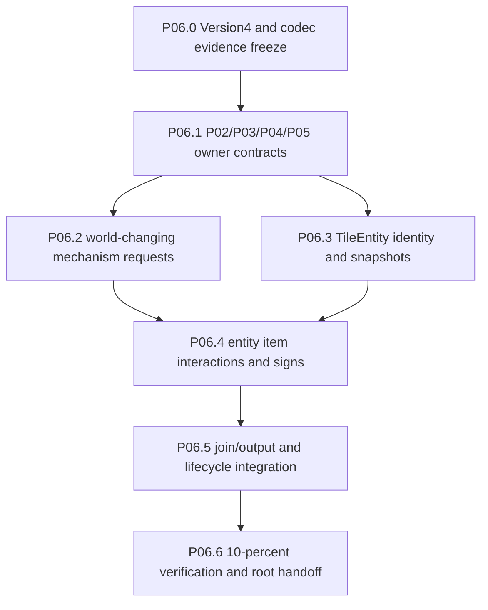

# P06 Mechanisms and Tile Entities — Implementation Plan

Status: draft direction plan; source inventory and implementation review remain open.  
Master plan: `docs/plans/minimal-implementation/MASTER-execution-plan.md`  
Implementation boundary: `D:\TRbackup\NLTX\src\MinimalImplementation`  
Allowed external code API: reviewed public APIs from `D:\TRbackup\NLTX\src\NSSLC.Infrastructure` and the .NET runtime.  
P06 owns mechanism semantics and TileEntity state; the root owns shared contracts, packet registration, composition, project inclusion, and the serialized build window.

## Objective and ownership boundary

Complete the selected Version4 mechanism and TileEntity request paths with authoritative state,
authenticated actor binding, bounded world access, cross-owner commit rules, exact packet
projections, and world/session cleanup. P06 owns TileEntity identity and payload state, mechanism
operation policy, signs, mechanism cooldown state, and the P06 side of section/join projections.
P06 does not own player identity or inventory, world tiles and section authorization, NPC state,
socket I/O, packet registry, or the shared application composition.

| Concern | P06 owns | Required boundary |
| --- | --- | --- |
| TileEntity state | Stable persistence/network IDs, generation handles, payload, lifecycle, immutable snapshots, uniqueness by world anchor, and selected interaction rules. | P03 supplies authoritative tile/section snapshots and remains the sole writer of world tile data. An entity and its anchor tile must be prepared and committed as one serialized operation or be rejected without partial state. |
| Mechanism commands | Door/gate policy, wires/actuators, logic-gate poke, switch activation, mass-wire tool semantics, and selected mechanism cooldowns. | P02 supplies authenticated actor and session epoch; P03 validates world/section access and commits tile deltas; P04 supplies item facts and inventory prepare/commit where tools or placed items are consumed. |
| Item-bearing TileEntities | Item Frame, Weapons Rack, Food Platter, Dead Cells Display Jar, Display Doll, Hat Rack, and item-bearing leashed anchor interactions. | Client item type/prefix/stack fields are requests only. P04 validates and prepares the inventory transfer; P06 prepares the entity payload; both commit before any success projection. |
| Signs | Sign identity, anchor/text state, open/read response, text update, and section sign projection. | P03 supplies versioned tile/anchor reads. P02 authenticates the sender. World-scoped sign state is retired on world replacement. |
| NPC-linked facts | Training dummy and critter-anchor references that require NPC/prototype validation. | P05 remains the only writer of NPC state and supplies narrow read/identity facts. P06 cannot create NPCs or mutate combat state. |
| Output | Immutable post-commit packet bodies and recipient intents for mechanism/entity/sign changes. | P01/root owns encoding registration, final routing/queueing, and transport writes. No mechanism owner writes to sockets. |

Every mutable owner must have one writer. All multi-owner requests run on the serialized server
loop and use prepare/validate/commit. A stale world, session, entity generation, inventory
revision, or owner revision rejects the whole request. Outbound success intents are formed only
after the durable state commit.

## Version4 evidence and packet contract

The following hashes identify the current target snapshot, `D:\TRbackup\Version4`. The packet
catalog under Infrastructure establishes wire DTO shape; Version4 `MessageBuffer` and
`NetMessage` establish receive/send behavior. Neither source class alone establishes the other.

| Version4 source | SHA-256 | P06 evidence locations |
| --- | --- | --- |
| `Terraria/MessageBuffer.cs` | `0F474225FA9D98C539F61249619273A44E73F69A4CF388B44258433A2D15D5EE` | Packet 17 actions 789–943; packet 19 doors/gates 946–977; packet 46/47 signs 1844–1880; packet 52 lock/unlock split 1982–2005; packet 59 switch 2077–2085; packet 86/87 entity sharing/placement 2545–2573; packet 89 item frame 2643–2652; packet 109/110 mass-wire operation/pay 2869–2898; packets 121–124 entity interactions 2985–3049; packet 133 platter 3116–3125; packet 149 display jar 3255–3264; packet 156 leashed-anchor item 3310–3319; join pylon call at 594. |
| `Terraria/NetMessage.cs` | `87B596BD8467B9C470DD1F2AD6963EBADE257689F87395163AB136C149BEBC9A` | Packet 47 writer and sign-list projection; packet 86/87 state writers 1208–1224; packets 121–124 writers 1445–1494; packets 109/110 writers 1399–1410; packet 10 section serialization of signs and TileEntities 1978–2070 and 2205–2227; the exact outbound packet cases must be rechecked during P06.0 before implementation. |
| `Terraria/WorldGen.cs` | `A06A8463E39EA065441FF1EF702A787D3450ADAE5CD3065CF30BF76784D3EA1D` | Candidate helper behavior for door, gate, tile placement/removal, and world mutations called by packets 17, 19, and 52. Trace only the selected calls; do not treat a helper name as a complete authorization or commit contract. |
| `Terraria/Wiring.cs` | `3D4D4C75B7A002207029294D63554B0BF376A29588AC7A06F62A08CC6A998225` | Packet 17 logic-gate/actuator dispatch, packet 59 switch, packet 109 mass-wire operation, mechanism cooldowns, and any resulting world/inventory effects. |
| `Terraria/Sign.cs` | `E9A6F33828D5B0B74C91B81E3D1A671498CC9029C798E7E4CF228CE113D1F090` | Sign read/create, update, anchor validation, and text limits called by packets 46/47 and packet 10 section output. |
| `Terraria.DataStructures/TileEntity.cs` | `8E164326E4876888D111A0CDD125CD846F222D28BA3C65940B5269FFB51B8E1B` | TileEntity type registration, placement, identity, read/write shape, and lifecycle used by packets 86/87 and section output. |
| `Terraria.ID/MessageID.cs` | `C911F86D932D6A23AC4FCB23149226CEE4993B7652AC2D2D530FF79DA9B944EC` | Packet identity check for 17, 19, 46/47, 52, 59, 86/87/89, 109/110, 121–124, 133, 149, and 156. |
| `Terraria.GameContent.Tile_Entities/TEItemFrame.cs` | `6827F88B7A644CEA52E82AA7E5E590EFB2375B0AC516D194598C502A40644382` | Item-frame placement and item payload semantics (packet 89). |
| `Terraria.GameContent.Tile_Entities/TEDisplayDoll.cs` | `A7D1C4E383A7B41892B42A75081EEED4BB44CAFB3CF97E0C34AA1D494121C19F` | Display Doll payload decode/encode and dummy sync behavior (packet 121). |
| `Terraria.GameContent.Tile_Entities/TEHatRack.cs` | `86B70462EF6CD934F95A2729270084247DEC1FE33D6047D82E598CCD68D6E7C7` | Hat Rack item state and packet 124 slot handling. |
| `Terraria.GameContent.Tile_Entities/TEWeaponsRack.cs` | `A69F33E6EECCFE92AB7FD2F5708A442EC8BCB110633545E76080AD95BCF4CEF6` | Weapons Rack placement and item payload semantics (packet 123). |
| `Terraria.GameContent.Tile_Entities/TEFoodPlatter.cs` | `D79A72F237C83B233DCB1D3394FD954D54468D66CB93171A7C84E3F99ACCBA97` | Food Platter placement (packet 133). |
| `Terraria.GameContent.Tile_Entities/TEDeadCellsDisplayJar.cs` | `3BB6B868D0187C6A6269841ED6616B1FB6A8A593038DBC5A1A1487CCF623BCE9` | Display Jar placement (packet 149). |
| `Terraria.GameContent.Tile_Entities/TELeashedEntityAnchorWithItem.cs` | `E9E423FA9876BA6D2F44AEFFBE60AE64872B5F0FA4C073B3421609D076EDCAB1` | Item insertion and anchor behavior (packet 156). |
| `Terraria.GameContent.Tile_Entities/TELogicSensor.cs` | `7CFBE2FF515D2E5E78AAFB6C438CA5FAD3883C495F6128C6BCBC4EE6550A3390` | Logic Sensor payload and tick behavior; include only state required by selected packet paths. |
| `Terraria.GameContent.Tile_Entities/TETeleportationPylon.cs` | `72AE486213C8269B86EA7976F7401BCDBF41E5FAC51979987E791D1F5B5B282D` | Pylon entity facts and join/pylon registration behavior. |

The P06 wire inventory is:

| Path | Version4 server observation | P06 contract and unresolved edge |
| --- | --- | --- |
| Packet 17 `TileManipulation` | Reads `byte action`, `Int16 x`, `Int16 y`, `Int16 editData`, and `byte style`. It routes actions 18 (logic gate) and 19 (actuation) through `Wiring` and handles wire/actuator codes in the same dispatch; other actions alter world tiles. | P06 handles only the root/P03-frozen mechanism action set. P03 owns tile facts, bounds, section authorization, revision, and the only world-tile commit. P06.0 must freeze an action-by-action table including codes 5–6, 8–13, 16–19; all other actions are P03 or explicitly unsupported. Unknown action codes reject without mutation/output. |
| Packet 19 `ToggleDoorState` | Reads `byte action`, `Int16 x`, `Int16 y`, and a direction byte; codes 0–5 invoke open/close door, trapdoor, and tall-gate helpers, then emit packet 19. | P06 validates a recognized action and frozen tile predicates, asks P03 to commit the world delta, then emits the exact projection. The decompiled path relays in-world recognized-coordinate requests even if a helper has no effect; whether to preserve that edge or use a stricter rejection is a compatibility decision. |
| Packet 52 `LockAndUnlock` | Actions 1/3 lock or unlock chests and action 2 unlocks a door, with packet 52 and tile-square output. | P06 receives only door action 2; P04 owns chest lock/unlock state. The shared handler must route once and not allow both owners to mutate the same request. Item/key and door predicates require Version4 tracing and P04 API agreement. |
| Packet 59 `HitSwitch` | Reads `Int16 x`, `Int16 y`, sets Wiring's current user to the connection sender, calls `Wiring.HitSwitch`, resets the user, and relays packet 59 excluding that sender. | Actor comes from P02, never packet coordinates or client fields. P03 validates location and commits resulting world changes. Preserve deterministic recipient exclusion and no success intent before commit. |
| Packet 109 `MassWireOperation` | Reads four `Int16` coordinates and one mode byte, temporarily applies the supplied tool mode, calls `Wiring.MassWireOperation` with the server player, and restores the previous mode. | Treat endpoints/mode as untrusted; bound area and mode before work. P04 provides any consumable/tool transaction API; P03 owns all tile changes. Trace Version4 cost, rate limit, output packets, and rollback expectations before selecting supported modes. |
| Packet 110 `MassWireOperationPay` | The Version4 receive branch exits before reading fields at line 2885. NetMessage has a writer, but this receive body does not establish server acceptance. | Do not implement a state-changing receive path as Version4 behavior. If a sender/receiver use is needed for client compatibility, root must approve a separately named compatibility rule; preserve the codec shape and do not silently consume inventory from this no-op branch. |
| Packets 46/47 `OpenSignRequest/Response` | Packet 46 reads two signed 16-bit tile coordinates and replies with packet 47 when `Sign.ReadSign` resolves a sign. Packet 47 reads a signed 16-bit sign id, coordinates, string, claimed player byte, and flags; text changes are stored and broadcast with the authenticated sender. | P06 binds sender from P02, checks current P03 world/tile snapshot, preserves index/coordinate wire limits and unchanged-text behavior, and projects committed sign snapshots. Text-size, access/range, and sign anchor semantics need helper-source review; stricter policy is labeled as such. |
| Packet 86 `TileEntitySharing` | The Version4 receive branch breaks before reading at line 2547. NetMessage writes the entity ID, existence flag, then the entity payload when present. | Treat inbound packet 86 as an explicit V4 no-op/reject policy; never accept client-authored entity snapshots. Support server-produced entity update/removal projections after owner commit. |
| Packet 87 `TileEntityPlacement` | Reads two signed 16-bit coordinates and one type byte; places an entity only for in-world coordinates with no entity already anchored there. | P06 resolves type, tile frame/anchor predicates, duplicate coordinate, world epoch, and identity generation. Any tile placement side effect commits through P03. Unknown type or occupied/invalid anchor leaves P03/P06 unchanged. |
| Packet 89 `ItemFrameTryPlacing`; packets 123/133/149 item placements | Each request carries signed 16-bit coordinates, signed 16-bit item type, byte prefix, and signed 16-bit stack. Version4 delegates to `TEItemFrame`, `TEWeaponsRack`, `TEFoodPlatter`, or `TEDeadCellsDisplayJar`. | Exact item eligibility, stack, prefix, inventory source, and consumption semantics must be traced from the corresponding helper and P04. Do not trust request values as item ownership or duplicate inventory mutation in P06. |
| Packet 121 `TEDisplayDollDataSync` | Reads a claimed player byte, entity `Int32`, slot byte, operation byte, then a conditional payload. The server substitutes the authenticated player, applies the entity read, and broadcasts excluding that player; unknown entity uses the dummy reader. | Decode the full conditional payload before state access; stage a P04-backed equipment transfer and P06 entity update together. Unknown entity/slot/action must consume the bounded frame and return a defined no-mutation result. |
| Packet 122 `RequestTileEntityInteraction` | Reads entity `Int32` and player byte; the server substitutes the connection player and sets/clears that player's entity anchor, then broadcasts. | Player interaction-anchor persistence is not a second P06 player writer. Agree a narrow P02 API or keep it as a P06 session-ephemeral projection tied to P02 epoch; validate entity generation/world scope. |
| Packet 124 `TEHatRackItemSync` | Reads claimed player byte, entity id, slot/action byte and conditional item payload; server substitutes authenticated player and relays accepted data excluding sender. | One P06 entity writer plus P04 inventory preparation; exact paired slot and remove/insert rules are frozen from Version4. |
| Packet 156 `TELeashedEntityAnchorPlaceItem` | Reads two signed 16-bit coordinates and a signed 16-bit item type; if an item-bearing leashed anchor exists at the coordinate, calls `InsertItem`. | Bind the item type to an authenticated P04 inventory transaction and a current P06 entity generation. Validate NPC/prototype reference through approved P05 facts and reject stale or absent anchor without mutation. |
| Packet 10 section / packet 8 join | Version4 section writer emits signs and TileEntity records after tile data; join flow calls `PylonSystem.OnPlayerJoining`. | P03 owns the captured world/section snapshot and queue authorization. P06 contributes immutable sign/entity/pylon projections from the same world scope and snapshot version; root defines join order and queue acknowledgement. |

Do not expand P06 to packet 34/79 ordinary object placement, packet 20 tile-square updates,
packet 125 tile picking, or packet 52 chest actions. Those are P03/P04 owned paths. If such a path
creates, removes, or invalidates a TileEntity, the owner notification is a prepared P03-to-P06
lifecycle event, not a second tile writer.

## Existing MinimalImplementation foundations and gaps

`src/MinimalImplementation/Mechanisms/` already contains a standalone
`MinimalImplementation.Mechanisms.csproj` and these source slices:

- `MechanismFacts.cs`: Version4 TileEntity type/anchor/payload, pylon, leashed prototype, and
  wiring facts.
- `TileEntityRegistry.cs`, `TileEntityRuntimeState.cs`, and `TileEntityProjection.cs`: scoped
  identity, payload state, prepared load/restore, projection, and lifecycle concepts.
- `MechanismSnapshot.cs`: immutable world and section snapshots with `CommitVersion`.
- `SignRegistry.cs`, `SignInteractionService.cs`, and `SignPacketHandler.cs`: sign storage, open/
  update operations, and routed packet-intent results.
- `MechanismCooldownService.cs`, `TeleportPylonRegistry.cs`, `LeashedEntityRegistry.cs`,
  `LeashedPrototypeResolver.cs`, and `IMechanismIdentityAuthority.cs`: partial supporting owners.

These files are foundations only. The root `MinimalImplementation.Server.csproj` currently does
not reference the Mechanisms project, and no mechanism verification source was found under
`src/MinimalImplementation/Verification`. The standalone project references Contracts and the
Infrastructure packet project; `SignInteractionService` also references the World project surface,
so project dependency correctness must be inspected before root integration. No P06 build or
functional scenario is claimed by this plan.

Before implementation is accepted, close these gaps:

1. Freeze the inbound/outbound packet table and exact codecs for packet 17 action routing, packet
   19 and 52 ownership, signs, TileEntity sharing/placement, item-bearing entity interactions,
   mass-wire operation, and packet 156. Record full frame/trailing-byte rules and conditional data
   consumption for every selected codec.
2. Complete/verify the action matrix with P03. Wire and actuator tile facts live in the world
   snapshot; P06 may request but not directly apply world writes. Door and gate helpers must be
   converted to validated P03 deltas and cannot mutate a separate tile array.
3. Close cross-owner atomicity for P03 world tiles, P06 entity payload/identity, P04 inventory,
   and P02 player interaction anchors. A failure in any prepared owner leaves all owners and
   outbound intents unchanged.
4. Audit all 11 TileEntity types (0–10) for payload bounds, anchor/frame rules, ID uniqueness,
   generation replacement, tile destruction, world-load restore, and section serialization. Keep
   unsupported payloads explicitly unsupported instead of fabricating a default entity.
5. Review item transfer semantics for Item Frame, Weapons Rack, Hat Rack, Food Platter, Display
   Doll, Display Jar, and leashed anchors. Define stack/prefix preservation and whether a remove,
   swap, or failed placement returns the item to inventory, using P04's transaction API.
6. Reconcile Version4 no-op input paths packet 86 and 110 with the server's selected support set.
   The Infrastructure catalog being bidirectional is not authority to accept client mutation.
7. Define how pylon join registration, sign/TileEntity snapshots, cooldown ticking, and world
   replacement share one `WorldScope` and `CommitVersion`; ensure output is not assembled from
   mixed owner revisions.
8. Freeze exact compile includes/project references for root. Keep root-owned composition, common
   handler registration, and server project modifications out of P06 changes.

## Consumer contracts and processing order

P06 should expose immutable requests/results to the server loop, not receive raw mutable buffers or
transport connections. Final type names can be reviewed during implementation, but the contract
must carry authenticated identity, session epoch, world scope, expected owner versions, and exact
decoded request data.

For mechanism world changes:

1. P01 validates the complete bounded frame and passes `SessionEpoch`, message id, and decoded DTO.
   P02 resolves the live authenticated player; embedded player bytes do not select an actor.
2. P03 verifies current world scope, section authorization, coordinate bounds, and current tile
   facts. P06 checks action/type-specific policy against those immutable facts.
3. P06 prepares the entity/inventory change if applicable. P03 prepares the complete tile delta.
   Every owner checks its expected generation/revision before a single serialized commit boundary.
4. Commit all prepared changes or reject all. Do not emit `Handled/Accepted` before commit.
5. Capture recipients from the committed session/world snapshot and return immutable outbound
   intents. The root queues them; only the queue contract acknowledges a section or dirty-state
   projection.

For section/join projection, P03 supplies one captured world/section version. P06 projects signs,
TileEntities, and agreed pylon data from that world scope/version. Each P06 collection must be
immutable, deterministic in order, and invalidated on the matching P03 world replacement. P02
disconnect retires session-ephemeral anchors and leases exactly once; world replacement retires
world-scoped entity handles and sign/cooldown entries without changing session identity.

## Work batches and acceptance gates

| Batch | Dependencies | Work | Acceptance gate |
| --- | --- | --- | --- |
| P06.0 Evidence freeze | None | Recheck the Version4 hashes and call sites above. Record packet direction, DTO shape, response recipients, conditional fields, all packet 17 action codes, packet 52 owner split, and the V4 no-op receive paths. Compare any earlier version only as candidate behavior and record a diff. | Every selected P06 path is classified as V4 supported, V4 no-op, root-approved compatibility behavior, or unsupported. No history-only behavior is called V4 parity. |
| P06.1 Owner and commit contracts | P02 identity/session; P03 world/access; P04 item transactions; P05 NPC facts; P01 outbound intents | Agree actor and epoch inputs, world/tile query and delta commit, entity transaction, item transfer prepare/commit, NPC identity lookup, and P02 interaction-anchor API. Freeze revision/generation rules and lifecycle ordering. | Each durable state has one writer. Cross-owner work can reject atomically. P03/P04/P02 accept the APIs before handlers depend on them. |
| P06.2 Mechanism world operations | P06.0–P06.1; P03 tile deltas; P04 consumables where needed | Implement selected packet 17 mechanism actions, packet 19 doors/gates, packet 52 door unlock delegation, packet 59 switch, and supported packet 109 mass-wire modes. Return P03 deltas and post-commit packet intents; enforce area/mode bounds and policy. | Recognized actions map to exactly one owner. Unauthorized, unsupported, stale, or malformed requests leave tile/inventory/revision/output unchanged. Commit emits the exact frozen projection after commit. |
| P06.3 Entity identity and section snapshots | P06.0–P06.1; P03 world lifecycle and section capture | Complete TileEntity placement/restore/remove, ID and generation allocation, anchor/frame validation for types 0–10, and immutable per-world/section capture. Reconcile automatic entity creation/destruction from P03 tile edits. | Duplicate anchors/IDs, invalid type, stale world, and stale generation reject. Section projection is deterministic and from one committed world version; tile and entity state cannot partially diverge. |
| P06.4 Item interactions and signs | P06.2–P06.3; P04 item transactions; P02 identity; P03 tile query | Implement selected item-bearing packet 89/121/123/124/133/149/156 paths and sign 46/47 read/update. Route packet 122's player anchor through the approved P02 seam. Trace semantic payload consumption and exact post-commit recipients. | Client item/player claims do not become authoritative. Failed item or sign operations do not change any owner or produce a success intent. Repeated/unchanged requests have the source-backed idempotency behavior. |
| P06.5 Join, output, and lifecycle integration | P06.2–P06.4; P03 packet 8/10; P01 outbound | Provide packet 86/87/121/124/133/149/156 output projections as applicable; combine signs/TileEntities/pylon data in packet 10 or P03-owned join envelope; implement session/world cleanup for anchors, cooldowns, IDs, and signs. Keep packet 86/110 client receive paths non-mutating unless root approves a labeled compatibility rule. | Every supported P06 input/output has decode, authority check, owner result, and exact intent. World replacement/disconnect is idempotent; queued output cannot acknowledge stale state. |
| P06.6 Verification and handoff | P06.5; root freezes global test set and opens serialized build window | Provide exact changed files, public API, project references/includes, packet registration requirements, and remaining risks. Run only the root-selected P06 functional scenario if global freeze includes it; build checks only in root's serialized window. | At most one P06 functional scenario runs and total global selection remains exactly 10%. Build and scenario outcomes are recorded separately; unrun behavior is labeled not verified. |

## Core scenario inventory and 10-percent proposal

The P06 direction inventory has ten core scenarios, `SC071`–`SC080`. SC071 was the P06 candidate
because it checks the highest-risk P03/P06 boundary: one authenticated mechanism edit is prepared,
committed through the sole world owner, and projected only after commit. It is not included in the
frozen global selection; no P06 scenario may run under the current test budget. P07 has already run
SC081; it is counted by the master plan and will not be rerun. This plan authorizes no test run.

| Scenario | Core assertion | Planned status |
| --- | --- | --- |
| SC071 | A packet 17 mechanism action uses authenticated actor and current section/tile facts, commits through P03 once, and emits the committed projection; unknown action or stale world causes no change/output. | Not selected globally; not run. |
| SC072 | Packet 19 door/trapdoor/tall-gate actions preserve direction/action fields and commit only supported tile deltas; invalid action or anchor has no success relay. | Not run. |
| SC073 | Packet 59 switch activation is bound to the sender, does not mutate before P03 validation, and excludes the sender from the post-commit packet 59 recipients. | Not run. |
| SC074 | Packet 109 mass-wire bounds/mode, tile changes, consumable costs, cooldown, and outbound projections succeed together or leave all owners unchanged. | Not run. |
| SC075 | Packet 87 placement validates Version4 type and tile anchor, rejects duplicate/stale-generation entities, and makes section output reflect one committed version. | Not run. |
| SC076 | Item-bearing TileEntity placement across packets 89/123/133/149/156 uses P04 item ownership and does not lose or duplicate an item on reject, retry, or stale entity. | Not run. |
| SC077 | Packets 121/124 validate conditional payload and authenticated player, commit Display Doll/Hat Rack state once, and produce a recipient-correct projection. | Not run. |
| SC078 | Packet 46 sign read and packet 47 changed/unchanged text paths validate anchors and exact wire limits; update broadcasts only after commit. | Not run. |
| SC079 | Packet 122 interaction anchor and session close are bound to P02 epoch; packet 156 insertion cannot target an obsolete anchor or NPC generation. | Not run. |
| SC080 | Packet 10 sign/entity snapshot and pylon join data are captured at one world version; world replacement retires old P06 state and stale output cannot acknowledge the new world. | Not run. |

No scenario may be substituted if SC071 is unavailable or fails. Compilation is a separate check and
is not a functional scenario. The full P06 inventory is a planning estimate; if source audit adds
or removes a core path, update this table and the master plan before freezing the global count.

## Acceptance and root handoff

P06 is ready for acceptance when:

1. Every selected packet path has a Version4 source identity, exact wire contract, direction,
   authority source, state owner, failure behavior, and post-commit response/projection.
2. Packet 17 action ownership is frozen with P03; packet 52 chest and door actions route to P04 and
   P06 once each; packet 86/110 no-op receive behavior remains explicit absent a root-approved
   compatibility decision.
3. P03 remains sole writer of world tiles, P06 sole writer of P06 entity/sign/mechanism state,
   P04 sole writer of inventory, P02 sole writer of identity/player lifecycle, and P05 sole writer
   of NPC state. Cross-owner requests prepare/commit or reject atomically.
4. Item transfer, anchor lifecycle, entity IDs/generations, sign identity, pylon data, and cooldowns
   are scoped to the right session/world epoch and retire in a documented order.
5. Packet 10 and other outputs use immutable snapshots/intents tagged with the relevant world
   scope and commit version; root owns queueing and transport delivery.
6. All new source and verification artifacts remain under `src/MinimalImplementation`; no source
   implementation outside that tree is referenced except reviewed Infrastructure public APIs.
7. The P06 project inclusion and compile include list are reviewed by root. No child edits shared
   composition or the root-owned server project.
8. Only the root-frozen 10-percent functional selection runs. P06 runs no more than the one
   selected `SC071`; this planning document itself authorizes none.

Handoff must list changed source/report paths, all public APIs and required owner dependencies,
packet registrations and recipient rules, exact compile includes/project references, Version4
hashes and source diffs, the approved compatibility decisions, SC071's frozen-selection status
and result if run by authorization, build evidence if the root opened its window, and every
unverified operation.

## References

- Version4 source/hash evidence above; detailed receive behavior must be checked against the
  corresponding helper methods before implementation.
- Infrastructure packet DTOs/codecs under
  `src/NSSLC.Infrastructure/Network/Pocket/DataPacketDefinition/Packets/Tiles/`,
  `Packets/TileEntities/`, `Packets/World/TileSectionPacket.cs`, and their public codecs in
  `Codecs/TileEntities/`.
- Existing mechanism source: `src/MinimalImplementation/Mechanisms/`.
- P02 authenticated identity and player lifecycle:
  `docs/plans/minimal-implementation/P02-session-player-implementation-plan.md`.
- P03 world, section, access, and sole world-tile writer:
  `docs/plans/minimal-implementation/P03-world-access-implementation-plan.md`.
- P04 item/inventory transaction boundary:
  `docs/plans/minimal-implementation/P04-quickstack-implementation-plan.md` and root-maintained
  P04 inventory/crafting additions.
- P05 NPC authority and entity facts:
  `docs/plans/minimal-implementation/P05-combat-implementation-plan.md`.
- P01 protocol and outbound intent contract:
  `docs/plans/minimal-implementation/P01-protocol-transport-handoff.md`.
