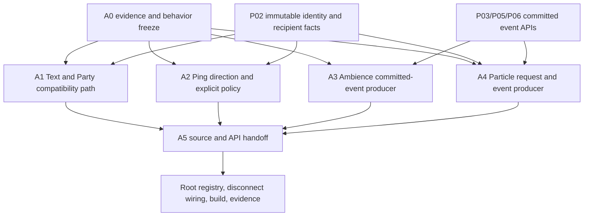

# P07-A Social and Presentation — Execution Plan

Status: module-local source implemented; root registry/lifecycle integration remains pending  
Strategy: `graph`, with `spec` acceptance gates per batch  
Owner: P07-A child session; root owns integration and serialized builds  
Parent plan: [P07 Packet 82 Modules](P07-module-implementation-plan.md)  
Master plan: [Version4 Minimal Server Implementation](MASTER-execution-plan.md)  
Production source boundary: `D:\TRbackup\NLTX\src\MinimalImplementation\Modules\Social` and `Modules\Effects`  
Verification boundary: `D:\TRbackup\NLTX\src\MinimalImplementation\Verification\Modules`  
Evidence boundary: `D:\TRbackup\NLTX\Build\diagnostics\MinimalImplementation`

## Goal

Complete the P07-owned Text/chat, Ping, Ambience, and Particles behaviors as bounded Packet 82
handlers and outbound-intent producers. Bind every client-authored identity to `ModuleDispatchContext`,
derive recipients from its authenticated recipient snapshot, and leave transport delivery to the
root-owned outbound path. A gameplay-originated presentation event may be published only after its
owning direction has committed it.

The Version4 tree is read-only evidence. Production code and verification code stay below
`src/MinimalImplementation`; outside that tree, this direction may call only approved public APIs
from `src/NSSLC.Infrastructure` and the .NET runtime. The P07-A child does not edit shared project
files, the common Packet 82 dispatcher/registry, or P02 disconnect wiring.

## Evidence freeze and current baseline

The Infrastructure codec contracts establish wire shape; they do not establish server authority or
application policy. Root has compared the empty Version4 Text and Ping receive methods against the
complete historical source snapshot at `D:\TRbackup\无任何删减通过编译` and selected their compatible
behavior for this minimal server. Implementations must keep that provenance visible and must not
describe those restored methods as behavior proven by the current Version4 bodies. Other unresolved
behaviors remain explicitly rejected or pending.

| Module | Version4 evidence and wire facts | Current minimal implementation | Required evidence treatment |
| --- | --- | --- | --- |
| Text (1) | Version4 `NetTextModule.SerializeServerMessage` writes author byte, `NetworkText`, then RGB bytes; `Deserialize` is empty. Version4 `ChatCommandProcessor.ProcessIncomingMessage` and both `PartyChatCommand` methods are empty. The complete historical snapshot implements C2S `ChatMessage` as command-id string then text string, dispatches it on the server, broadcasts Party text to the sender's nonzero team, sends `LegacyMultiplayer.10` to unteamed senders, and consumes empty Party messages without broadcast. | `Modules/Social/Chat` parses the historically supported Party command, binds author to the authenticated slot, selects visible same-team recipients, sends the no-team localization key to the sender, and creates server Text intents. SC081 exercises the nonzero-team route. | Use the root-selected historical compatibility behavior for Party. SC081 proves the local two-string codec/dispatch/intent path against that decision; it does not prove current Version4 receive behavior, socket delivery, or client handling. Unsupported commands remain rejected until separately assigned and source-audited. |
| Ping (2) | Version4 `NetPingModule.Deserialize` is empty; its serializer is also absent from the current tree. The complete historical snapshot serializes a position as two `Single` values; on a server, `Deserialize` rebroadcasts the position except to the authenticated sender, while clients add the position to their ping view. | `Modules/Social/Ping/PingModuleHandler.cs` checks the authenticated active session, bounds finite coordinates, derives visible recipients from P02 context, excludes the sender, and creates a Ping intent. | The server route is the root-selected historical compatibility behavior. Coordinate bounds and the absence of a module-local request throttle are local policy choices, not Version4 facts. Never accept an author or audience from payload data. |
| Ambience (3) | `Terraria.GameContent.NetModules/NetAmbienceModule.cs` writes player byte, seed `Int32`, and sky-entity byte. Its receive method is empty. `Terraria.GameContent.Ambience/AmbienceServer.cs` calls the serializer from `SpawnForPlayer`, which publishes server-selected ambience. | `Modules/Effects/AmbienceModuleHandler.cs` rejects client requests and can create a producer intent for an already-approved server spawn. | Keep the module server-authored. Preserve the upstream event owner as the source of spawn decision, player, and seed; P07-A packages the committed event and does not implement ambience selection or world predicates. Verify enum bounds against the Version4 enum before freezing constants. |
| Particles (8) | `Terraria.GameContent.NetModules/NetParticlesModule.cs` serializes particle type byte plus settings; its `Deserialize` reads those fields and broadcasts the same particle while excluding `userId`. `Terraria.GameContent.Drawing/ParticleOrchestraSettings.cs` contains position vector, movement vector, unique-info `Int32`, and invoking-player byte. The Infrastructure DTO mirrors those fields. | `Modules/Effects/ParticlesModuleHandler.cs` validates request data, rebinds invoking player from authentication, rate-limits by epoch, and emits intents to the recipient snapshot. It exposes epoch retirement and a post-commit producer method. | Preserve only the source-backed direction/fan-out rule. Treat particle payloads as presentation requests, not gameplay state. Keep numeric/rate limits explicit and bounded; document the selected limits as local defensive policy, not Version4 parity. Do not let client `InvokingPlayer` choose identity or client payload choose audience. |

The authoritative module ids are defined by the Infrastructure `Packet82ModuleId` API (Text 1,
Ping 2, Ambience 3, Particles 8). Its `Packet82KnownModuleCodecsV4` is the wire contract used by
the implementation. Relevant Version4 and historical source files are read-only evidence; they are
not compile inputs. The root compatibility decisions for Text and Ping are recorded in the parent
P07 plan. Other unresolved methods stay marked `unknown` rather than being filled from codec
structure alone.

## Historical compatibility decision

Root selected the complete historical bodies from `D:\TRbackup\无任何删减通过编译` for Packet 82
modules 1 and 2 because Version4 preserves the matching module identities and DTO wire shapes while
its corresponding receive methods are empty. For Text, the historical `ChatMessage` serializes the
command id and message text as two .NET strings; `NetTextModule.DeserializeAsServer` dispatches the
decoded command, and `PartyChatCommand` uses the server-owned team to create same-team Text messages.
When the sender has no team, the handler sends the historical `LegacyMultiplayer.10` localization
key with server-message color; an empty message creates no intent.
For Ping, the historical server deserializer rebroadcasts the decoded two-float position to every
connected client except the authenticated sender. The local implementation must use
`ModuleDispatchContext` for identity and audience; it must not copy transport writes or static
game-state access.

This decision restores behavior from a complete earlier snapshot where Version4 has gaps. It does
not change the evidence status of the current Version4 empty methods and does not authorize claims
that these methods execute in the Version4 tree.

## Ownership and API boundary

P07-A owns the module-local handler/command/producer behavior and its source files. It consumes:

- `ModuleDispatchContext` for authenticated epoch, player slot, team, stage, and the immutable
  recipient snapshot supplied by P02;
- `InboundPacketEnvelope` and the Packet 82 DTO/codecs from `NSSLC.Infrastructure` through the
  existing local protocol boundary;
- the root outbound-intent and commit-version contracts;
- committed event data from P03/P05/P06 when those owners publish presentation events.

P07-A returns `ModuleDispatchResult` and `OutboundPacketIntent`. It never writes to a socket, mutates
another direction's state, or invents world/combat facts. Root owns `MinimalImplementation.Server.csproj`,
shared Packet 82 registry/composition, common framing, and build serialization. P02 owns the actual
disconnect hook; P07-A exposes and documents its `RetireEpoch` contract for Particles.

## Dependency graph

## Batches and acceptance gates

| Batch | Work | Acceptance gate |
| --- | --- | --- |
| A0 — Evidence and policy freeze | Inspect Version4 module methods, their call sites, exact Infrastructure DTO/codec fields, complete historical bodies for Version4 gaps, current local source, and SC081 report. Record direction, provenance, immutable facts required from P02, and local defensive limits. | Every accepted behavior names current Version4 evidence or an explicit root compatibility decision. Empty methods remain labeled as gaps. Packet direction and field shape are distinguished from authority and recipient policy. No Version4 or historical source enters the build. |
| A1 — Text and Party | Keep the existing Party processor and Text handler within the selected SC081 scope. Verify the historical two-string wire shape, active-stage requirement, authenticated author binding, nonzero-team policy, recipient deduplication, self inclusion, RGB/NetworkText encoding, and rejection of unsupported commands. Record the Version4 empty-body gap alongside the selected compatibility decision. | SC081 remains the only selected functional scenario and is reported as the historical compatibility path. No new scenario is run. Handoff does not claim current Version4 receive behavior or transport delivery. |
| A2 — Ping | Use the root-selected historical receive behavior, confirm Version4 registration and Infrastructure float fields, then implement one handler that checks active session, finite/bounded coordinates, and visible recipients from authenticated P02 facts. Exclude the sender and provide bounded per-epoch request state if throttling is used. | Accepted Ping requests create one S2C intent for visible recipients other than the sender. The policy is identified as historical compatibility plus local defensive validation. Client payload cannot nominate an identity or recipient. No functional Ping scenario is run. |
| A3 — Ambience | Keep client-to-server Ambience rejected. Expose an outbound intent path for a server-selected, already-approved ambience event; validate module payload bounds and target epochs; encode via the Infrastructure codec. Do not duplicate spawn timing, biome/height predicates, or random selection. | Every outbound intent has valid committed producer input, a nonempty immutable target list, the exact Packet 82 module id and codec shape. Client requests cannot author ambience. No functional Ambience test is run. |
| A4 — Particles | Preserve the Version4 request-to-broadcast direction, check the payload before fan-out, replace the invoking player with the authenticated slot, use only the context's visible recipient snapshot, and bound each session's request rate. Provide a committed-event producer for owner-originated particle effects and a `RetireEpoch` method. | Malformed/non-finite/out-of-policy data is rejected before intent creation; payload identity is rebound; the author cannot choose audience; per-epoch state is bounded and can be retired. Gameplay-triggered effects use the owning direction's commit version. No functional Particles test is run. |
| A5 — Handoff to root | List changed production files, public APIs, required module project compile includes, policy/evidence gaps, and P02 close-hook contract. Root reviews the source boundary and integrates the handlers and lifecycle hook. | Root can register each P07-A handler exactly once, wire the epoch-retirement callback, and connect intents to its encoder/sender. The child does not change shared project files or run builds. |

## Root integration handoff

The module-local source slice is implemented and compiled. Its production files are:

- `Modules/Social/Chat/ChatCommandProcessor.cs`, `ChatCommandResult.cs`, `ChatMessage.cs`,
  `IChatCommand.cs`, `PartyChatCommand.cs`, and `TextModuleHandler.cs`;
- `Modules/Social/Ping/PingModuleHandler.cs`;
- `Modules/Effects/AmbienceModuleHandler.cs`, `Packet82PresentationValidation.cs`,
  `ParticleRateLimiter.cs`, and `ParticlesModuleHandler.cs`.

Root added `Social\Ping\*.cs` to `MinimalImplementation.Modules.csproj`. The Server project already
references the Modules project. P07-C/root integration still needs to register each handler once,
connect outbound intents to the production encoder/sender, and call the Particles handler's
`RetireEpoch` during P02 session retirement. Ping has no module-local rate limiter; its finite
coordinate bound is local defensive policy, while any transport-wide request limit remains with the
shared admission/dispatch layer.

Root's final incremental builds passed for Modules, Server, and the Modules verifier. SC081 is the
only unique functional scenario run; no Ping, Ambience, or Particles scenario was run.

Independent batches A1–A4 may be worked in parallel after A0 because they own separate handler
areas. Their results must not edit the shared registry, common packet project configuration, or P02
lifecycle. A5 waits for all four handoffs.

## Frozen functional test budget

The parent P07 plan freezes ten core scenarios, SC081–SC090, with SC081 as the single 10% selection.
SC081 passed against the root-selected historical Text compatibility path and has evidence at
`Build/diagnostics/MinimalImplementation/SC081/SC081-result.md`. Root reran this same scenario id
after correcting its evidence text; it remains the only unique scenario authorized. This subplan
does not run SC082, SC083, SC085, or any other functional scenario. Static source review and root's
incremental compile checks are recorded separately. SC081 does not prove the current Version4
empty receive methods, production registration, socket delivery, or end-to-end client behavior.

## Handoff checklist

The P07-A child reports:

1. Exact changed source paths and any new API signatures.
2. Version4 evidence paths/methods for each direction, including explicit empty-method gaps.
3. The Ping acceptance/rejection policy and its evidence basis.
4. Particle limits and recipient/identity rules, clearly separating defensive policy from V4 facts.
5. The required P02 epoch-retirement call site and P03/P05/P06 event inputs.
6. Exact compile include paths for the root-owned project wiring.
7. Functional scenarios run (expected: none in this subplan; parent SC081 remains the only run) and
   any compile checks performed by root (not the child).

Completion means each P07-A-owned accepted behavior has one owner, one direction rule, one bounded
outbound-intent path where applicable, an explicit rejection for unsupported requests, and a root-
reviewable evidence handoff. It does not mean all Packet 82 modules or the production listener are
complete.
