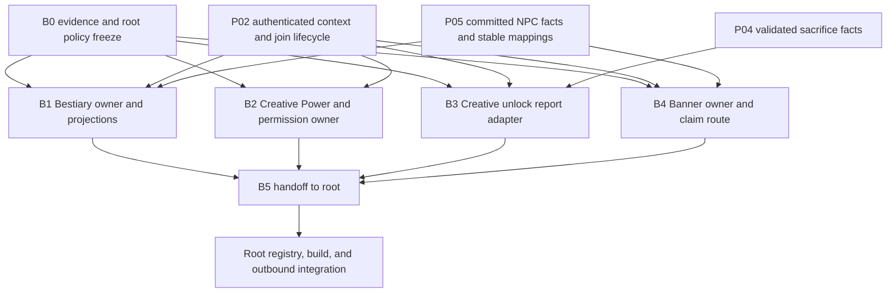

# P07-B Stateful Module Owners — Execution Plan

Status: plan complete; root B0 receive-policy freeze recorded; implementation and root integration review in progress  
Strategy: `graph`, with `spec` acceptance gates per batch  
Owner: P07-B child session; root owns compatibility decisions, shared registration, and serialized builds  
Parent plan: [P07 Packet 82 Modules](P07-module-implementation-plan.md)  
Master plan: [Version4 Minimal Server Implementation](MASTER-execution-plan.md)  
Production source boundary: `D:\TRbackup\NLTX\src\MinimalImplementation\Modules\Bestiary`, `Modules\Banners`, and `Modules\Creative`  
Verification boundary: `D:\TRbackup\NLTX\src\MinimalImplementation\Verification\Modules`  
Evidence boundary: `D:\TRbackup\NLTX\Build\diagnostics\MinimalImplementation`

## Goal

Complete P07-owned state and projection behavior for Packet 82 modules 4, 5, 6, 9, and 10. Keep
Bestiary and Banner state fed by committed P05 facts; keep Creative Power state owned by one
server-side owner; bind all accepted client identity to authenticated dispatch context; expose
immutable, deterministically ordered snapshots and outbound intents. Under the frozen Version4
policy, module 6 remains rejected/pending and does not call the sacrifice-report owner; a future
compatibility decision would require P04-owned sacrifice facts. Module 10 must not mutate inventory
directly. Root remains responsible for the common registry, Packet 82 framing, project wiring, P02
close path, and connection to the final outbound encoder.

This subplan is a path to source-backed behavior, not a blanket parity statement. Where the current
Version4 receiver is empty or its wire shape differs from a local override, B0 must record a root
compatibility decision before implementation uses behavior from an earlier complete source snapshot.
Until that decision is recorded, the owner must reject the unconfirmed direction or leave it
unregistered/pending; it must not report an unsupported payload as handled.

## Scope and boundaries

- Own modules 4 Bestiary, 5 Creative Powers, 6 Creative Unlock Player Report, 9 Creative Power
  Permissions, and 10 Banners, within the protocol direction decisions in B0.
- Use `ModuleDispatchContext` for authenticated player, host status, stage, epoch, and recipients.
  P05 supplies committed NPC events for modules 4 and 10. Module 6 currently consumes no P04 API
  because its Version4 receive path is empty. P07-B must not write P04 inventory or P05 NPC state.
- Keep server state changes in the existing Bestiary, Banner, and Creative owners. Prepare immutable
  copies and validate restored inputs fully before publishing restored state.
- Emit `OutboundPacketIntent` only after the relevant owner has committed. Do not write to a socket
  or modify a second direction's state from a module handler.
- All new production and verification source remains below `src/MinimalImplementation`. Version4
  and the historical snapshot are read-only evidence. Use only approved public APIs from
  `src/NSSLC.Infrastructure` and .NET; do not reference or compile Version4 code.
- Do not edit the shared Server project, module registry, P04 inventory writer, P05 NPC writer, or
  P02 disconnect hook. Root reviews any required compile includes and performs builds.

## Evidence freeze and known discrepancies

Root has now frozen the receive policy in the parent P07 plan's **Root compatibility decisions**
section. P07-B applies Version4-only behavior for modules 4, 5, 6, 9, and 10: module 5 accepts
only current live power id 14's authenticated per-player slider request; modules 4, 9, and 10
produce server-authored projections and reject client state; module 6 stays rejected/pending; and
historical Banner claim actions 3/4 are not selected. The implementation must preserve these
boundaries and must not revive local-only creative codec variants.

The Infrastructure DTOs and codecs establish supported byte layouts but do not establish server
authority or fill gaps in Version4 method bodies. The following evidence was checked while writing
this plan:

| Module | Current Version4 evidence | Existing minimal source / gap to close | Required evidence treatment |
| --- | --- | --- | --- |
| Bestiary (4) | `NetBestiaryModule` serializes action 0 kill count (`short` NPC net id plus 7-bit count), action 1 sight, and action 2 chat. Its `Deserialize` is empty. `NPCKillsTracker`, `NPCWasNearPlayerTracker`, and `NPCWasChatWithTracker` update server state before broadcasting; their join callbacks send known entries. | `BestiaryState` accepts P05 contributions, captures state, restores from persistence, and creates sorted join intents. Validate restored counts/ids and deterministic network-id resolution. | Treat P05 post-commit events as authority. Do not accept client Bestiary state. The historical `NetBestiaryModule.Deserialize` updates the client tracker only; cite it as compatibility evidence, not current Version4 receiver behavior. |
| Creative Powers (5) | `NetCreativePowersModule.Deserialize` reads a `ushort` power id, rejects unknown ids, and delegates to the selected power. The current Version4 `CreativePowers` source has live code for some power families and empty methods for others. `CreativePowerManager` registers 15 ids and sends permission plus join projections. | `CreativePowerStateOwner` checks id, value kind, permission and finite slider bounds, but restore and full initial value projections need review. The local `CreativePowerWireCodec` does not match every Infrastructure codec branch: Infrastructure treats ids 6/7 as no-payload and accepts only full-table action 0 for ids 5/11, while the local codec also uses slider values for 6/7 and accepts single-player toggle action 1. | Audit each registered power and exact send/receive body. Freeze whether earlier complete bodies may restore empty Version4 behavior. Do not resolve the codec disagreement by inferring from DTOs or enum names alone. Player ids in per-player payloads must be rebound to authenticated identity on server requests. |
| Creative Unlock Player Report (6) | `NetCreativeUnlocksPlayerReportModule.Deserialize` is empty in current Version4. The Infrastructure default module codec represents id 6 as an empty module, but local `CreativeModuleCodecs` substitutes a typed item/amount payload. | `CreativeUnlockReportOwner` validates item and amount through `ICreativeSacrificeFacts`, but the active Version4 receive path is not established and `CreativeModuleHandler` currently has no Packet 82 module handler. | Historical complete source reads a player byte, item id, and amount; on the server it replaces the supplied player with `userId` and relays to peers. This is only a candidate until root selects it. Never trust the payload player id or treat a report as proof of a sacrifice without P04 facts. |
| Creative Power Permissions (9) | Current Version4 serializes action 0, power id, and level; `Deserialize` is empty. `CreativePowerManager.SyncThingsToJoiningPlayer` sends the current level for every registered power. | The Creative owner captures 15 permission entries and rejects client permission updates. Confirm value bounds, default/configured levels, and deterministic join emission. | The historical complete receiver applies permission state on clients and rejects the server side. Keep policy server-authored; cite the current serializer and join callsite separately from historical client-side application. |
| Banners (10) | Current Version4 serializers and Infrastructure codec establish actions 0 full state, 1 kill-count update, and 2 claim-count update. `BannerSystem.AddNPCKillBy` updates kill/claim counts and broadcasts these projections; `NetBannersModule.Deserialize` is empty. | `BannerState` accepts P05 kill contributions, captures/restores 293 entries, and processes claim requests, while local `BannerModuleWireCodec` additionally defines actions 3/4 for claim request/response. Review claim commit ordering and ensure initial snapshot is immutable. | Actions 0–2 are current Version4 outbound evidence. Actions 3/4 exist in the complete historical snapshot but not the current Version4 codec/module body; root must explicitly select that compatibility path before accepting claims. Keep item ownership outside P07. |

Relevant read-only evidence paths include `D:\TRbackup\Version4\Terraria.GameContent.NetModules\NetBestiaryModule.cs`,
`NetCreativePowersModule.cs`, `NetCreativeUnlocksPlayerReportModule.cs`,
`NetCreativePowerPermissionsModule.cs`; `D:\TRbackup\Version4\Terraria.GameContent\BannerSystem.cs`;
`D:\TRbackup\Version4\Terraria.GameContent.Creative\CreativePowers.cs` and
`CreativePowerManager.cs`; plus their counterparts in `D:\TRbackup\无任何删减通过编译` where a
complete historical body is needed. Infrastructure wire definitions live in
`src/NSSLC.Infrastructure/Network/Pocket/DataPacketDefinition/Packets/Modules/NetModulesPacket.cs`
and `.../Codecs/Modules/Packet82KnownModuleCodecsV4.cs`.

## Dependency graph

B1–B4 may proceed in parallel only after B0 freezes each module's receive policy and dependencies.
They own separate module directories. Any shared API or codec change is proposed to root instead of
being made in the shared registry or project files.

## Batches and acceptance gates

| Batch | Work | Acceptance gate |
| --- | --- | --- |
| B0 — Evidence and policy freeze | Inspect current Version4 registrations, every relevant `Serialize`/`Deserialize` and callsite, creative power registration and subtype handlers, Infrastructure codec branches, local codec overrides, current owners, and the complete historical candidate. Record wire direction, exact fields, authority, persistence, and unsupported paths. The root's policy for module 5 gaps, module 6 input, module 9 projection semantics, and module 10 actions 3/4 is recorded above and in the parent plan. | One evidence row per behavior names its source and version. Every empty method and codec mismatch is labeled. No unconfirmed receive path reports `Handled`. No Version4 or historical source enters a project. |
| B1 — Bestiary | Accept only P05-committed kill/sight/chat contributions; guard monotonic source commit versions and duplicate contributions; keep counts bounded; capture detached snapshots; validate persistent identifiers/counts before restore; create deterministic initial-join intents after resolving persistent IDs to valid network IDs. | Rejected or duplicate P05 events do not create duplicate state/intents. Capture cannot be changed by mutating the owner afterward. Restore rejects malformed, duplicate, negative, or over-cap data before publication. Join output is stable and uses only valid IDs. No client contribution is accepted. |
| B2 — Creative Powers and permissions | Audit the 15 registered IDs and each current wire body; fix or explicitly isolate the local/Infrastructure codec differences according to B0. Bind actor/affected player from authenticated context; enforce permission and gameplay-host rules at the handler boundary; expose committed effects to the world/power owner rather than applying unrelated state. Add validated immutable snapshot restore and deterministic join-time permission/value projections. Reject unknown ids, wrong value kinds, non-finite/out-of-range values, invalid player-bit padding, and unauthorized requests. | Every accepted message maps to one registered power and one expected value kind. Client-supplied player IDs cannot affect another slot. Permission changes and values advance one commit version only on change/accepted action. Snapshot copies cannot mutate live state; restore validates before publication. Join projections encode the frozen V4-compatible state in deterministic power-id order. |
| B3 — Creative Unlock report | Under the frozen B0 policy, preserve module 6 as explicitly rejected/pending. Keep the active codec on Infrastructure's empty-module shape; do not invoke `CreativeUnlockReportOwner`, do not infer a typed historical report payload, and do not create a report/fan-out intent. | Every module 6 request returns a rejection/pending result and changes neither creative research nor P04 inventory. No historical item/amount payload is treated as handled. A future change requires a new root compatibility decision and a P04-owned fact contract. |
| B4 — Banners | Consume only P05-committed kills and trusted banner mappings/thresholds; retain the fixed 293-entry owner tables; produce action 0 join snapshot and actions 1/2 post-commit updates. If root selects historical claim actions, authenticate the claimant, validate the index, clamp zero requests to one and grant at most claimable count, then emit claim-count and response intents with one consistent commit version. Do not modify P04 inventory or emit a grant before the banner count commit. | Kill and threshold updates are derived from P05 committed facts exactly once; snapshot arrays are immutable and contain 293 values each. Restore validates both complete tables and rejects negative kill counts. Claim requests are rejected until action 3/4 approval; after approval, only the authenticated sender receives the response, and no claim count is consumed on invalid requests. |
| B5 — Handoff to root | Report files/APIs, exact Version4 and historical citations, selected compatibility decisions, P02/P04/P05 dependencies, codec or compile include requests, and unresolved authority questions. Root reviews and integrates one handler per id and the join/outbound path. | Root can review changed source without inferring wire facts, register each handler once, provide needed producer inputs, and determine all remaining unsupported paths. The child edits no shared registry/project files and runs no functional scenario. |

## Frozen functional test budget

The P07 core inventory is `SC081`–`SC090`, with a maximum of one unique scenario (10%). The root
plan records SC081 as already run and selected. That exhausts the P07 functional budget. This
subplan does not run SC084, SC086, SC087, SC088, or any other functional scenario; these remain
`NOT RUN` regardless of implementation progress. Child verification is limited to source review and
handoff. Root may run the already-authorized incremental builds for changed projects under the
repository build rules; builds are not additional functional scenarios.

## Handoff checklist

The P07-B child reports:

1. Exact changed files and public owner/adapter APIs.
2. Current Version4 evidence per module and any historical compatibility source used.
3. Root decisions needed or applied for empty receivers and wire-codec disagreements.
4. Creative power ID/value map, authenticated actor binding, permission rules, and snapshot order.
5. Bestiary/Banner P05 commit inputs; module 6 remains unconnected to P04 under the frozen policy.
6. Snapshot/restore validation and any unresolved persistent-id or mapping requirements.
7. Required compile includes or Infrastructure API requests for root review.
8. Functional scenarios run (expected: none); static checks performed and all remaining gaps.

Completion means all accepted P07-B behavior has a single authoritative owner, validated direction,
immutable projections, and an explicit outcome for unsupported input. It does not claim complete
Version4 client parity for any empty receiver, nor does it close global Packet 82 registration,
P02 disconnect lifecycle, the listener, or the unrun P07 scenarios.
