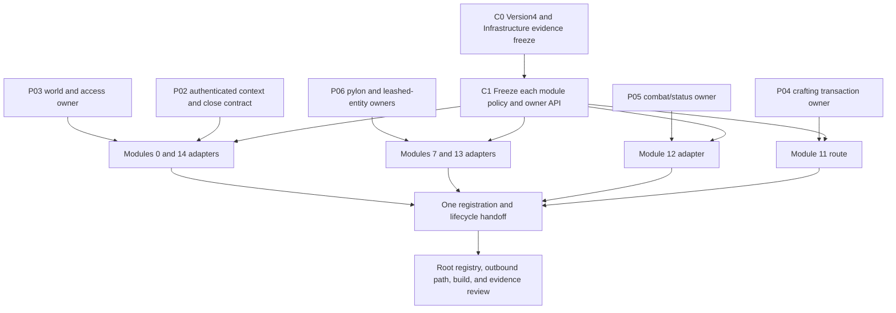

# P07-C Delegated Module Adapters and Lifecycle — Execution Plan

Status: plan complete; root route policies frozen; implementation and root integration review in progress  
Strategy: `graph`, with `spec` acceptance gates per batch  
Owner: P07-C child session; root owns compatibility decisions, common registration, P02 close wiring, and serialized builds  
Parent plan: [P07 Packet 82 Modules](P07-module-implementation-plan.md)  
Master plan: [Version4 Minimal Server Implementation](MASTER-execution-plan.md)  
Source boundary: `D:\TRbackup\NLTX\src\MinimalImplementation`; delegated durable state remains owned by P03/P04/P05/P06  
Verification boundary: `src/MinimalImplementation/Verification/Modules`  
Evidence boundary: `D:\TRbackup\NLTX\Build\diagnostics\MinimalImplementation`

## Goal

Finish the Packet 82 handoff for modules whose durable state belongs to P03, P04, P05, or P06;
define one exact registration and disconnect-retirement contract for the P07 dispatcher; and
deliver committed module intents to the root-owned outbound path. The P07-C work must preserve the
existing owner APIs and must not create a second writer for world, inventory, combat, mechanisms,
player, or session state.

This is a routing and lifecycle plan, not a claim that the current Version4 empty receive methods
accept client mutations. Each delegated path must be classified as accepted, deliberately ignored,
or explicitly rejected from evidence and a root policy decision. A codec being able to decode a
message is not permission to mutate state.

## Scope and ownership

P07-C covers module ids 0, 7, 11, 12, 13, and 14, plus the dispatch retirement and intent handoff
contracts. P07-B retains module 6 Creative Unlock Player Report. P07-A retains modules 1, 2, 3,
and 8; P07-B retains modules 4, 5, 9, and 10. The final Packet 82 registry still belongs to root.

| Module id | Delegated owner | Current minimal source and required P07-C treatment |
| ---: | --- | --- |
| 0 Liquid | P03 `WorldOwner` | Root freezes module 0 as server-authored output only. `Host/WorldLiquidModuleHandler` currently accepts local direct assignments, but Version4's `NetLiquidModule.Deserialize` returns false; remove that inbound mutation path. Keep the current changed-liquid projection path from committed P03 state. |
| 7 Teleport Pylon | P06 mechanism owner, with P03 world scope/access and P02 player-teleport commit as required by the audited call path | P06 has a `TeleportPylonRegistry`, but no Packet 82 handler is present. Version4 emits pylon add/remove and join projections; its `PlayerRequestsTeleport` enum value has no active receive behavior because `Deserialize` is empty. Reject client requests; keep movement authorization with P02/P06. |
| 11 Crafting Requests | P04 crafting transaction owner | `Inventory/Crafting/CraftingModule11Handler` delegates to `CraftingTransactionCoordinator`, but Version4's `Deserialize` is empty and Infrastructure models module 11 as empty. Root freezes the route as rejected/pending; do not enable the local typed P04 request codec or return approval for decoded input. |
| 12 TagEffect State | P05 combat/status owner | `Combat/TagEffects/TagEffectStateOwner` exists, but no Packet 82 adapter is registered. Version4's receive method returns its default result and `WriteNPCChange` is empty. Root freezes client input as rejected; output may use only active Version4 producer callsites and P05 committed facts. |
| 13 Leashed Entity | P06 mechanism/entity owner, with P05 facts only if prototype validation requires them | `Mechanisms/LeashedEntityRegistry` owns the local entity state, but no module handler is present. Version4's server serializer emits full/partial/remove projections and its `Deserialize` returns false. Root freezes module 13 as output-only; client entity mutations are rejected. |
| 14 Unbreakable Wall Scan | P03 world queries plus P02 committed player position; P07 owns only the module projection adapter | `Host/UnbreakableWallModuleHandler` currently reports a local no-op as handled, and `Modules/Effects/UnbreakableWallModuleProducer` can create a local notification intent. Version4's receive and broadcast methods are empty. Root freezes module 14 as explicitly rejected/pending; do not treat that no-op as handled or emit the local-only notification as Version4 behavior. |

The table is a starting ownership map, not final proof of direction or compatibility. If an owner
API cannot represent a required accepted action, P07-C reports the narrow API request to root and
the owning direction; it does not write the missing delegated state.

## Evidence freeze and current gaps

Version4 evidence checked for this plan:

| Evidence source | SHA-256 | Relevant finding |
| --- | --- | --- |
| `D:\TRbackup\Version4\Terraria.Initializers\NetworkInitializer.cs` | `AAA25C7F45484B07DC5265B856B33EC8295624DF57DC6A4F31466904E2D9E920` | Registers Liquid first and registers ids 7 and 11–14 in sequence, establishing Packet 82 module ids when read with `NetManager.Register`. |
| `D:\TRbackup\Version4\Terraria.GameContent.NetModules\NetLiquidModule.cs` | `F1B678CB9AFA26468167CCE65DFD59168B227E813A9B331370B07CDB5D46FB49` | Emits changed tile coordinate, liquid amount, and type to clients; current server `Deserialize` is empty. |
| `D:\TRbackup\Version4\Terraria.GameContent.NetModules\NetTeleportPylonModule.cs` | `E6968992FDEE1BBE80F68AE40C2B390BC30A184B73032A91F8EDB108039C402E` | Emits action plus pylon tile X/Y and type for add/remove; current server `Deserialize` is empty. |
| `D:\TRbackup\Version4\Terraria.GameContent\TeleportPylonsSystem.cs` | `C1A6B6A163ACAB5E33E09EC6D4F49FB27881E47528844F1B652BE67B12777D1F` | Rebuilds its list from teleport-pylon tile entities, broadcasts add/remove projections, and sends known pylons to a joining player. |
| `D:\TRbackup\Version4\Terraria.GameContent\CraftingRequests.cs` | `88EA7FF558AA521704068B3AC8DE8CB8E733DE2C30B60F965931768C79EFAE20` | The current module receive method is empty; its local declarations do not prove the request wire shape or server algorithm. |
| `D:\TRbackup\Version4\Terraria.GameContent.Items\TagEffectState.cs` | `14C287E967739D5407A70086FD0475BA0262D62F422FC53022F4EB049146C74F` | Defines output action layouts, but current `Deserialize` returns the default result and `WriteNPCChange` returns an empty packet. |
| `D:\TRbackup\Version4\Terraria.GameContent\LeashedEntity.cs` | `DD8A2B1DCC4C3E73ADB65F5D14A39B4C6AD1D5389D972C2C1DDAB7CFA1E0775E` | Current sync output carries full/partial action, 7-bit entity id/type, optional anchor, and subtype data; module `Deserialize` is empty. |
| `D:\TRbackup\Version4\Terraria.GameContent\UnbreakableWallScan.cs` | `625C2350E1436E202DBB592ECDC82BBE26C8BED6562AB6E79D4C0583BA2E9663` | Server module `Deserialize` and `BroadcastChange` are empty; its synchronous world scan is separate from the network module shell. |

Root froze the route policies in the parent P07 plan's **Root compatibility decisions** section.
The P07-C evidence pass must still re-check hashes and inspect actual callsites before
implementation; the table records the source identity used to prepare this plan, not a blanket
behavioral claim. No older implementation is selected for these module ids. If a source check
contradicts a frozen policy, stop that path and report it to root before changing behavior.

Important code/API facts from the current MinimalImplementation tree:

- `Modules/ModuleDispatcher.cs` already bounds ids to 0–14, rejects duplicate registrations,
  exposes missing ids, and has `RetireEpoch`. It does not currently require a complete handler set.
- `Modules/ModuleDispatchResult.cs` supports `Handled`, `NotRegistered`, and `Rejected`, carries a
  commit version, and freezes outbound intents into an immutable copy. A delegated handler must not
  return `Handled` for unsupported state mutation merely because decode succeeded.
- `Contracts/OutboundPacketIntent.cs` and `Modules/Protocol/Packet82ModuleIntentProducer.cs`
  provide the intent boundary. Handler/producer code returns intents; root/P01 resolves the target
  epoch, encodes, queues, and writes them.
- `Effects/ParticleRateLimiter.cs` is session-epoch scoped and already exposes retirement. Any
  additional P07 session-local state must join the same P02 cleanup event, while P07 world/module
  state must not be cleared on a player disconnect.
- `Host/ServerComposition.CreateP03ModuleHandlers` currently returns module 0 and 14 handlers.
  `Inventory/Crafting/CraftingModule11Handler` is present separately. The final registry and its
  project references/compile includes remain root-owned.

## Dependency graph

C2–C5 can proceed in parallel after C0/C1 freezes their route policies and stable public owner
contracts. They may not edit the shared registry, shared project files, or owner state projects.

## Batches and acceptance gates

| Batch | Work | Acceptance gate |
| --- | --- | --- |
| C0 — Evidence and wire-direction freeze | Re-check the Version4 module registration order, `Serialize`/`Deserialize` methods, sender/recipient callsites, Infrastructure codec type and trailing-byte behavior, local codec overrides, and P03/P04/P05/P06 owner API. Record exact fields and action directions for every id, whether the current receive method mutates state, and any difference from an earlier complete snapshot. | Every enabled input has a current Version4 source-backed direction and a named writer, or a root-approved compatibility decision. Unknown/mismatched paths stay pending or explicitly rejected. No source outside `MinimalImplementation` is compiled or referenced. |
| C1 — Policy and API contract freeze | For each module, record one of: `accepted-and-committed`, `source-backed-no-op`, or `explicitly-rejected/pending`. Confirm world scope, session epoch, actor source, commit result, post-commit intent recipient selection, and error mapping with the owner direction. Freeze a minimal API request where an owner cannot express an accepted action. | No decoded payload becomes authoritative by itself; each accepted action names a single owner and stable call contract. No guessed compatibility behavior is enabled. |
| C2 — World adapters (0 and 14) | Reconcile the existing `WorldLiquidModuleHandler` and `UnbreakableWallModuleHandler` with the frozen policies. Module 0 is output-only; remove or quarantine its local direct-assignment handler and preserve projections from committed P03 changes. Module 14 returns an explicit rejection/pending result and emits no notification. | Module 0 accepts no client mutation and every output follows a committed P03 change. Module 14 owns no scan state, reports no unsupported input handled, and emits no local-only intent. |
| C3 — Pylon and leashed adapters (7 and 13) | Place any narrow protocol adapter at the P07-to-P06 seam, using immutable pylon/entity facts. Reject module 7 client requests, including `PlayerRequestsTeleport`; keep teleport authorization and player movement with P02/P06 owners. Reject module 13 client mutations; emit full/partial/remove projections only from committed P06 changes and join snapshots. | No client-selected pylon, entity slot, generation, or position directly mutates state. Every emitted pylon/entity update follows an owner commit and world-scope check. Unsupported inputs are rejected without partial P06 mutation. |
| C4 — TagEffect adapter (12) | Keep all client-authored TagEffect state rejected. Inventory current Version4 output callsites and adapt only active output forms through the P05 owner, using committed facts and resolved NPC generation/world scope. Do not implement TagEffect rules in P07 or revive the empty `WriteNPCChange` path. | Rejected input has no mutation or success intent. Every emitted output is backed by an active Version4 writer callsite and a P05 commit. |
| C5 — Crafting route (11) | Keep Packet 82 module 11 rejected/pending under the frozen policy. Ensure the existing P04 `CraftingModule11Handler` and local typed codec are not reachable through the active V4 module registry; do not emit an approval for this unsupported route. Do not alter the P04 transaction coordinator. | Module 11 cannot report approval or mutate P04 state through Packet 82 until a new root compatibility decision explicitly enables a source-backed request contract. |
| C6 — Registry, replay, close, and outbound handoff | Give root the exact single-handler list for all ids 0–14, including explicit policy handlers for unsupported ids. Define the P02 close observer contract: stop dispatch for the closing epoch; capture its dependent cleanup keys; retire `ModuleDispatcher.RetireEpoch` and every epoch-scoped P07 limiter/state exactly once; discard any queued outbound intent whose target epoch is retired; then release the player slot for a fresh epoch. Root composes the handlers and sends intents through the P01 encoder/queue. | Registry has each id 0–14 exactly once and `IsComplete == true`; every close path (orderly close, kick, timeout, transport failure) is idempotent and cannot revive a retired epoch; handlers perform no socket writes. |
| C7 — Handoff and source review | Report changed files, handler IDs, public owner APIs, current V4 evidence, root compatibility decisions, compile include/project reference requests, and all pending module policies. Review source statically; do not run a P07 functional scenario or build. | Root can integrate without inferring ownership or route behavior. All unapproved behaviors are visibly pending/rejected; no functional-test budget is spent by this child. |

## Disconnect and outbound ordering contract

P02 owns connection retirement and must expose one idempotent close event containing the captured
`SessionEpoch` and authenticated player binding. P07-C consumes that event; it does not add a
second binding or close API. The integration order is:

1. P02 marks the epoch closed so new frames cannot enter authenticated dispatch. Frames already
   queued with that epoch are either drained before close or rejected as stale; they cannot commit
   after dependent owner cleanup begins.
2. Root captures the P07 cleanup keys from the still-valid binding, then calls
   `ModuleDispatcher.RetireEpoch(epoch)` and `ParticleRateLimiter.RetireEpoch(epoch)` (plus any
   additional P07-owned session limiter added under this plan). Repeated retirement is harmless.
3. Root drops unsent outbound intents targeted only to the retired epoch. Intents for other active
   recipients remain valid. World-owned Bestiary/Banner/Creative/Pylon state is not erased by a
   single player disconnect.
4. P02 invalidates the binding/identity and makes the player slot reusable only with a fresh epoch.
   A stale close callback or replayed envelope from the old epoch cannot affect the new session.

The actual callback and shared composition edits belong to root/P02 integration. P07-C supplies the
required call list and verifies that every P07 session-scoped owner exposes an idempotent retirement
method; it does not modify the P02 close path.

For outbound messages, the delegated handler or producer creates an immutable
`OutboundPacketIntent` after owner commit, with an explicit recipient `SessionEpoch` set and commit
version. Root/P01 confirms that each epoch is still active, encodes with the approved Infrastructure
codec, queues to the corresponding transport, and records a failed/closed recipient without
rolling back domain state. No adapter broadcasts by player slot alone or reaches into socket
transport.

## Fixed P07 functional-test budget

The P07 core inventory remains `SC081`–`SC090`. The root-selected 10% allocation is SC081, which has
already run. This subplan authorizes **zero additional functional scenarios**. In particular,
SC089 and SC090 remain `NOT RUN`; static source review and root-approved compile checks do not change
that status. P07-C does not build projects because the root owns the serialized build window.

## Handoff checklist

The P07-C child reports:

1. Exact changed files and module ids handled by each file; no shared registry/project edits.
2. Version4 evidence identity and direction for ids 0, 7, 11, 12, 13, and 14.
3. Root compatibility decisions applied, with current Version4 empty bodies still labeled as gaps.
4. The one authoritative owner and accepted result contract for every enabled action.
5. Epoch-scoped cleanup methods and the required P02/root close-event order.
6. Exact recipient epochs, commit versions, codec calls, and root outbound dependencies for emitted intents.
7. Required compile includes/project references, left for root to review and apply.
8. Functional scenarios run (expected: none), builds run (expected: none), and all unrun behavior.

Completion means delegated module routing is explicit, duplicate writers do not exist, root has a
complete registration/lifecycle/outbound contract, and unresolved Version4 directions remain
visible. It does not claim unsupported or empty Version4 receive methods are implemented, nor does
it claim listener readiness, all-module runtime coverage, or completion of SC082–SC090.
