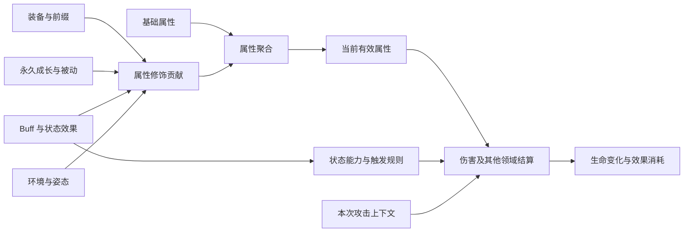

# 玩家属性修饰与 Buff 统一机制研究

文档 ID：DOC-2026-10-23-ATTRIBUTE-MODIFIER-SYSTEM-RESEARCH  
逻辑域：research  
产物类型：evidence / design analysis  
状态：proposal；源码阅读与外部资料研究，不是实施完成或运行验收  
日期：2026-10-23（Asia/Shanghai）  
参考源码：`D:/TRbackup/最新的客户端`，`Main.versionNumber` 和程序集版本均为 `1.4.5.8`  
canonical 路径：`docs/research/2026-10-23-attribute-modifier-system-research.md`

## 1. 判断

推荐统一属性修改的表示、聚合与来源管理。名称宜使用中性的“属性修饰系统”，同时支持增益与减益。

Buff、装备、套装、永久成长、环境和姿态，都可以向它提供属性修饰器。这些来源在“对某个属性施加影响”的层面可以采用同一模型；但 Buff 的完整语义比属性修饰器更大。Buff 可能携带多个属性修改，也可能授予能力、周期执行行为、维持召唤物、消耗层数或提供表现。

因此，结构上的共同点是“来源向属性贡献修饰”，不是 Buff 与整个属性领域的一一对应。防御是属性；“穿戴装备增加 10 防御”是修饰；生命池是独立战斗状态；“这次受到多少伤害”是结算结果。这些概念应分别存在。

本文中的边界是概念建议，不是最终 ECS 组件、System API 或存储方案。没有修改参考客户端和项目业务源码，也没有执行编译、测试、运行或性能测量。

## 2. 客户端源码证据

以下路径以 `D:/TRbackup/最新的客户端/` 为根，行号为本次读取位置。这里只列关键正例和反例，不声称已经穷举所有玩家属性写入。

| 观察对象 | 源码证据 | 对统一机制的含义 |
| --- | --- | --- |
| Buff 实例 | `Terraria/Player.cs:1491`：44 个槽位，`buffType[]` 与 `buffTime[]` | 当前 Buff 有独立实例管理、容量与时间语义 |
| Buff 添加 | `Player.cs:5255`、`5394`：免疫、联机权限、互斥组、同类型刷新时间；部分类型累加时间到上限 | 不能把 Modifier 的重复加入直接等同于 Buff 的重新施加 |
| 每帧重算 | `Player.cs:18389`：防御归零，耐力归零，伤害与移速倍率归一，最大生命派生值回到基础值 | 现有代码已经靠重新计算避免大部分“到期反向减回”问题，不能把这一优点说成当前代码完全没有 |
| 运行顺序 | `Player.cs:25686`、`25761`、`25828`、`25839`、`25880`：重置、Buff、装备、永久增益、套装 | 重排为统一求值阶段可能改变条件判断和当帧生效时点 |
| 铁皮 Buff | `Player.cs:10047`：`statDefense += 8` | 可直接表示为限时固定防御加值 |
| 耐力 Buff | `Player.cs:10289`：`endurance += 0.1f` | 可与非 Buff 的同通道减伤贡献统一聚合 |
| 装备防御 | `Player.cs:13219`：累加 `armorPiece.defense` | 适合装备来源的修饰贡献，生命周期绑定装备有效状态 |
| 饰品前缀 | `Player.cs:14052`：不同前缀提供 1～4 防御 | 与铁皮可共享固定加值运算，但来源和驱散策略不同 |
| 蠕虫围巾 | `Player.cs:15193`：Item 3224，`endurance += 0.17f`；名称见 `Terraria.ID/ItemID.cs:7994` | 与耐力药水在数值聚合层已经使用相同字段 |
| 永久增益 | `Player.cs:12946`：使用过埃癸斯果实则加 4 防御 | 原始使用记录是权威状态，防御贡献可派生，避免新增第二份永久记录 |
| 套装 | `Terraria.DataStructures/ArmorSetBonuses.cs:129`、`159`：叶绿近战套装加 0.05 耐力，海龟套装加 0.15 耐力并启用反伤 | 一个来源可同时产生数值与行为效果 |
| 坐骑 | `Terraria/Mount.cs:4856`：超级矿车按速度贡献防御 | 修饰的幅度可能依赖动态状态，不只是常数 |
| 举盾 | `Player.cs:25909`：加 20 防御；`26153` 同时影响移动 | 触发条件/姿态归原行为所有，防御贡献可统一 |
| 灵液与破甲 | `Player.cs:10148`：灵液减 15 防御；`26217`、`26221`：破甲和枯萎盔甲各使已汇总防御整数除二 | 支持负贡献和不同计算阶段；加值与最终倍率不能混为一种操作 |
| 冰屏障 | `Player.cs:10549`：低于半血时加 0.25 耐力，否则移除 Buff；`14993`：对应装备在条件满足时施加 Buff | 条件、装备与 Buff 生命周期已相互关联，直接全量改写有时序风险 |
| 复合 Buff | `Player.cs:10390`：树妖祝福同时加生命恢复、防御并设置标志与反伤强度 | Buff 到 Modifier 是一对多，且仍有非纯数值内容 |
| 混合正负效果 | `Player.cs:12005`：微醺减防御，同时增加近战属性 | 效果整体与每一条修饰的利弊不能只用正负数判定 |
| 非属性 Buff | `Player.cs:9968`：设置坐骑；`10299`：狱火扫描邻近实体、施加 Buff、造成周期伤害 | 单一属性聚合不能覆盖全部 Buff |

### 2.1 防御与减伤实际分属多个阶段

NPC 碰撞伤害路径中，旗帜减伤在 `Player.cs:31620`，寒冷抗性在 `31651`，之后才调用 `Hurt`。它们有来源条件，并在防御之前修改本次输入伤害。

`Hurt` 的关键路径为：

1. `Player.cs:38476` 起：无敌、伤害冷却和闪避可能直接返回。
2. `38526`：以防御计算伤害；公式见 `Terraria/Main.cs:67143`。
3. `38584`：按 `1 - endurance` 缩放并转换为整数。
4. `38585` 起：日耀盾在指定伤害上下文下被消耗，再提供独立减伤并触发反击表现/弹幕。
5. `38602`：甲虫层数提供每层 15% 的独立减伤，本次受击后扣一层、更新 Buff 并清零计数。
6. `38620`：圣骑士护盾寻找符合条件的队友并转移部分伤害。
7. `38660` 附近：最小伤害处理，随后扣生命、记录伤害并设置受击冷却。

只看普通 PvE 的防御阶段，公式为 `max(1, D - k × Defense)`，普通、专家、大师的 `k` 分别为 0.5、0.75、1。这不是整个受击流程，也不是 PvP、所有特殊伤害或持续掉血的完整公式。该快照在 `Hurt` 尾部还会针对 PvP 重算返回值，不能把返回值直接当成全部副作用的统一定义。

两个简单算例说明统一时必须保留通道：

- 同时有耐力药水和蠕虫围巾，当前 `endurance = 0.10 + 0.17 = 0.27`，该阶段剩余伤害为 73%。若改为各自独立乘算，剩余伤害为 `0.9 × 0.83 = 74.7%`。这已经改变平衡。
- 假设输入伤害 100、防御 40、普通难度，20% 减伤若发生在防御前，结果为 `100 × 0.8 - 40 × 0.5 = 60`；若发生在防御后，结果为 `(100 - 40 × 0.5) × 0.8 = 64`。不能仅存一个“减伤 20%”而不存应用阶段。

此外，现有流程在多个阶段整数转换。即使实数乘积相等，合并中间步骤也可能改变最终整数。

## 3. 网络资料与证据范围

本次进行了网页检索，并直接读取以下项目维护者的一手文档正文。外部设计用于比较，不用于替代本地 1.4.5.8 客户端的行为证据。tModLoader stable 页面本次显示版本为 `v2026.08`；stable 链接随项目发布可能变化。

### 3.1 Epic Gameplay Effects

来源：[Gameplay Effects for the Gameplay Ability System](https://dev.epicgames.com/documentation/en-us/unreal-engine/gameplay-effects-for-the-gameplay-ability-system-in-unreal-engine)。

官方文档明确说明：

- Gameplay Effect 的持续类型可为 Instant、Infinite、Has Duration。
- Modifiers 表达对属性的数学影响，可以附带标签要求。
- Stacking 管理重复施加、层数上限、时长重置或追加、以及多个实例等策略。
- Executions 通过 `UGameplayEffectExecutionCalculation` 处理普通 Modifier 难以覆盖的复杂公式。
- Gameplay Cues 处理表现；免疫、持续执行条件等也有独立机制。

推导：统一效果机制可以同时服务临时与长期来源，但仍需要把数值聚合、复杂结算和表现分开。这不等于引入完整 GAS，也不证明把任何业务函数放进 Modifier 就是合理的。

### 3.2 Epic Gameplay Attributes

来源：[Gameplay Attributes and Attribute Sets](https://dev.epicgames.com/documentation/en-us/unreal-engine/gameplay-attributes-and-attribute-sets-for-the-gameplay-ability-system-in-unreal-engine)。

文档区分 base 与 current。例子是基础跳跃高度 100，疲劳效果使当前值为 70；升级后基础值变成 110，疲劳期间当前值为 77。其 setter 示例通过 Ability System Component 修改基础值，以保持已有修饰继续正确生效。

推导：永久成长、有效属性、暂时修饰需要明确所有权。本文的“属性当前有效值”不是指把生命池的每次受伤都保存为长期修饰；扣血/治疗仍是明确的状态转换或瞬时效果。

### 3.3 tModLoader StatModifier

来源：[StatModifier Struct Reference](https://docs.tmodloader.net/docs/stable/struct_stat_modifier.html)。

文档明确给出求值顺序：

```text
result = (baseValue + Base) × Additive × Multiplicative + Flat
```

`Base` 是倍率前固定加值；`Flat` 是倍率后固定加值。`Additive` 汇总加算倍率，`Multiplicative` 在之后作用。文档还说明典型百分比增益使用加法操作，独立乘法用于另一类效果。

推导：即使术语都叫“增加伤害/防御”，也必须区分固定值、百分比加算、独立倍率以及作用阶段。这个公式可以作为设计词汇，不能直接替换本地所有属性的旧公式。

### 3.4 tModLoader HurtModifiers

来源：[Player.HurtModifiers Struct Reference](https://docs.tmodloader.net/docs/stable/struct_player_1_1_hurt_modifiers.html)。

官方文档明确区分：

- `IncomingDamageMultiplier`：特定来源的防御前减伤，原版寒冷抗性与旗帜使用这一类语义。
- `FinalDamage`：最终伤害修饰，`Player.endurance` 用于总体减伤。
- `SourceDamage`：伤害来源的基础伤害修饰。
- 穿甲、最终伤害上限、击退等具有各自字段/约束。
- 给最终伤害 Modifier 的 `Base` 和 `Flat` 加值，是否经过后续减伤的语义不同。

推导：与 Terraria 最相近的现有扩展同样采用“通用数值修饰词汇 + 明确受击阶段”，支持本文建议的分层方向。

## 4. 代码仓库对比

本节比较固定提交中的项目源码，而非仅依据 README 概述。链接均固定到提交 SHA，以便复查。它们提供的是设计样本；引擎、规模和规则与本客户端不同，不能直接移植为本项目架构。

| 仓库 | 实际观察 | 可借鉴点 | 不应照搬之处 |
| --- | --- | --- | --- |
| [Unity Gameplay Ability System](https://github.com/sajad0131/Unity-Gameplay-Ability-System/tree/105d63354a28f7988e6daae9d2b422ecc08c57a9) | [`AttributeModifier`](https://github.com/sajad0131/Unity-Gameplay-Ability-System/blob/105d63354a28f7988e6daae9d2b422ecc08c57a9/Assets/UGAS/Core/Attributes/AttributeModifier.cs) 保存运算类型、数值、来源资产与时长；[`AttributeValue`](https://github.com/sajad0131/Unity-Gameplay-Ability-System/blob/105d63354a28f7988e6daae9d2b422ecc08c57a9/Assets/UGAS/Core/Attributes/AttributeValue.cs) 分离 BaseValue/CurrentValue，先汇总 Flat、再汇总 Percent，最后 Clamp；[`GameplayEffectRunner`](https://github.com/sajad0131/Unity-Gameplay-Ability-System/blob/105d63354a28f7988e6daae9d2b422ecc08c57a9/Assets/UGAS/Core/Effects/GameplayEffectRunner.cs) 维护目标上的活动效果并执行时间、周期与层数更新。 | 很直观地展示“效果管理器拥有时长/层数，属性值负责重算”的分层；属性变化可以从基础值与当前修饰重建。 | [`DurationModifierEffect`](https://github.com/sajad0131/Unity-Gameplay-Ability-System/blob/105d63354a28f7988e6daae9d2b422ecc08c57a9/Assets/UGAS/Core/Effects/DurationModifierEffect.cs) 按 `Effect` 资产对象从目标移除修饰；Runner 也按 Effect 与 Target 查找重复效果，没有把每次施加的唯一实例 ID 纳入匹配，且匹配未纳入 Instigator。不同施加来源的同一效果会汇入同一活动实例，过期/驱散的独立性较弱。它是教学型 Unity 实现，不是完整 GAS 的语义保证。 |
| [DOTS-Stats](https://github.com/SinyavtsevIlya/DOTS-Stats/tree/ed57ce0aaa4c261e35c8b852030c17b79a5708f1) | [`StatsComponents`](https://github.com/SinyavtsevIlya/DOTS-Stats/blob/ed57ce0aaa4c261e35c8b852030c17b79a5708f1/Source/Components/StatsComponents.cs) 将 Stat Context 说明为可属于物品、药水、Buff 或能力的上下文；其 Stat Entity 持有属性组件，并通过 `StatReceiverLink` 指向 Receiver。[`UpdateStatRecieverLinkSystem`](https://github.com/SinyavtsevIlya/DOTS-Stats/blob/ed57ce0aaa4c261e35c8b852030c17b79a5708f1/Source/Systems/UpdateStatRecieverLinkSystem.cs) 消费变更/移除请求；[`CalculateStatSystem`](https://github.com/SinyavtsevIlya/DOTS-Stats/blob/ed57ce0aaa4c261e35c8b852030c17b79a5708f1/Source/Systems/CalculateStatSystem.cs) 按 Receiver 查找并聚合 Additive/Multiply Stat。 | 来源与承受者分开，Buff、装备、能力可以成为同一类属性上下文；通过请求、事件与 System 处理变化，思路适合 ECS 中的来源追踪。 | 示例 Calculate 系统从 `0f` 开始累加，再把乘算 Stat 逐个相乘，并将其写成 Receiver 值；它没有在该通用系统中合并一个明确的 BaseValue，因此不适合作为玩家基础属性的直接公式。移除通过查询重新聚合，便于避免反向相减误差，但每次变更会枚举关联来源；需结合规模、缓存和调度验证成本。代码示例本身也需独立做正确性审查。 |
| [StatMaster](https://github.com/yudinikita/stat-master/tree/91197372b61afa57e261660defe09b3e803cfe1f) | [`CharacterStat`](https://github.com/yudinikita/stat-master/blob/91197372b61afa57e261660defe09b3e803cfe1f/src/StatMaster/CharacterStat.cs) 固定五段公式 `((base + BaseFlatPlus) * BaseTimes + BasePlus) * TotalTimes + TotalPlus`；[`ModifiableValue`](https://github.com/yudinikita/stat-master/blob/91197372b61afa57e261660defe09b3e803cfe1f/src/StatMaster/ModifiableValue.cs) 按 priority/添加序号稳定排序，支持缓存、变更事件、修饰项启停/移除与逐项 Probe。 | 可借鉴显式阶段公式及“这个来源把值从多少改到多少”的诊断能力；说明聚合顺序与可观测性需要成为系统契约。 | 它是通用的可排序 Modifier 管线，值变化会传播失效事件；用于所有游戏状态容易引入跨帧通知、事件订阅与顺序耦合。加算数学并非在任意位置上交换等价，例如不同 modifier 通道有优先级。 |
| [tModLoader 1.4.5](https://github.com/tModLoader/tModLoader/tree/fcafebc0b792b90e110bac7c1fc67cac81cb60ed) | [`StatModifier`](https://github.com/tModLoader/tModLoader/blob/fcafebc0b792b90e110bac7c1fc67cac81cb60ed/patches/tModLoader/Terraria/ModLoader/StatModifier.cs) 使用 Base、Additive、Multiplicative、Flat 四个明确通道，并给出固定求值顺序与 `CombineWith`、`Undo`。[`Player.TML.Hurt.cs`](https://github.com/tModLoader/tModLoader/blob/fcafebc0b792b90e110bac7c1fc67cac81cb60ed/patches/tModLoader/Terraria/Player.TML.Hurt.cs) 把输入伤害倍率、防御穿透、护甲减伤、FinalDamage、伤害上限分开，并在防御结构中分开正/负防御、加算奖励与最终倍率。 | 与本研究目标游戏最接近，适合参考通道命名、组合规则，以及把“属性贡献”和“本次受击阶段”分开。正/负防御也展示了聚合后取整前仍可保留语义字段。 | 这是扩展 API 设计，不是将 Buff 与所有属性合并的 ECS 参考实现。其 HurtModifiers 仍明确表达阶段与特殊语义，因此支持“共同的修饰数学，不同领域结算”，不支持“只有一种通用属性 Modifier”。 |

### 4.1 对当前客户端的综合启示

四个仓库共同支持的部分，是将不同来源贡献的数值从命令式字段写入中抽出，按可声明的算子汇总，并让来源可识别。它们并未证明所有效果都应该成为同一种可持续属性记录：

- 适合统一的是修饰贡献的描述和计算契约：属性键、操作/通道、值、作用阶段、来源身份、条件和有效期策略。
- 生命周期仍归效果来源：Buff 继续负责时间刷新、叠层、免疫、驱散、网络与展示；装备/永久成长不应伪装成短时 Buff。
- 战斗结算保留专属管线：防御属性修饰可落在防御汇总阶段；防御前伤害倍率、endurance、受击后消耗层数、伤害转移仍属不同阶段和副作用。
- 来源身份至少区分“定义”与“活动实例”。同一个 Buff 类型可以由多个施加上下文触发；移除一个来源时不能误删其他来源贡献。叠层键（按目标、效果定义、施加者或实例）应由游戏规则明确。
- 首个试点仍建议使用防御与 endurance 来源汇总：保留旧式重置和结算顺序作为对照，验证值轨迹、移除、条件变化、整数边界和网络重建后，再决定是否扩大范围。

这个比较让优缺点更具体：统一系统确实能改善重复加字段、来源追踪和调试；代价则是旧公式兼容、来源实例身份、更新/缓存顺序与 ECS 执行成本。若只是把所有值装入一个集合，却丢失作用阶段和生命周期规则，抽象会更统一而行为会更难推理。

## 5. 重力相关效果是否适合纳入属性系统

结论是“重力幅度可以作为属性修饰，重力方向和重力控制应作为状态/能力建模，再由移动系统消费”。把 \`gravity\`、\`gravDir\`、\`gravControl\` 和 \`forcedGravity\` 放进同一个数值 Modifier 列表，会丢失它们在原版中的不同语义。

### 5.1 客户端中的四种不同重力语义

| 原版状态 | 客户端证据 | 建议建模 |
| --- | --- | --- |
| \`gravity\` | \`Player.cs:2499\` 定义默认值 \`0.4f\`；\`Player.cs:24557\` 每帧先重置为 \`defaultGravity\`；水、蜂蜜、微光、旋涡减益和深度等在 \`24574-24882\` 改写或缩放它；移动阶段在 \`27554\` 等处把它加入垂直速度 | 可以定义 \`GravityMagnitude\` 或 \`GravityAcceleration\` 属性，支持基础值、倍率和有限的覆盖规则。属性系统只负责得到本帧有效值，移动系统负责把它应用到速度和碰撞。 |
| \`gravDir\` | \`Player.cs:1939\` 为 \`1f\`；\`Player.cs:10112-10115\` 的重力药水 Buff 只设置 \`gravControl\`；\`Player.cs:15180-15183\` 的重力球只设置 \`gravControl2\`；真正的 \`gravDir = ±1\` 切换发生在 \`26889-26935\` 的移动控制逻辑中 | 不应按 \`+1/-1\` 聚合。它是离散的 \`GravityDirection\` 状态，或者由优先级明确的 \`GravityDirectionOverride\` 产生的状态。 |
| \`gravControl\` / \`gravControl2\` | 两者在每帧重置段 \`Player.cs:18495-18501\` 清零，再由 Buff 或饰品重新授予；它们决定玩家能否通过输入翻转 \`gravDir\` | 适合成为布尔能力/标签，例如 \`CanToggleGravity\`，而不是 \`GravityMagnitude\` 的 Modifier。若两个来源同时存在，应定义能力并集、互斥或来源优先级。 |
| \`forcedGravity\` | \`Player.cs:26490-26496\` 由重力脑附近的条件设置为 10 帧，并强制 \`gravDir = -1f\`；每帧在 \`18496-18499\` 递减 | 这是带计时器的强制状态，适合由状态效果持有剩余时间和优先级；不能通过到期后把一个数值“减回去”来实现。 |

### 5.2 哪些原版效果可以成为属性修饰

- **可以直接投影为重力幅度修饰的来源。** 水、蜂蜜、微光和部分移动状态会改变 \`gravity\`；例如蜂蜜状态把它设为 \`0.1f\`，普通水中为 \`0.2f\`，旋涡减益把它设为 \`0f\`（\`Player.cs:24593-24627\`）。这些可以投影为环境或状态来源的 \`GravityMagnitude\` 贡献，但必须保留覆盖/优先级语义。
- **可以投影为能力或标签的来源。** 重力药水与重力球并不是直接把方向改成负值，而是授予方向切换能力（\`Player.cs:10112-10115\`、\`15180-15183\`）。这类效果可进入统一效果系统，但产物应是 \`CanToggleGravity\` 能力，而非普通百分比属性。
- **可以投影为强制状态的来源。** 强制重力、传送期间的零重力和类似控制效果可以表示为带时长的 \`GravityDirectionOverride\` 或 \`GravityMode\`。状态结束时重新求解有效状态，不执行反向补偿。
- **不应只作为重力属性的来源。** 网状束缚在 \`Player.cs:11952-11967\` 同时把速度置零、跳跃高度、移速和抓钩都改掉；它的 \`gravity = 0f\` 只是复合控制效果的一部分。把它仅写成零重力会漏掉冻结/禁用移动语义。

### 5.3 为什么重力方向必须留在移动/碰撞域

\`gravDir\` 被传入 \`Collision.TileCollision\`、\`SlopeCollision\`、\`StepUp/StepDown\` 等碰撞路径，并参与跳跃、平台、下落伤害、输入方向、玩家朝向和绘制偏移。它还会改变“脚下/头顶”的判定，而不是只影响一个速度公式。因此属性系统可以产生“允许切换”或“请求反转”的状态，最终方向切换、速度重置、碰撞和表现应由移动系统按明确顺序执行。

原版也存在多个动态来源同时写入重力幅度：介质状态先改变值，深度再通过 \`gravity *= num6\` 缩放，移动模式和坐骑还会读取它。若统一属性系统把这些来源无序相加，结果会和原版不同。建议把通道至少分成：

1. 基础重力幅度；
2. 环境/介质倍率；
3. 装备或坐骑倍率；
4. 状态效果的覆盖或倍率；
5. 世界深度缩放；
6. 移动模式的最终限制（例如零重力、最大下落速度）。

每一层都应声明是加算、乘算还是覆盖，并在同一帧由移动系统读取一次。\`gravDir\` 则单独使用“默认值 → 强制覆盖 → 玩家切换 → 边界修正”的状态顺序。

### 5.4 对统一属性系统的建议

重力适合作为统一系统的第二类试点，但应采用“属性 + 能力 + 状态”的组合：

\`\`\`
GravityMagnitude        数值：本帧重力加速度幅度
GravityScale             数值：环境/装备/状态倍率
GravityDirection         离散状态：Normal / Reversed
CanToggleGravity         能力：是否允许输入切换方向
GravityDirectionOverride 状态：来源、优先级、剩余时间
MaxFallSpeed             数值：与重力相关但独立求值
\`\`\`

其中 \`GravityMagnitude\` 和 \`GravityScale\` 可以复用属性修饰器的来源、时长和条件；\`GravityDirection\`、\`CanToggleGravity\` 和 \`GravityDirectionOverride\` 应复用效果生命周期与来源追踪，但使用状态/能力语义。移动系统再将求值结果应用到速度、碰撞、跳跃和渲染。

这样既能让“装备、Buff、环境、坐骑都能贡献重力相关效果”，又不会把碰撞方向、输入状态和周期副作用塞进一个万能数值容器。

## 6. 建议的概念边界



属性修饰记录应能回答：谁贡献、修改哪个属性、做什么运算、在什么阶段生效、幅度多少、何时有效。来源可以包括具体 Buff 实例、装备实例及效果槽、套装、成长记录或姿态；相同物品类型的两个实例不应被误认为同一来源。

时长、层数、互斥、驱散、免疫等归效果/来源生命周期。数值运算不应单独复制一份计时和层数权威状态。装备贡献可以随装备有效而存在，并明确驱散策略；不必占用目前的 44 个 Buff 槽位或出现在 Buff UI 中。

条件和幅度也应区分：低血量条件、白昼条件、攻击类型、伤害来源不同；有些在属性汇总时判断，有些在某次命中时判断。涉及来源属性的幅度，要声明施加时快照还是持续读取。不能让一次属性查询顺便扣甲虫层数、扫描全世界、造成伤害或发送网络消息。

若未来采用 ECS，以上共同模型也不自动要求每个修饰器成为独立实体或组件类型。应在实际所有权、独立生命周期、访问频率与性能证据明确后再决定存储。

## 7. 优点

1. **计算规则集中。** 铁皮、装备基础防御、前缀防御可以复用加值机制；耐力药水和围巾可复用同一减伤聚合通道。新内容不再必须在多个大方法中直接写字段。
2. **来源可解释。** 可以说明当前防御来自哪些装备、Buff、成长和减益，也能按来源撤销、替换或比较。套装或装备失效后可整体移除其贡献。
3. **复合效果可组合。** 一个 Buff 提供多条修饰，装备也能提供同一组修饰；混合增益/减益无需再建立另一套数学机制。
4. **数据与调试更一致。** 条目中可显式记录通道、叠层组和运算，平衡表、调试视图和工具提示可复用这些信息。表现文本仍应经过策划语义处理。
5. **可针对聚合与生命周期验证。** 能独立检查相同通道的叠加、移除、刷新、来源销毁与过期，并比较旧/新结算轨迹。
6. **有条件地优化。** 来源不变时可以缓存聚合结果；动态条件和命中条件按声明更新。但是否更快必须测量，统一本身不是性能保证。

当前客户端已经使用每帧重置重算，因此“避免反向修改漂移”主要是应保留的性质；本次更实在的新增收益是来源追踪、明确聚合规则和维护集中。

## 8. 缺点与代价

1. **公式兼容成本高。** 加算和独立乘算、属性倍率与伤害倍率、防御前后、覆盖优先级、上下限及整数转换，都可能改变平衡。统一表示可以共用，而各属性的求值策略未必完全相同。
2. **生命周期复杂度仍然存在。** 刷新、累加时长、不同来源叠层、条件暂停、死亡、卸装、切换套装、召唤物消失与联网权限都需要归属。把它们隐入通用系统不会消除复杂性。
3. **易形成万能容器。** 任意回调可以做任何事情时，属性系统会重新聚合移动、召唤、伤害、表现和网络职责。调试很难知道读取一个属性会触发哪些行为。
4. **运行与缓存代价。** 大量对象、散乱的集合、每帧注册/注销、全量排序和失效传播可能比直接加字段更贵。动态依赖还会产生循环或过时缓存，例如最大生命影响低血量条件，而效果又改变最大生命。
5. **网络与存档重做风险。** 本地 `NetMessage.cs:999` 的消息 50 发送 Buff 类型列表；`MessageBuffer.cs:2472` 接收时对远端 Buff 使用占位时间；`Player.cs:55519` 保存可保存的 Buff 类型与时间。所有修饰器直接并入这些通道，会扩大数据、容量和兼容问题。应先决定来源、效果实例和派生值分别如何重建/同步，避免同时把来源与结果作为互相覆盖的权威状态。
6. **数据配置也会出错。** 字符串属性名、百分比单位、正负号、分组遗漏与错误阶段会把编译期错误变成内容错误，需要配置约束与诊断工具。
7. **简单内容的门槛增加。** 一个直接 `+8` 会需要来源、目标与运算描述。只有多个来源和维护需求足够多时，这一基础设施投入才值得；本客户端已经存在足够多的重复来源，但仍宜小范围引入。

## 9. 可执行的下一步建议

建议第一轮选择“防御 + endurance 的来源汇总”作为试点：铁皮、耐力药水、装备/前缀防御、围巾、果实和套装。保留现有来源的权威状态，将它们投影成修饰贡献，并保持原阶段和整数处理。

第二轮处理灵液、破甲、动态防御和低血量冰屏障，重点记录条件在哪个阶段读到哪个版本的属性。不要在第一轮同时改事件调度、计时语义、Buff UI 和网络协议。

日耀盾、甲虫层数、闪避、圣骑士分伤与狱火周期行为继续由相应领域处理；其中的数值可以使用共同的运算类型与结算通道。一次性扣血和治疗使用状态转换/瞬时效果，不能作为到期后自动还原的长期属性修饰。

实施时需要的验证包括：同来源重复施加和替换、不同来源叠层、Buff 时间刷新、来源移除、死亡/加载重建、低血量阈值穿越、难度差异、取整边界、受击消耗和队友分伤。只有交换语义相同、同通道的无序加算贡献才要求施加顺序无关；对于覆盖、时长刷新和状态机事件，应验证声明的顺序规则。本次没有执行这些验证。

最终建议是“统一属性修饰的表示与求值契约，保留效果生命周期和领域结算的明确职责”。采用到这一层，能得到大部分维护收益；扩展为所有玩法行为的唯一系统，会显著提高耦合和迁移风险。
