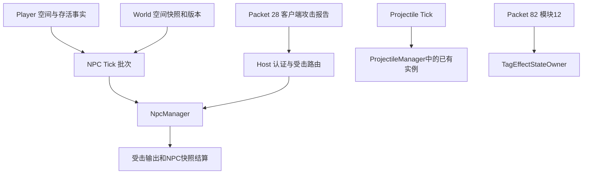

# Combat：战斗系统阅读入口

[返回总览](../README.md)

## 三个协作领域

Combat 将 NPC、弹幕和标签效果放在同一战斗项目中，但三者有各自的状态所有者。
它们使用共同的战斗身份契约，依赖捕获的玩家、世界和内容事实进行计算。

| 子系统 | 主要作用 | 状态所有者 | 阅读文档 |
| --- | --- | --- | --- |
| NPC | 出生、目标、AI、运动、生命、受击和退休 | NpcManager | [NPC](Npcs/README.md) |
| Projectile | 弹幕同步、AI、运动、碰撞、命中和终止 | ProjectileManager | [Projectile](Projectiles/README.md) |
| TagEffects | 玩家施加到特定 NPC 实例的标签、计时和命中附加效果 | TagEffectStateOwner | [TagEffects](TagEffects/README.md) |

## 身份、状态和规则怎样组合

[CombatEntityIdentity](Identity/CombatEntityIdentity.cs) 表达实体实例，
[ICombatEntityIdentityAuthority](Identity/ICombatEntityIdentityAuthority.cs) 由 Host 适配到
服务器共享身份注册表。NPC 槽位、弹幕运行时槽和协议编号不等于实例身份。
槽位重用后，旧受击请求、标签或追踪关系需要通过代次校验拒绝。

NPC、Projectile 都是带受控写入的聚合运行时对象，读取方使用 NpcView、ProjectileView。
规则计算返回计划或准备对象，Manager 校验身份、来源版本和作用域后提交。
网络包生产、连接选择和发送回执由 Host、Protocol 负责。

## 当前默认服务器的实际调用

默认 Tick 顺序中 NPC 在 Projectile 之前。NPC 阶段在准备前捕获玩家目标和有界世界空间
事实，提交时检查世界来源版本。Projectile 阶段推进已有实例的 AI 与到期生命周期。

普通 Packet 27/29 当前没有接入默认入站路由；完整弹幕移动、碰撞、命中与 TagEffect
附加效果也不能仅由领域服务存在来推断已串成运行链。查看功能时，应同时检查
[ServerComposition](../Host/ServerComposition.cs)、[默认 Tick](../Host/DefaultServerTickPhaseOwners.cs)
和 [Version4InboundRouter](../Host/Version4InboundRouter.cs)。

## 受击、掉落和客户端表现的边界

当前 NPC 受击入口接收客户端 Packet 28 报告，检查会话、玩家存活、NPC 网络代次及区块
交付，再交给伤害处理器。它尚不包含完整武器或弹幕来源验证。
服务端生命变化、客户端预测确认、受击表现和最终生命快照各有作用，输出顺序见 NPC 文档。

[NpcLootService](Npcs/NpcLootService.cs) 返回掉落意图。意图仍需 Host 与 Inventory
协调创建世界物品；不能把战利品规则存在等同于所有 NPC 战利品已接入。

## 建议阅读顺序

先沿 NPC 的 `Npc → NpcManager → NpcTickBatchOwner → Host 受击路由` 理解一个已接入流程，
再读 Projectile 的准备与提交模式，最后读 TagEffects 如何把玩家状态关联到 NPC 代次。
遇到跨系统状态变化，继续追踪参与者提交和输出结算，而不是在规则计算结果处停止。
