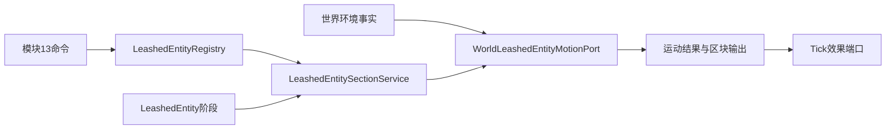

# Mechanisms：机关、图格实体与交互

[返回总览](../README.md) · [地形](../World/README.md) · [模块分发](../Modules/README.md)

## 作用与边界

本目录管理地形上需要额外状态或交互的对象：牌子、图格实体、晶塔、拴系实体，以及电路
传播、计时器和逻辑感应规则。方块本身仍在 WorldOwner 中，玩家位置和状态在 PlayerOwner
中。机关系统通过 Port、准备对象和 Host 适配器与它们协作。

## 主要状态与组件

| 部件 | 维护什么 | 协作方式 |
| --- | --- | --- |
| [TileEntityRegistry](TileEntityRegistry.cs) | 图格实体登记、创建、恢复和移除 | 共享身份适配器、World 锚点检查、状态投影 |
| [TileEntityRuntimeState](TileEntityRuntimeState.cs) | Handle、持久化 ID、网络 ID、锚点、物品、逻辑与生命周期 | Registry 控制写入，Projection 提供外部数据 |
| [SignRegistry](SignRegistry.cs) | 牌子位置和文本 | SignInteractionService 执行交互规则 |
| [TeleportPylonRegistry](TeleportPylonRegistry.cs) | 晶塔登记及位置 | PylonInteractionService 使用玩家、世界场景事实 |
| [LeashedEntityRegistry](LeashedEntityRegistry.cs) | 拴系对象锚点、实例及运动状态 | 模块、区块服务和运动 Port 共同驱动 |
| [MechanismCooldownService](MechanismCooldownService.cs) | 电路冷却 | 与地形变化一起准备、校验和提交 |

`PersistenceId`、`NetworkId` 和运行时 Handle 有不同用途；存档编号不能直接当成新世界的
活动实体身份。身份分配通过 [IMechanismIdentityAuthority](IMechanismIdentityAuthority.cs)
接入统一身份根。

## 图格实体和牌子交互

[TileEntityPacketHandler](TileEntityPacketHandler.cs)、[SignPacketHandler](SignPacketHandler.cs)
把协议输入交给 Registry 或交互服务。默认 Host 路由已有牌子和图格实体放置入口。
Registry 负责实例与状态，地形操作和范围认证仍需检查调用方。

创建、交互、移除的细节分别从
[TileEntityInteractionService](TileEntityInteractionService.cs)、
[TileEntityRemovalCoordinator](TileEntityRemovalCoordinator.cs) 和
[SignInteractionService](SignInteractionService.cs) 跟读。存在一种图格实体定义，不等于
所有家具放置和库存消耗协议都已完整实现。

## 晶塔如何跨系统传送

模块 7 → [TeleportPylonModuleHandler](TeleportPylonModuleHandler.cs) →
[PylonInteractionService](PylonInteractionService.cs)。服务使用晶塔登记、玩家捕获事实和世界
场景指标验证条件，通过 [PlayerMechanismTeleportPort](../Host/PlayerMechanismTeleportPort.cs)
准备玩家变化和区块需求。世界场景读取不能代替玩家身份和来源版本校验。

## 拴系实体如何每帧运行

[LeashedEntitySectionService](LeashedEntitySectionService.cs) 处理活动区块、重新进入区块时的
恢复和帧输出。[LeashedCritterMotionService](LeashedCritterMotionService.cs)、
[LeashedKiteMotionService](LeashedKiteMotionService.cs) 提供已支持原型的运动。
默认 [LeashedEntityServerTickPhaseOwner](../Host/LeashedEntityServerTickPhaseOwner.cs)
要求同时提供运动和效果端口：执行活动区块更新后必须消费结果。

## 电路规则的组合与当前接入范围

[WiringPropagationService](WiringPropagationService.cs) 计算传播计划；
[MechanismTimerService](MechanismTimerService.cs) 准备定时器 Tick；
[LogicSensorService](LogicSensorService.cs) 准备和提交逻辑感应变化。
地形效果通过 [MechanismWorldPort](MechanismWorldPort.cs) 准备到 WorldOwner。

定时器准备对象同时检查世界准备和冷却准备，在独占提交窗口中依次提交参与者；
输出要在提交成功后发布。这里的领域能力没有全部自动接入默认 Tick 或普通包路由，
需要逐项核对 [默认注册](../Host/DefaultServerTickPhaseOwners.cs) 和
[入站路由](../Host/Version4InboundRouter.cs)。

## 加载、区块与保存如何协作

Host 的 [WorldAttachmentHydrator](../Host/WorldAttachmentHydrator.cs) 将存档附件恢复到各
Registry，区块附件提供器捕获牌子和实体投影，
[WorldAttachmentPersistenceProjector](../Host/WorldAttachmentPersistenceProjector.cs)
将当前支持的附件状态投影回文档。恢复、发送和保存分别有自己的数据形状与版本边界。

建议按某一对象的 `Registry → RuntimeState → Interaction/Handler → Host → 保存投影`
顺序阅读，再进入电路和拴系运动，避免把所有机关理解为同一个全局更新过程。
