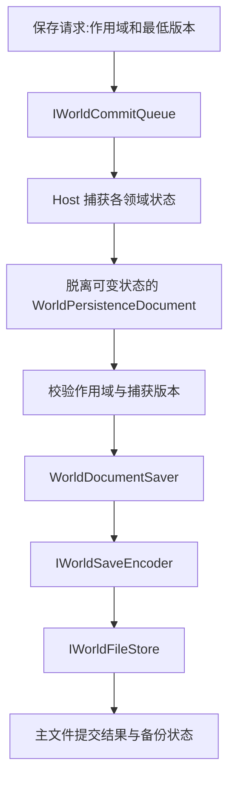

# Persistence：加载、保存、调度与停止

[返回总览](../README.md) · [世界状态](../World/README.md) · [Host](../Host/README.md)

## 作用与依赖边界

此目录将世界加载、恢复、保存和安全停止组织成明确阶段，并提供 Tick 调度契约。
文件读取、格式解码和文件提交由契约后的基础设施实现；WorldOwner 管理运行时地形，
Host 负责把各领域快照投影成要保存的文档。

目录并非程序集边界：WorldDocumentLoader 和 WorldDocumentLoadResult 由 Server 项目
编译，其余显式包含项见 [MinimalImplementation.Persistence.csproj](MinimalImplementation.Persistence.csproj)。
WorldDocumentWorldFactory 则位于 World 项目。

## 加载与恢复部件

| 部件 | 作用 |
| --- | --- |
| [WorldDocumentLoader](WorldDocumentLoader.cs) | 读取、解码并验证配置的世界文档 |
| [WorldDocumentRecoveryLoader](WorldDocumentRecoveryLoader.cs) | 按策略尝试主文件与恢复来源 |
| [WorldDocumentRecoveryCoordinator](WorldDocumentRecoveryCoordinator.cs) | 组织恢复选择和结果 |
| [WorldLoadCoordinator](WorldLoadCoordinator.cs) | 用候选文档组织多参与者的世界加载阶段 |
| [IWorldStateParticipant](IWorldStateParticipant.cs) | 描述各领域世界状态的准备、发布与清理参与者 |
| [WorldLoadStage](WorldLoadStage.cs)、[WorldLoadResult](WorldLoadResult.cs) | 记录阶段和失败边界 |

基本流程是“读取文件 → 解码文档 → 验证内容 → 准备领域候选 → 校验参与者 → 发布世界与附件”。
文档解码成功和世界已经可运行属于不同阶段。恢复结果也要记录实际来源，避免把备份文件
加载当成主文件修复完成。

## 世界生成与初始文档

[WorldInitialDocumentBuilder](WorldInitialDocumentBuilder.cs) 和
[WorldCreationCoordinator](WorldCreationCoordinator.cs) 提供创建初始文档的组合能力。
默认 Host 实际创建路径在 [P08BServerRuntime.TryCreateWorldDocumentAsync](../Host/P08BServerRuntime.cs)：
完整生成器 → GeneratedWorldDocumentFactory → 初始文档 → 保存/加载流程。
不能只阅读通用创建协调器就判断当前生成器的内容范围。

## 保存时组件怎样协作

[WorldDocumentSaveCoordinator](WorldDocumentSaveCoordinator.cs) 把捕获排进提交循环，检查
世界作用域和捕获版本不早于请求版本，然后只用脱离运行时的文档在循环外进行 I/O。
[WorldDocumentSaver](WorldDocumentSaver.cs) 调用编码器与文件存储，
[WorldDocumentSaveResult](WorldDocumentSaveResult.cs) 分别报告主文件提交与备份状态。
判断保存成功应查看 `IsPrimaryCommitted`，而不是仅看编码或备份完成。

关键契约位于 Contracts/Persistence：
[IWorldSaveEncoder](../Contracts/Persistence/IWorldSaveEncoder.cs)、
[IWorldFileStore](../Contracts/Persistence/IWorldFileStore.cs)、
[WorldPersistenceDocument](../Contracts/Persistence/WorldData/WorldPersistenceDocument.cs)。
Host 通过正式基础设施适配器装配具体文件格式与平台实现。

## 当前保存的状态范围

Host 的 `CaptureDocumentForSave` 以已加载文档为基础，合并 WorldOwner 的当前地形和头部、
箱子、牌子、图格实体，以及图鉴、旗帜、入侵、灯笼夜和世界范围创造能力状态。
相关入口是 [P08BWorldSnapshotProjector](../Host/P08BWorldSnapshotProjector.cs) 与
[WorldAttachmentPersistenceProjector](../Host/WorldAttachmentPersistenceProjector.cs)。

只修改运行时对象不会自动扩展保存范围。在线玩家背包、地面掉落物和诊断 NPC 的完整
运行时状态并未因此自动持久化进世界文件；应以捕获与投影中实际写入的区段为准。

## 停止时为什么要分阶段

[WorldStopCoordinator](WorldStopCoordinator.cs) 按以下顺序调用
[IWorldHostStopBoundary](IWorldHostStopBoundary.cs)：

1. 停止新连接准入。
2. 停止新 Tick 准入。
3. 排空已接受命令。
4. 按配置保存。
5. 关闭传输。
6. 退休世界和资源。
7. 停止提交循环。

`StopAsync` 共享一次完成任务，使重复停止不会重复执行整条链。各阶段有截止时间；失败时
保留失败阶段，并尝试后续有界清理。停止完成不能掩盖保存主文件提交失败。

## Tick 契约为什么在这里

[IServerTickPhaseOwner](IServerTickPhaseOwner.cs)、[ServerTickPhase](ServerTickPhase.cs)
与 [WorldTickScheduler](WorldTickScheduler.cs) 提供服务器编排边界，不是文件编解码算法。
调度器通过 IWorldCommitQueue 执行同步阶段动作，默认 60 Hz、最多追赶 4 帧。
无活动客户端时保留维护推进，游戏帧是否推进由 Host 提供的谓词决定。

阶段依次为 Player、Npc、Projectile、WorldItem、LeashedEntity、Time、World、Invasion、
PeriodicSync。注册检查阶段完整性和事务身份；Time/World 可共享同一个复合 owner。
具体游戏规则仍留在各领域，默认注册入口见 Host 文档。
