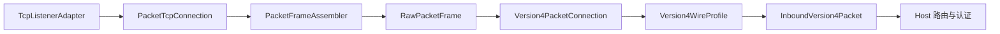

# Protocol：连接、帧与协议编解码

[返回总览](../README.md)。本目录把 TCP 字节转换为已解码消息，并将捕获的发送意图写回连接。
具体玩家、地形和战斗操作从 Host 路由进入领域系统。

## 接收链路

| 部件 | 作用 |
| --- | --- |
| [TcpListenerAdapter](TcpListenerAdapter.cs) | 监听和接受 socket，交接连接生命周期 |
| [PacketTcpConnection](PacketTcpConnection.cs) | 收发循环、队列、预算和连接关闭 |
| [PacketFrameAssembler](PacketFrameAssembler.cs) | 把分段收到的字节拼成完整帧，处理粘包与拆包 |
| [PacketFrameCodec](PacketFrameCodec.cs) | 读取或写入帧头、长度及消息信息 |
| [Version4PacketConnection](Version4PacketConnection.cs) | 将传输帧接到 Version4 解码和上层回调 |
| [Version4WireProfile](Version4WireProfile.cs) | 具体包的编码绑定、解码绑定和输出意图创建 |
| [Version4ModuleCodecs](Version4ModuleCodecs.cs) | Packet 82 模块负载编解码 |
| [ConnectionByteBudget](ConnectionByteBudget.cs) | 管理连接缓冲或发送占用的字节额度 |

## 收到的三份数据为什么不同

[InboundRawFrame](InboundRawFrame.cs) 保留传输获得的帧、连接与接收信息。
[InboundPacketEnvelope](../Contracts/InboundPacketEnvelope.cs) 由 Host 补充接收时的阶段及
作用域上下文。[InboundVersion4Packet](InboundVersion4Packet.cs) 进一步携带类型化解码结果。

进入领域前，Session 仍要校验当前阶段、绑定、序号及玩家身份。接收时合法的快照上下文
可能在等待提交期间失效，因此解码成功不能代替提交时的认证。

## 编解码依赖什么

[Version4ProtocolFactsInput](Version4ProtocolFactsInput.cs) 与
[Version4ProtocolFactsFactory](Version4ProtocolFactsFactory.cs) 提供协议所需的内容事实。
Host 的 [ProtocolFactsBootstrap](../Host/ProtocolFactsBootstrap.cs) 和
[Version4ProductionFacts](../Host/Version4ProductionFacts.cs) 负责装配实际数据。

[项目文件](MinimalImplementation.Protocol.csproj) 在 CoreCompile 前调用 WireCompiler，将
生成代码写到 Build/generated/MinimalImplementation.Protocol 下再参与编译。
阅读生成规则时进入 [Tools 指南](../Tools/README.md)，修改时应追溯生成源。

## 发送怎样与其他系统协作

领域 Producer 创建 OutboundPacketIntent，Host 确定目标会话和发送顺序，连接层写入 socket
并返回 SendReceipt。需要跟踪同步进度的系统使用 Settlement 回到提交循环确认结果。
发送失败或结果未知时，具体领域保留尚未确认的版本或快照，以便后续处理。

## 定位协议问题的顺序

1. 查帧长度、包 ID、模块 ID，判断错误发生在拆包还是类型解码。
2. 查 WireProfile 的绑定与所依赖的内容事实。
3. 查 Host 主路由是否有该消息的分支。
4. 查 Session 阶段和领域返回的拒绝原因。
5. 若客户端表现为不同步，再查输出顺序、目标、回执和结算。

当前默认装配忽略版本字符串限制，但普通消息仍可能缺少 Host route。
DebugCommandHandler 也是独立代码入口，不能由它的存在推断默认原版 TCP 路径使用了它。
