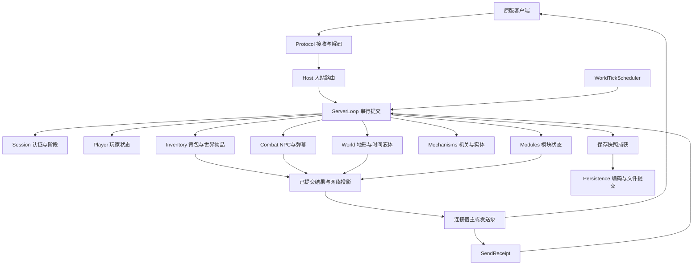

# 最小服务器源码阅读指南

本文及各目录 README 依据 **2026-10-22 当前工作区源码**编写。它们描述已经存在的调用关系，
用于读代码、定位问题和理解状态流转；具体实现以链接的源码为准。项目入口是
[MinimalImplementation.Server.csproj](MinimalImplementation.Server.csproj)，目标框架为 .NET 10。

## 1. 从哪里开始读

建议先沿着一条真实请求阅读，再进入领域细节：

1. [Program.cs](Program.cs)：解析参数、启动、等待退出、停止。
2. [P08BServerRuntime.cs](Host/P08BServerRuntime.cs)：装载世界、创建默认网络与 Tick 集成、保存和退出。
3. [ServerComposition.cs](Host/ServerComposition.cs)：查看每个系统的实例、依赖及注册关系。
4. [Version4InboundRouter.cs](Host/Version4InboundRouter.cs)：找到客户端请求进入哪个领域入口。
5. [DefaultServerTickPhaseOwners.cs](Host/DefaultServerTickPhaseOwners.cs)：找到持续更新的驱动入口。
6. [ServerOutboundDeliveryPump.cs](Host/ServerOutboundDeliveryPump.cs)：理解状态提交后如何发送并结算。

## 2. 各系统阅读入口

| 系统 | 主要作用 | 阅读文档 |
| --- | --- | --- |
| Host | 进程生命周期、系统装配、路由、提交循环、跨领域衔接 | [Host](Host/README.md) |
| Contracts | 会话、身份、版本、输入输出与持久化的共享契约 | [Contracts](Contracts/README.md) |
| Identity | 分配实例身份、世界作用域与代次，拒绝失效引用 | [Identity](Identity/README.md) |
| Protocol | TCP、拆包、编解码、发送预算与收发回执 | [Protocol](Protocol/README.md) |
| Session | 握手、玩家绑定、入服阶段、认证与断线清理 | [Session](Session/README.md) |
| Player | 玩家生命、移动、状态、出生、队伍与运行时空间信息 | [Player](Player/README.md) |
| World | 地形、区块、时间、液体、碰撞查询与地形修改准备 | [World](World/README.md) |
| Inventory | 背包、箱子、世界物品、归属、丢弃和跨存储事务 | [Inventory](Inventory/README.md) |
| Combat | 战斗领域的总入口和子系统关系 | [Combat](Combat/README.md) |
| NPC | NPC 身份、AI、生命、受击、死亡与同步 | [NPC](Combat/Npcs/README.md) |
| Projectile | 弹幕实例、AI、移动、命中、结束与玩家追踪关系 | [Projectile](Combat/Projectiles/README.md) |
| TagEffects | NPC 标签效果、持续状态及命中效果计算 | [TagEffects](Combat/TagEffects/README.md) |
| Mechanisms | 牌子、图格实体、电路规则、晶塔和拴系实体 | [Mechanisms](Mechanisms/README.md) |
| Modules | Packet 82 的 15 个模块、聊天、图鉴、旗帜及世界事件 | [Modules](Modules/README.md) |
| Creative | 创造能力、权限、研究上报与按接收者结算 | [Creative](Modules/Creative/README.md) |
| Persistence | 加载、恢复、保存、停止协议与 Tick 调度契约 | [Persistence](Persistence/README.md) |
| Verification | 既有验证项目的目录与阅读用途 | [Verification](Verification/README.md) |
| Tools | 协议代码生成工具和生成输出入口 | [Tools](Tools/README.md) |

目录与程序集不是一一对应。Player、Session、Identity、Inventory、Host 的源码由 Server
项目编译；World、Combat、Mechanisms、Protocol、Persistence、Contracts 等有独立项目。
最终边界应查看各 csproj 的 ProjectReference 与 Compile，不能仅由命名空间推断。

## 3. 系统、组件与状态如何分工

本实现同时使用 Owner、Manager、Store、Coordinator、规则计算和只读快照。
这里“组件”包含这些协作部件，也包含玩家生命、移动等状态对象。
当前 Player、Npc、Projectile 仍有聚合运行时对象；阅读时不能假定所有状态已经注册进统一 ECS。

| 部件 | 负责什么 | 实际例子 |
| --- | --- | --- |
| 运行时状态 | 保存某个玩家、NPC、世界物品当前的值 | PlayerVitals、Npc、WorldItemRuntime |
| Owner / Manager / Store | 保管并提交权威状态，检查身份和版本 | PlayerOwner、NpcManager、WorldItemStore |
| Rules / Planner | 根据已捕获的数据算出规则结果或修改计划 | NpcDamageRules、WorldTreeHarvestRules |
| Coordinator / Preparation | 组合参与者，准备、校验并提交跨状态操作 | WorldItemTransactionCoordinator |
| Snapshot / View | 把某个版本的数据交给其他系统读取 | WorldSpatialSnapshot、NpcView |
| Adapter / Handler | 把网络、文件和领域操作连接起来 | Version4InboundRouter、WorldDocumentLoader |
| Projection / Producer | 将已提交结果转换为发送内容 | NpcNetworkProjection、WorldItemProjectionProducer |
| Settlement | 根据发送结果结算快照，处理重试和过期版本 | NpcSnapshotDeliverySettlement |

一次操作通常经过“读取事实 → 计算计划 → 校验 → 提交 → 产生输出 → 结算回执”。
每一阶段是否存在、是否跨系统，由具体代码决定；并非所有入口都统一实现同一种事务。

## 4. 整体协作图

这是协作关系图。并非每个输出都走发送泵：路由器也会发送当前请求的回复；发送顺序由
连接宿主的 OutboundTurn 等边界协调。文件 I/O 与异步发送在提交窗口外进行。

## 5. 一帧怎样执行

调度顺序由 [ServerTickPhase.cs](Persistence/ServerTickPhase.cs) 定义，而不是文件排列顺序：

| 顺序 | 阶段 | 默认驱动 |
| --- | --- | --- |
| 1 | Player | PlayerServerTickPhaseOwner → PlayerUpdateService |
| 2 | Npc | 内置 NpcServerTickPhaseOwner → NpcTickBatchOwner |
| 3 | Projectile | ProjectileServerTickPhaseOwner → ProjectileAiService |
| 4 | WorldItem | 内置 WorldItemServerTickPhaseOwner → 所有权选择与物品更新 |
| 5 | LeashedEntity | LeashedEntityServerTickPhaseOwner |
| 6–7 | Time、World | WorldTickPhaseCompositeOwner，共享一次 WorldTickCoordinator 提交 |
| 8 | Invasion | 内置 InvasionServerTickPhaseOwner，消费世界 Tick 的结果 |
| 9 | PeriodicSync | ModulePeriodicSyncOwner，捕获脏快照并排队发送 |

[WorldTickScheduler](Persistence/WorldTickScheduler.cs) 按 60 Hz 排队，限制积压时的追赶次数。
默认集成只有存在 Active 会话才推进游戏帧；无 Active 玩家时仍有维护计数。
Time、World 的复合注册避免一次游戏帧把同一世界事务推进两次。

## 6. 三条适合跟读的完整流程

### 入服并看到地形

连接建立并分配 SessionEpoch → Hello/密码检查 → 玩家和槽位绑定 → 上传玩家数据 →
请求世界信息 → 请求初始区块 → 玩家、NPC、物品和模块快照同步 → 发送完成情况结算 →
Spawn 请求 → Active。移动后，PlayerControls 路径继续捕获应发送的新区块。

重点阅读 [Session](Session/README.md) 与
[区块请求协调器](Host/WorldSectionRequestCoordinator.cs)。

### 砍树、掉落、捡起

Packet 17 → 认证和区块基线排队记录检查 → WorldTreeHarvestRules 算树干与掉落 →
准备地形修改和世界物品创建 → 同一物品事务协调地形参与者提交 → 输出地形与物品 →
分配客户端物品所有权 → 客户端拾取并发 Packet 151，随后上传背包变化。

当前原版拾取路径中，Packet 151 只退休世界物品，不在服务端再次增加背包，避免重复入账。
详见 [Inventory](Inventory/README.md) 和 [地形路由](Host/Version4InboundRouter.Terrain.cs)。

### 攻击 NPC

Packet 28 → 认证玩家与 NPC 槽位/网络代次检查 → 返回预测攻击确认 Packet 162 →
NpcCombatPacketHandler 计算并提交受击 → 给旁观者发送受击 Packet 28 → 同步生命 Packet 23 →
按发送回执处理脏状态和致死退休。详见 [NPC](Combat/Npcs/README.md)。

## 7. 判断功能状态时看哪里

编解码绑定齐全、模块编号齐全、Tick 阶段齐全，分别说明边界注册形状；它们不能独立证明
每种物品、机关、NPC 或所有原版请求都已实现。

- 某个普通包是否接通：看 Version4InboundRouter 的 switch 和各 partial 文件。
- 某个 Packet 82 模块是否接通：看 ServerComposition.CreateModuleDispatcher。
- 某项持续行为是否执行：看默认 Tick 注册及对应 owner 的 Advance。
- 某个类型是否支持：看内容目录、规则表和 NotReady/Unavailable 分支。
- 某项状态是否保存：看 CaptureDocumentForSave 与各保存 projector。

例如，当前默认入站路由没有普通弹幕 Packet 27/29 的处理分支；弹幕领域有实现和 Tick
注册仍不足以说明客户端弹幕流程完整。QuickStack 分类和合成材料目录在默认装配中也使用
空配置。各领域 README 会说明这些接入限制。

## 8. 阅读中的身份与确认边界

不要混用 SessionEpoch（一次连接）、WorldScopeId（身份世界范围）、WorldEpoch（世界发布代次）、
EntityGeneration（实例代次）与 CommitVersion/Revision（状态版本）。跨系统操作需要明确映射。

状态提交成功、编码成功、排入发送队列、写入本地 socket、客户端应用，是不同阶段。
SendReceipt 中的 LocallySent 只能确认本地发送；保存成功则应检查主文件是否实际提交。

文档维护时，请同时更新装配、路由、Tick、快照和持久化涉及的章节，并保持相对源码链接有效。
