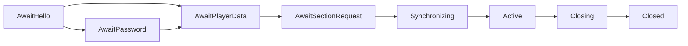

# Session：连接、认证与入服阶段

[返回总览](../README.md) · [网络边界](../Protocol/README.md) · [玩家状态](../Player/README.md)

## 作用与边界

Session 管理一次连接从握手到关闭的过程，并把连接绑定到当前玩家实例。
它回答“这个请求是谁发的、现在能做什么、是否属于仍然有效的连接”。玩家生命、
背包和地形由其他系统维护；Session 为这些操作提供认证后的绑定和阶段约束。

## 主要协作部件

| 部件 | 保存或处理的内容 | 与其他部件的关系 |
| --- | --- | --- |
| [SessionAdmissionCoordinator](SessionAdmissionCoordinator.cs) | 会话记录、阶段、入站序列、提交版本 | 执行握手、认证和准备好的阶段转换，使用 PlayerOwner 和 BindingStore |
| [SessionAdmissionPolicy](SessionAdmissionPolicy.cs) | 协议标识、密码和准入配置 | 决定 Hello、密码等请求是否可以继续 |
| [SessionBindingStore](SessionBindingStore.cs)、[SessionBinding](SessionBinding.cs) | SessionEpoch、玩家槽位和 EntityHandle 的映射 | 防止重用槽位接收旧连接的数据 |
| [SessionPacketHandlers](SessionPacketHandlers.cs) | 握手相关包的领域入口 | 将解码结果交给准入协调器 |
| [JoinCoordinator](JoinCoordinator.cs) | 世界信息和初始区块的阶段推进 | 通过 Host 回调捕获世界、玩家和其他实体同步批次 |
| [JoinSynchronizationBatch](JoinSynchronizationBatch.cs) | 一次入服捕获的输出及交付信息 | 交给 Host 编码、发送和结算 |
| [SessionHostAuthorization](SessionHostAuthorization.cs) | HostToken 授权 | 与玩家的 CountsAsHostForGameplay 分开处理 |
| [SessionCloseCoordinator](SessionCloseCoordinator.cs) | 关闭上下文与幂等清理结果 | 通知玩家和其他系统释放该会话的依赖状态 |

## 阶段怎样协作

[SessionStage](SessionStage.cs) 定义以下阶段；密码阶段是否经过由准入策略决定：

图中展示成功入服主路径。错误、踢出和断开可以从更早阶段进入关闭流程。
`Synchronizing` 表示正在交付初始内容；不能仅因已经生成了区块输出就认为客户端可以开始游戏。

一次入服的源码跟读顺序：

1. [ServerConnectionHost](../Host/ServerConnectionHost.cs) 接受连接、分配 SessionEpoch。
2. [Version4InboundRouter](../Host/Version4InboundRouter.cs) 将 Hello、密码和玩家包交给对应入口。
3. AdmissionCoordinator 检查阶段并建立绑定；玩家内容交给 PlayerOwner。
4. Packet 6 触发世界信息回复，Packet 8 触发初始区块捕获。
5. [区块路由](../Host/Version4InboundRouter.Sections.cs) 与
   [入服快照](../Host/Version4InboundRouter.JoinSnapshots.cs) 组合地形、玩家、NPC、物品和模块输出。
6. Host 记录交付状态；初始同步完成后，Spawn 路径才允许玩家进入 Active。

## 认证不是读取包里的玩家编号

`ExecuteAuthenticatedPlayerPacket` 用信封的 Epoch、序列、允许阶段及当前绑定校验请求，
把绑定解析出来的玩家交给操作。包内玩家槽位属于输入，不能用它跨过绑定直接修改任意玩家。
准备过的阶段转换也需要在提交时重新校验，避免用旧状态推进会话。

`SessionEpoch` 标识一次连接，`EntityHandle` 标识玩家运行时实例。槽位相同并不代表实例相同；
重连后保留的旧请求或旧发送回执不能作用于新玩家。

## 区块与移动为什么需要 Host

Session 管理入服阶段；实际区块范围、编码和每会话交付账本由
[WorldSectionRequestCoordinator](../Host/WorldSectionRequestCoordinator.cs) 及
[WorldSectionDeliveryLedger](../Host/WorldSectionDeliveryLedger.cs) 处理。
进入世界后的 PlayerControls 继续触发移动区块捕获，因此“已入服”和“后续地形持续加载”
是两个需要分别跟踪的流程。

## 关闭时如何协作

关闭协调器先准备通知和依赖释放，再完成会话与玩家清理。Host 的
[关闭路由](../Host/Version4InboundRouter.Close.cs) 释放待处理丢弃、箱子访问、世界物品归属、
战斗所有者引用、模块重放状态与区块跟踪。清理以原 Epoch 为边界，防止误删新连接的状态。

## 阅读和排查入口

- 卡在发现服务器或入服：先看准入阶段、最后收到的消息 ID，再看初始区块发送与结算。
- 入服后普通操作被拒绝：看 Active 条件、绑定、Epoch 和入站序列。
- 重连后出现旧状态：看 CloseCoordinator 与各系统的会话退休入口。

默认装配当前使用 `Terraria319` 准入标识并设置 `ignoreProtocolVersion: true`，见
[ServerComposition](../Host/ServerComposition.cs)。这只影响握手版本门禁；包布局和世界文件
编码仍必须各自匹配。Session 本身不提供任意版本协议转换。
