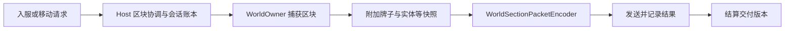

# World：地形、区块、时间与液体

[返回总览](../README.md) · [物品事务](../Inventory/README.md) · [持久化](../Persistence/README.md)

## 作用与边界

[WorldOwner](WorldOwner.cs) 保管当前世界的权威地形、头部信息、液体运行状态及脏区块版本。
它提供快照、规则操作和准备后提交入口。网络会话、背包、NPC、文件路径和 socket
由各自系统维护；Host 将这些系统与世界操作连接起来。

## 状态与协作部件

| 部件 | 内容和职责 |
| --- | --- |
| [WorldTile](WorldTile.cs) | 单格方块、墙、帧、液体等值；不是独立网络连接或文件对象 |
| [WorldSnapshot](WorldSnapshot.cs) | 世界及头部快照，包括几何、出生点、时间、WorldEpoch 和版本 |
| [WorldSpatialSnapshot](WorldSpatialSnapshot.cs) | 指定范围内脱离可变世界的空间读取数据，供碰撞和规则计算使用 |
| [WorldFacts](WorldFacts.cs) | 方块内容属性及规则所需事实 |
| [WorldOwner](WorldOwner.cs) | 准备、发布、修改、捕获、确认脏状态和卸载世界 |
| [WorldTileMutationPreparation](WorldTileMutationPreparation.cs) | 带世界代次及基础版本的地形修改准备对象 |
| [WorldTickCoordinator](WorldTickCoordinator.cs) | 把一次时间与液体推进组合成一个世界 Tick 事务 |
| [WorldSectionTransferCoordinator](WorldSectionTransferCoordinator.cs) | 区块传输所需的领域准备和范围处理 |
| [LiquidSimulation](LiquidSimulation.cs)、[LiquidRules](LiquidRules.cs) | 液体队列、局部更新和合并等模拟规则 |

`WorldEpoch` 区分世界发布代次，`CommitVersion` 区分当前世界状态版本。
旧世界快照不能用于新发布的世界；同一世界的旧准备对象也不能跳过版本校验提交。

## 世界从哪里来

加载路径由 [WorldDocumentLoader](../Persistence/WorldDocumentLoader.cs) 取得文件文档，
[WorldDocumentWorldFactory](WorldDocumentWorldFactory.cs) 将文档转换为世界准备数据，
最后通过 WorldOwner 校验并发布。

创建路径在 [P08BServerRuntime](../Host/P08BServerRuntime.cs) 的
`TryCreateWorldDocumentAsync`：调用完整世界生成库，再由
[GeneratedWorldDocumentFactory](../Host/GeneratedWorldDocumentFactory.cs) 将生成结果转换为
文档。转换器检查非空地形及 FrameImportant 等内容事实，并构造保存区段。
这里的运行时世界、生成器输出和 WorldFile 文档是三个不同的数据形状。

## 区块如何交付给客户端

WorldOwner 负责提供某个版本的地形，Host 的
[WorldSectionRequestCoordinator](../Host/WorldSectionRequestCoordinator.cs) 负责请求和移动范围，
[WorldSectionPacketEncoder](../Host/WorldSectionPacketEncoder.cs) 负责网络格式，
[WorldSectionDeliveryLedger](../Host/WorldSectionDeliveryLedger.cs) 负责每个会话的交付情况。
“区块是脏的”和“某玩家已收到区块”属于不同记录，不能互相替代。

## 破坏、放置与掉落如何保持一致

普通地形操作首先经过 Host 的 [地形路由](../Host/Version4InboundRouter.Terrain.cs)
进行会话、位置与区块基线排队记录检查，再使用具体规则：

- [WorldTileDropRules](WorldTileDropRules.cs)：支持的方块或植物掉落规则。
- [WorldTreeHarvestRules](WorldTreeHarvestRules.cs)：树木受击范围、树干移除与掉落计算。
- [WorldFraming](WorldFraming.cs)：修改后相关方块帧处理。
- [WorldDoorOperations](WorldDoorOperations.cs)：门操作的领域规则。

需要掉落物时，地形修改准备对象与 WorldItemSpawn 一起进入物品事务；
[TileItemTransactionParticipant](../Host/TileItemTransactionParticipant.cs) 将地形校验和提交
加入该事务。放置则组合库存消耗准备。先完成全部校验再提交，避免掉落成功但地形未变，
或者扣了物品却没放下方块。

具体支持范围由规则表、路由操作及 Unavailable/拒绝分支决定，不能由一个通用方法名推断
全部家具、多格物体或树种均已支持。

## 时间和液体如何推进

[WorldTickScheduler](../Persistence/WorldTickScheduler.cs) 在提交循环里驱动
[WorldTickPhaseCompositeOwner](../Host/WorldTickPhaseCompositeOwner.cs)。Time、World
两个阶段共享一次 WorldTickCoordinator 提交，防止一帧重复推进。
协调器校验 Tick 顺序、世界代次和来源版本，再返回时间变化、液体变化和合并事实。
跨系统效果需要调用方消费这些事实，不会因返回结果而自动完成。

液体模拟还有 [准备逻辑](LiquidSimulation.Preparation.cs)、[紧急处理](LiquidSimulation.Panic.cs)
和 [ILiquidRandomSource](ILiquidRandomSource.cs)。Packet 82 模块 0 的直接液体赋值与
完整模拟是不同入口，阅读时应跟随具体调用。

## 保存和输出边界

保存使用 `CaptureSaveSnapshot`，由 Host 合并当前附件和模块状态后交给持久化层编码。
脏区块、脏液体的确认按捕获版本处理；旧回执不能清除更新版本的脏标记。
周期同步器只捕获其明确注册的输出，不能假定 WorldOwner 的全部脏状态都会自动广播。

排查“世界为空”先核对加载和生成的实体方块，再看区块编码与发送；排查“修改重进后消失”
则沿地形提交、保存捕获、主文件提交和再次加载分别确认。
