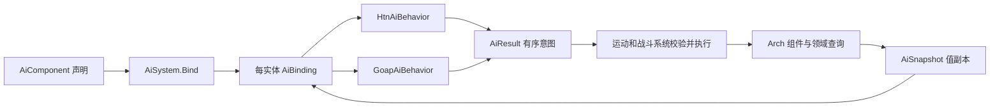
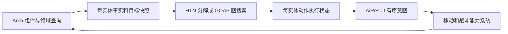

# AI 核心

此目录提供统一的 AI 行为绑定与计算入口，底层支持 FluidHTN 分层任务网络和 CrashKonijn
GOAP 目标规划。实体通过 `AiComponent` 声明 C# 行为绑定；Projectile、NPC、Player 等领域
可以提供自己的行为选择键、能力/状态组件和 `AiBehavior<TIntent>` 实现，但行为执行仍统一归入
本 AI 系统。宿主读取
组件快照，统一调用 `AiBinding<TIntent>.Calculate`，取得 `AiResult<TIntent>`。移动、攻击、
伤害和其他领域组件更新由消费意图的能力系统提交。AI 行为只返回独立结果；需要更新 Arch
组件时由对应领域适配器在提交边界完成，AI 绑定本身不直接写 Arch。共享库没有 Arch 依赖，
宿主可以显式注册绑定和 NPC 适配器到 EcsServer；行为目录、快照提供者和生命周期仍由宿主
负责，不自动发现。

实体类型、初始组件组合和创建依赖见 [实体定义与组件协作](../Entity/README.md)。实体定义
不拥有 AI 运行态；`AiEntitySystem` 只维护实体键到绑定的关联，并把计算结果交回宿主。

宿主也可以实现 `IAiSnapshotProvider<TEntity>`，让 `AiEntitySystem.Calculate` 根据绑定暴露的
`RequiredComponents` 读取 Arch 组件并生成一次性的 `AiSnapshot`。Provider 只负责投影输入，不能
在捕获过程中修改权威组件；实体有效性、世界作用域和 generation 校验仍由宿主负责。

## Arch 集成与粒度

Arch 中有几种不同的粒度，不能把它们都叫作“组件”：

| 粒度 | Arch/NSSLC 表达 | 是否附加到实体 |
| --- | --- | --- |
| ECS 状态原子 | `AiComponent`、行为选择、行为状态、目标、感知事实和能力组件 | 是 |
| AI 功能组合 | `AiComponent + AiBehaviorSelectionComponent + NpcBehaviorStateComponent + NpcTargetComponent` 等组件签名 | 是，以多个组件组合存在 |
| 每实体算法运行态 | `AiBinding<TIntent>` 中的 Planner、GOAP Agent、Context 和动作状态 | 否，由宿主按实体键持有 |
| 共享 AI 规则入口 | `AiSystem<TIntent>`，注册行为工厂并创建绑定 | 否，不持有实体或 Arch World |
| Arch 调度适配器 | `BaseSystem<World, EcsServerTickContext>`，查询组件、捕获快照和消费意图 | 是一个系统对象，不是实体组件 |

因此，“AI 由更小组件组成”是正确的 ECS 组合；“AI 系统本身是原子组件”需要分清语义：
从实体能力查询的角度，`AiComponent` 可以作为一个原子声明，表示实体接入 AI；从规则和
运行时的角度，`AiSystem`、`AiBinding` 和 Arch 适配器仍是系统/运行时对象，不能把它们的
引用、World、Planner 或字典放进 `AiComponent`。一个功能模块可以在模块层面作为整体注册，
但它的实体状态仍必须拆成可查询的组件。

推荐的实体组合如下：

```text
AiComponent
  = 已注册 C# 行为的声明和启用状态
AiBehaviorSelectionComponent
  = BehaviorId + ProfileId，选择内容行为和参数定义
NpcBehaviorStateComponent
  = 当前阶段、决策冷却和有限的可观察运行态
NpcTargetComponent
  = 当前目标关系或目标版本
MovementCapabilityComponent / AttributeSetComponent / Combat 状态
  = AI 只读的能力与事实来源
```

这些组件分别拥有自己的写入者。AI 查询可以要求完整组合，也可以只要求当前行为需要的
子集；没有某项能力的实体不会因为 AI 系统存在而自动获得默认组件。

### 创建和绑定

创建 Arch 实体时，把 `AiComponent` 和实体真正拥有的状态组件放进同一个初始组合：

```csharp
using Arch.Core;
using System.Numerics;
using Terraria.Ai;
using Terraria.Ai.Examples;
using Terraria.Combat;
using Terraria.Entity;
using Terraria.Movement;

using World world = World.Create();
Entity entity = world.Create(
    new EntityIdentityComponent(EntityUuid.Create()),
    AiComponent.For<SlimeAiBehavior>(),
    LocationComponent.At(100f, 200f),
    new VelocityComponent(Vector2.Zero));
```

`World.Create` 只负责 Arch 的句柄、Archetype 和组件存储。服务器宿主随后用自己的
`EntityRuntimeHandle` 索引把这个 Arch `Entity` 绑定到 `AiEntitySystem`：

```csharp
AiSystem<ExampleAiIntent> aiSystem = ExampleAiUsage.CreateSystem();
AiEntitySystem<EntityRuntimeHandle, ExampleAiIntent> aiEntities = new(aiSystem);

// handle 由实体生命周期宿主分配，并包含 EntityUuid、WorldScope 和 Generation。
aiEntities.Attach(handle, world.Get<AiComponent>(entity));
```

`AiEntitySystem` 不需要知道 Arch API；Arch 句柄到 `EntityRuntimeHandle` 的映射属于宿主。
这样实体槽位复用、世界切换和实体销毁时，可以先按完整运行时句柄 `Detach`，再释放 Arch
实体，而不会把旧绑定交给新实体。

### 查询、快照和意图

Arch 适配器是连接两边的唯一位置：它查询实体组件，复制成快照，调用绑定，再把意图交给
领域系统。下面是结构示例；`runtimeHandles` 和 `intentBuffer` 是宿主拥有的索引/请求端口，
不是 AI 组件：

```csharp
QueryDescription query = new QueryDescription()
    .WithAll<EntityIdentityComponent, AiComponent, LocationComponent, VelocityComponent>();

world.Query(in query, (Entity entity,
    ref EntityIdentityComponent identity,
    ref AiComponent ai,
    ref LocationComponent location,
    ref VelocityComponent velocity) =>
{
    EntityRuntimeHandle handle = runtimeHandles.Resolve(entity, identity.Id);

    // 从多个权威组件生成独立的 unmanaged 事实；不把 AttributeSet 或集合引用传进去。
    AiSnapshot snapshot = AiSnapshot.Empty
        .With(new ExampleMovementComponent(
            location.Coordinates,
            IsGrounded: false,
            JumpReady: true));

    AiEntityResult<EntityRuntimeHandle, ExampleAiIntent> result =
        aiEntities.Calculate(handle, ai, snapshot, deltaTime);

    foreach (ExampleAiIntent intent in result.Result.Intents)
    {
        intentBuffer.Enqueue(handle, intent);
    }
});
```

快照类型是**输入投影**，不是第二份权威组件。一个行为需要多个小组件时，Provider 可以从
`LocationComponent`、`VelocityComponent`、`GroundingComponent`、`AttributeSetComponent` 和
目标关系合成一个或多个 `unmanaged` fact；`AttributeSetComponent`、`BuffListComponent`
和其他集合不能直接放入 `AiSnapshot`。`AiRequirements` 检查的是这些快照值的精确类型，
不是让 AI 在运行时自行搜索 World。

### 调度和写入闭包

建议把 Arch 适配器注册到现有 `EcsServer` 的 Preparation 阶段：

```text
Preparation
  Arch 查询 → 快照 → AiBinding.Calculate → MovementIntent / CombatIntent
Simulation
  MovementIntentResolver → SpatialSimulationCoordinatorSystem
Commit
  Combat admission/mitigation/commit → LifeComponent
```

AI 只能产生请求。`MovementIntent` 可以由 AI 适配器写入或排入宿主请求端口，但
`LocationComponent`、`VelocityComponent`、目标 `LifeComponent`、Inventory 和 Attributes
仍由各自领域系统写入。能力系统必须重新检查实体是否存活、目标版本、范围、碰撞和资源，
然后在自己的提交阶段应用结果。

如果 AI 的启用状态、行为类型或目标关系发生变化：

1. 需要结构变化时，用 `EcsServerCommandBuffer` 延迟 `Add`、`Remove` 或 `Set`，不要在
   正在遍历的 Arch 查询中改变组件组合；
2. 结构提交完成后，由生命周期/AI 适配器执行 `Attach`、`Rebind` 或 `Detach`；
3. `Rebind` 先返回旧行为的停止意图，宿主消费这些意图后再继续新行为；
4. 销毁实体或卸载世界时执行 `Stop → 消费结果 → Dispose → Destroy`。

如果“AI 系统本身是原子模块”意味着调用方希望一个统一入口，可以保留一个模块门面，
例如 `NpcAiModule` 同时注册感知、目标选择、AI 决策和意图适配器；但这些内部对象仍按
读写集和提交阶段注册为 Arch 系统，不能把门面实例作为 `AiSystemComponent` 附到每个实体。

## Projectile、NPC 与 Player 的统一行为模型

三类实体使用同一个 `AiSystem<TIntent>`、`AiBinding<TIntent>`、`AiRequirements`、
`AiSnapshot` 和 `AiResult<TIntent>`。差异只来自行为实现、快照提供者、意图类型和领域适配器：

| 领域 | 行为选择 | 行为运行态 | 结果适配器 |
| --- | --- | --- | --- |
| Projectile | `AiBehaviorSelectionComponent` 的 `BehaviorId`/`ProfileId` | `ProjectileBehaviorStateComponent` 及追踪、反弹等能力状态 | Projectile AI 适配器、空间和战斗系统 |
| NPC | `AiBehaviorSelectionComponent` 的 `BehaviorId`/`ProfileId` | `NpcBehaviorStateComponent`、目标和战斗状态 | NPC AI 适配器、空间和战斗系统 |
| Player | 玩家行为声明或已验证控制意图 | Player 行为状态或宿主输入状态 | Player 控制适配器、空间和战斗系统 |

因此不建立三套独立的 `ProjectileBehaviorSystem`、`NpcBehaviorSystem` 和 `PlayerBehaviorSystem`
作为 AI 引擎。领域适配器可以存在，但只做三件事：从领域组件形成快照、消费共享 AI 结果、
在提交边界写入该领域拥有的运行态或产生 `MovementIntent`/`CombatIntent`。共享 AI 不直接写
`LocationComponent`、`VelocityComponent`、目标 `LifeComponent`、Buff 列表或属性集合。

NPC 的组件职责固定为：

```text
AiComponent
    = C# AiBehavior<TIntent> 的绑定声明
AiBehaviorSelectionComponent
    = BehaviorId + ProfileId，选择内容行为和不可变参数
NpcBehaviorStateComponent
    = 当前阶段、阶段进入 Tick、决策冷却、动作阶段和有限的可观察行为槽位
NpcTargetComponent
    = 当前目标关系
NpcCombatStateComponent
    = 攻击请求或受击过程的领域状态
```

`NpcBehaviorStateComponent` 不是 Planner 容器，也不是 NPC 的全部状态收容处。HTN Planner、
GOAP Agent、Context、World、Arch Entity、服务引用和其他算法运行态由每个实体的 `AiBinding`
持有。追踪、反弹、重力等能力的动态状态继续放在各自能力组件中；目标、战斗、出生、归家和
掉落也不塞入行为状态组件。

属性和 Buff 只能作为 AI 的只读事实输入。NPC、Player、Projectile 或其他实体是否拥有
`AttributeSetComponent`、`BuffListComponent`、`BuffImmunityComponent` 以及共享的 Buff 接收
策略，由 ECS 组件组合表达；Buff 系统和属性系统是这些组件的权威写入者。AI 可以据此判断
减速、眩晕、免疫、攻击能力或资源是否可用，但必须通过意图请求由 Buff、Attribute、Movement
或 Combat 系统提交结果。由于 `AiSnapshot` 的输入必须是独立的 `unmanaged` 值，快照提供者
应把这些组件解析成不可变的属性/状态事实投影（例如当前移动速度倍率、是否眩晕、可接受的
效果类别），不能把 `AttributeSetComponent`、`BuffListComponent` 或其内部集合直接塞入
快照，也不能让 AI 持有组件引用。

如果实体仍然存在但 AI 行为声明改变，使用 `Rebind`。它先停止旧行为并返回清理意图，再安装
新的独立运行态；替换失败时旧绑定仍保留。不要仅把 `AiComponent` 字段改成新类型后继续使用
旧 `AiBinding`。

## 领域行为选择与统一对外 API

`AiComponent.BehaviorType`、领域组件中的 `BehaviorId` 和 `ProfileId` 分属不同层次：

| 标识 | 用途 |
| --- | --- |
| `AiComponent.BehaviorType` | C# `AiBehavior<TIntent>` 的绑定类型 |
| `BehaviorId` | 内容领域稳定的行为选择键 |
| `ProfileId` | 不可变行为参数配置键 |

Definition/Lifecycle Resolver 负责确认行为键、Profile 和 C# 行为注册兼容后，才调用
`AiSystem<TIntent>.Bind`。共享 AI 系统不在运行时各处重复 `switch (BehaviorId)`。
追踪、反弹、重力等能力由具体组件是否存在表达，行为通过 `AiRequirements` 声明自己需要的
组件快照和只读事实；能力系统和空间系统负责提交结果。

## 统一对外 API

| 类型 | 职责与拥有的状态 |
| --- | --- |
| `AiComponent` | 普通 ECS 声明组件，保存行为类型和启用状态 |
| `AiSystem<TIntent>` | 注册行为工厂，创建绑定；不保存实体或世界 |
| `AiBinding<TIntent>` | 每实体运行时，控制计算、依赖校验、停止与释放 |
| `AiRequirements` | 不可变的 AI 快照输入类型集合 |
| `AiSnapshot` | 按精确类型索引的组件值副本 |
| `AiBehavior<TIntent>` | 两个适配器共同遵守的需求、输入、输出与生命周期契约 |
| `HtnAiBehavior<TContext,TIntent>` | 刷新 HTN Context，推进 Planner，再收集意图 |
| `GoapAiBehavior<TEnvironment,TIntent>` | 刷新 GOAP 事实和目标，推进 Agent，收集意图 |
| `AiOutput<TIntent>` | 当前调用内的有序意图和警告收集器，不能在调用外写入 |
| `AiResult<TIntent>` | 独立持有的只读结果，包含状态、意图、警告、缺失输入类型 |

组件保存数据，绑定保存算法运行态。`IAiBehavior` 仅提供共同的元数据；注册工厂必须返回
`AiBehavior<TIntent>` 派生类，保证两种算法都经过统一的绑定入口。



两种 AI 的调用完全相同，只需在绑定时选择行为：

```csharp
using System.Collections.Generic;
using System.Numerics;
using Terraria.Ai;
using Terraria.Ai.Examples;

AiSystem<ExampleAiIntent> system = ExampleAiUsage.CreateSystem();
AiComponent component = AiComponent.For<SlimeAiBehavior>();
// GOAP 可改为 AiComponent.For<AttackGoapAiBehavior>()，其余调用相同。
using AiBinding<ExampleAiIntent> binding = system.Bind(component);

// 宿主从真实组件或领域查询取得这些副本。示例值不读取任何实体。
AiSnapshot snapshot = AiSnapshot.Empty
    .With(new ExampleMovementComponent(Vector2.Zero, IsGrounded: true, JumpReady: true))
    .With(new ExampleTargetComponent(new Vector2(100f, 0f), true, true, Revision: 1))
    .With(new ExampleAttackFeedbackComponent(RequestId: 0, Finished: false));

AiResult<ExampleAiIntent> result = binding.Calculate(component, snapshot, 1f / 60f);

// 示例用队列代表能力系统的输入，HTN 和 GOAP 使用同一个消费者。
List<ExampleAiIntent> pending = [];
pending.AddRange(result.Intents);

// 移除 AI/实体或卸载世界前，先交付停止意图，再 Dispose。
pending.AddRange(binding.Stop().Intents);
```

`ExampleAiUsage.cs` 提供可编译的共同注册与计算入口。`TIntent` 是玩法自己定义的输出格式；
两种算法使用同一个 `TIntent`，才能注册到同一个系统。本例用 `ExampleAiIntent` 表示跳跃、
移动、停止、发起攻击和取消攻击。核心不把所有玩法固定成几种布尔字段，也不把取消、停止、
新动作合并覆盖；宿主必须保留结果中的顺序。

### 输入需求

行为在构造时声明输入，绑定通过 `RequiredComponents` 暴露需求，在每次计算前逐项检查：

```csharp
AiRequirements requirements = AiRequirements.Empty
    .Require<ExampleMovementComponent>()
    .Require<ExampleTargetComponent>();
```

| 示例行为 | 必须提供的输入 |
| --- | --- |
| `SlimeAiBehavior` | `ExampleMovementComponent`、`ExampleTargetComponent` |
| `AttackGoapAiBehavior` | 上述两项及 `ExampleAttackFeedbackComponent` |

`Example*Component` 是独立的示例值投影，不替代已有位置、速度、身份或生命组件。宿主可以
直接复制实际的 `unmanaged` 组件，也可以从多个组件或只读查询中生成专门的输入投影。
共享 AI 层检查的是**已提供的快照**；真实实体是否仍存活、是否仍具有源组件，由宿主负责。
缺失输入不会被自动添加，也不会通过给字段补默认值隐藏。

快照和意图的值类型约束为 `unmanaged`，防止普通组件对象、集合或服务引用穿过这层入口。
`With` 返回新快照；结果保存独立只读集合，后续计算不会覆盖之前的结果。这不是 C# 回调的
安全沙箱：自定义行为、Operator、Action 和环境仍须遵守不捕获 World、组件引用或服务的契约。

### 生命周期与提交规则

| 返回状态 | 含义与宿主处理 |
| --- | --- |
| `Calculated` | 本次计算完成，可能有意图，也可能等待/无计划；不表示实际动作成功 |
| `Disabled` | 不推进规划；首次禁用时停止旧动作并返回清理意图 |
| `MissingComponents` | 不推进规划；`MissingComponents` 列出缺失类型，并停止旧动作 |
| `BindingChanged` | 旧绑定已退役；消费清理意图、释放旧绑定，为新声明重新 Bind |
| `Stopped` | 显式停止；清理意图只返回一次，健康且未退役的绑定可以继续计算 |

所有状态下都要消费 `Intents`，不能只在 `Calculated` 时消费，否则会丢失取消和停止。
`component = component with { Enabled = false }` 后仍需让旧 binding 观察该声明，或显式调用
`Stop()`；仅在 Arch 查询中过滤掉禁用实体不会触发清理。

每个绑定拥有独立的行为实例，注册工厂不可返回之前已经绑定过的实例。工厂还必须为每个实例
提供独立的可变 Context、环境和动作运行态；不要把它们放入 ECS 组件。绑定在所属模拟线程使用，
禁止回调重入或并发 Calculate/Stop/Dispose。`Calculate` 会推进私有规划状态，不是可以随意重复
调用的只读查询；宿主通常每 tick 调用一次。

宿主按完整且有效的 Arch 实体身份维护绑定，并在组件移除、实体销毁、身份复用或世界卸载时
执行 `Stop → 消费结果 → Dispose`。不要只用裸实体数字 ID 复用旧绑定。`Dispose` 保证尝试释放
本地资源，但不会把取消意图提交给 ECS；调用方需先消费 `Stop` 的结果。

异常直接向上传播，故障绑定禁止继续 Calculate，允许 Stop 和 Dispose。宿主在异常路径也需
解除该实体的运动/战斗控制并释放绑定；发生异常的调用不返回可提交的完整结果。

能力系统消费时重新检查实体、目标、版本、资源和动作前置条件，按本 tick 顺序提交，避免重复
提交结果。真实状态在下一帧重新形成输入，AI 不通过“预测效果”修改权威状态。本例的
`TargetRevision` 只是目标观察版本，由宿主在更换目标时递增；它不是实体身份。GOAP 环境会
失效旧目标对象，避免执行中的动作悄悄切换目标。`RequestId` 仅在当前 binding 中关联一次
攻击与真实执行反馈；重建绑定时宿主需清除旧反馈。攻击完成会产生一次对应的取消/清理意图，
消费者对已完成请求的取消应当保持幂等。

本例 `Finished` 表示实际执行已经结束，包含完成、拒绝和失败；不表示击杀目标。消费者需为
每个结束的请求回填匹配的反馈，否则持续攻击动作会一直等待。真实目标生命仍由下一帧的
`ExampleTargetComponent.IsAlive` 提供。

## 底层规划 API

下面的核心类型仍然公开，供定义行为和扩展适配器使用。实体侧默认使用上面的统一入口；
底层类型不会自动建立 ECS 绑定，也不会自动提交意图。

## 来源

- `Htn/` 以 FluidHTN `e67af264cfdf240053f392d4e0e6c620c454eb97` 为基础，保留完整核心。
  [文件与源码映射](Htn/SOURCES.md) 逐类型对比固定上游提交，除命名空间、文件拆分、来源头和
  `#nullable disable` 外，类型代码 token 与来源相同。许可证见 [MIT](Htn/LICENSE.txt)。
- `Goap/` 以 CrashKonijn GOAP `7fb29cfe59dc61aa8cf1f69880d3ef95fc29126c` 为基础。
  [映射表](Goap/SOURCES.md)、[Apache-2.0 许可证](Goap/LICENSE.txt) 和
  [归属说明](Goap/NOTICE.txt) 随源码提供。
- 移植没有添加第三方包。FluidHTN 上游缩进和代码格式保留，便于比对；项目适配代码使用
  当前仓库格式。

## FluidHTN

FluidHTN 用 `DomainBuilder<TContext>` 描述有优先级的复合任务，并把它们分解成 primitive
tasks。Selector 表示按顺序尝试替代方案；Sequence 要求子任务顺序完成。Planner 管理计划、
执行中的 Operator、失败和重规划。条件、执行条件、效果、MTR 优先级、部分计划暂停/继续、
Slot 和工厂接口均由上游核心实现。

`BaseContext` 使用 byte 数组和索引是 FluidHTN 的规划状态存储约定。新领域代码可继承
`EnumContext<TState>`，通过命名枚举读取和修改事实，不需要在业务代码散落 `ai[1]` 一类
数字索引。示例 `Examples/SlimeContext.cs` 与 `SlimeDomain.cs` 展示等待/跳跃选择：

```csharp
using Terraria.Ai.Examples;
using Terraria.Ai.Htn;

SlimeContext context = new();
context.SetState(SlimeFact.HasTarget, true);
context.SetState(SlimeFact.IsGrounded, true);
context.SetState(SlimeFact.JumpReady, true);

HtnAgent<SlimeContext> slime = new(SlimeDomain.Create(), context);
slime.Tick();
bool jump = context.WantsJump;
float direction = context.MoveDirection;
context.ClearIntent();
```

每个 NPC 各自持有 Context 和 `HtnAgent<TContext>`。Domain 定义可复用，但 Slot 是运行时
可变的；若不同实体各自修改 Slot，应给它们独立 Domain，或由宿主显式串行化共享修改。
复合任务还包含可变的临时计划队列：同一 Domain 可以依次处理不同 Context，不能并行分解。
默认每个 Agent 独立创建 Domain 最容易管理。当前封装要求在所属模拟线程调用
Tick/Stop/Dispose；实体删除、AI 禁用或世界卸载前调用 Dispose。

每次 Tick 之前，先清理上次意图，再从 ECS 组件刷新 `HasTarget`、`IsGrounded` 和 `JumpReady`。
Tick 后读取意图，交给运动系统；跳跃冷却和是否落地由真实领域状态决定。需要持续动作时，
使用 Operator 的 Start/Update/Stop/Abort，不在共享任务节点中保存某只 NPC 的计时器。

三类 Effect 的含义保持上游契约：

| EffectType | 规划时 | 执行时 |
| --- | --- | --- |
| PlanOnly | 进入规划变化栈，参与后续分解 | 不写入执行状态 |
| PlanAndExecute | 进入规划变化栈 | 动作成功后应用 |
| Permanent | 进入规划变化栈；成功计划会提交到 Context | 保留在 Context 中 |

这里的提交对象是规划 Context。Effect 回调必须只修改相应的规划事实；不要在规划回调中
扣血、生成物品或发包。统一层中的 Operator 执行阶段也只生成意图，真实操作由调用返回后的
能力系统提交。如果后续任务依赖跳跃或攻击真正完成，Operator 应返回 `TaskStatus.Continue`，
直到后续输入包含完成或失败反馈，再返回 Success/Failure。本例 Slime 仅发出一次跳跃请求，
Operator 的 Success 表示本次请求已生成。
调用 `SetState` 时将 Effect 回调收到的 `EffectType` 传给 `effect:` 参数，才能保留上述类别。

## GOAP

GOAP 把 Goal 条件和 Action 前置条件/效果连接成图。`GraphBuilder` 按 `IKeyResolver` 将效果与
条件连接，并过滤冲突；`GraphResolverJob` 从未满足目标反向搜索，按动作成本、目标距离与未满足
条件成本比较路径，再回溯出当前可执行的首个动作。实现保留 CrashKonijn 的搜索和路径算法。

Unity Jobs/Burst 与 Native 容器由同步 .NET 集合和 `System.Numerics.Vector3` 取代。`GoapAgent`
和 `GoapActionProvider` 是项目宿主适配：每个实体单独创建，WorldData 输入、当前动作、ActionData、
移动/范围结果和生命周期都属于该 Agent。冻结后的 GraphResolver 可以供多 Agent 只读共享；
不要在构建后修改图，也不要并发 Dispose。

```csharp
using Terraria.Ai.Examples;
using Terraria.Ai.Goap.Resolver;
using Terraria.Ai.Goap.Runtime;

AttackAction attack = new();
attack.Created(); // 定义完成配置后调用一次；共享定义不按 Agent 重复创建。
DefeatEnemyGoal goal = new();
using GraphResolver resolver = new([goal, attack], new KeyResolver());
GoapActionProvider provider = new(resolver, goal);
using GoapAgent agent = new(environmentForThisEntity, provider);

// 每个服务器 tick 前由感知/规则系统刷新这一实体自己的事实。
WorldData worldData = (WorldData)environmentForThisEntity.WorldData;
worldData.SetState<EnemyAliveKey>(enemyLife);
agent.Run(deltaTime);
```

`environmentForThisEntity` 实现 `ICombatAiEnvironment`，其 `WorldData` 属性返回同一份事实
存储。统一入口中的 `ExampleCombatAiEnvironment` 是完整的计算环境实现：读取快照，将动作
请求记录到 `AiOutput`。每个 Agent 应有自己的 WorldData 与 GoapActionProvider。
为兼容 Terraria 的二维坐标，传给 Vector3 的 Z 设为 0；所有位置、范围和距离倍率使用相同单位。

示例 `Examples/AttackAction.cs` 只调用 `ICombatAiEnvironment` 发起攻击和查询结束状态。
实际伤害仍由战斗系统提交。GOAP 的 `IEffect` 是图搜索的规划连线描述，不会修改 WorldData、
ECS 组件或生命值；动作完成后，系统应从真实实体状态重新感知并规划。

`IAgentEnvironment` 是底层动作端口。统一层要求其 `Move`、`StopMoving`、`BeginAttack` 等方法
只记录意图，由调用返回之后的宿主交给能力系统执行。不要在计算环境里调用 ECS 写操作，
也不要把 Entity 句柄、服务、委托或并发共享规划器伪装成持续状态组件。



两个规划器各自可用，不会自动嵌套。要在 HTN 的某个 Operator 内运行 GOAP，应显式创建
该实体的 GoapAgent，并在 Operator 的 Stop/Abort 中结束它。

GOAP 动作流程是 `Start → BeforePerform → Perform → Complete/Stop → End`。
`BeforePerform` 首次执行调用一次，`Perform` 可以返回 Continue、Completed、Stop 或每次新建的
Wait 状态。Wait 保存剩余时间，不能跨实体共享；Continue 等无状态单例可以共享。
移动模式保留 `MoveBeforePerforming` 与 `PerformWhileMoving`。移动必须由宿主处理可达性、
卡住和超时，并在无法继续时调用 `StopAction` 或禁用该动作。

GoapAgent 初次 Run 会解析目标；完成/失败的动作在下一个 tick 重新解析。没有可用计划时，
Agent 保持空闲，感知或目标变化后由宿主调用 `ResolveAction()`；也可先 `StopAction()` 强制
打断不可重规划的当前动作。`ContinueOrResolve` / `Wait(..., mayResolve: true)` 允许处理当前
待解析请求。`RequestGoals(...)` 只替换请求；随后 `ResolveAction()` 会排队解析，只有当前动作
允许重规划，或先被 `StopAction()` 停止后，解析才会执行。
暂停会清理当前动作，恢复后重新解析；Dispose 会停止动作并清理移动。所有回调在调用线程执行，
不得在回调内递归 Run/SetAction/StopAction，也不得将当前 Agent 操作转移到后台线程。

本实现保留上游按节点索引搜索的语义：Effect 只表达某项事实增加或减少，不承诺动作能一次满足
任意数量目标。不要将返回的动作链等同于通用多事实状态空间的最优完整计划。每步执行后应根据
真实传感器结果重新规划。相同 F 成本的多个候选未约定固定选择顺序。

## 范围

此移植保留 HTN 规划内核和 GOAP 主要图解析/动作生命周期，但没有移植 Unity 编辑器资产、
ScriptableObject 配置工作流、反射数据注入、MonoBehaviour 事件、定时器、自动传感器调度、
AgentType 配置检查或并行 Job 调度。请通过本项目的 ECS 系统和显式接口适配这些职责。
框架尚未注册到服务器系统调度；示例也不是史莱姆服务器 AI 的替换实现。

本次统一层与整个 AI 目录共 148 个 C# 文件已独立编译，0 警告、0 错误；产物为
`Build/bin/Terraria.Components/AI.Binding.Validation.dll`。这只覆盖 AI 源码切片，不代表完整
组件项目或服务器构建通过。未新增或运行测试，未运行服务器，因此目前没有行为、性能、
线程安全或旧 AI 等价验证。


