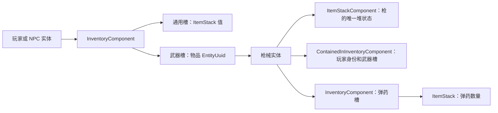

# 广义 Inventory：持有能力、槽位规则与实体交互

实体附加 `InventoryComponent` 后，即可通过 `InventorySystem` 放入、取出、拾取和转移物品。
玩家、NPC、箱子、猪猪存钱罐和武器复用同一种能力；构造参数决定槽位布局、允许的物品类别
和每槽容量。系统不通过玩家/NPC 类型判断谁能拥有库存。

玩家的装备关系也由这个通用库存能力表达。护甲、饰品、武器和弹药使用
`InventorySlotDefinition`/`InventorySlotKind` 的类别规则进入库存；不再建立
`PlayerEquipmentComponent` 或另一套 Player 装备槽。装备对防御、抗性、伤害和其他属性的
贡献由 Inventory/Item 提交后写入 `AttributeSetComponent` 的 `AttributeModifier`，库存
本身只负责物品和关系的权威状态。

实现位于本目录，物品定义和堆状态复用相邻的 [Item](../Item/README.md) 领域。
当前交付是共享库源码及使用合同，尚未接入现有最小服务器的拾取、网络、UI 或存档流程。

## 状态由谁持有

| 类型 | 作用 |
| --- | --- |
| `InventoryComponent` | 每个实体独立的槽位状态；对外提供只读视图 |
| `InventorySlotDefinition` | 索引、语义、接受类别、槽位堆叠上限 |
| `InventorySlot` | 空槽、一个值堆，或一个物品实体的身份引用 |
| `ItemDefinitionRegistry` | 共享不可变物品定义及最大堆叠数 |
| `ItemStack` | 定义 ID、数量、前缀组成的不可变值 |
| `ItemStackComponent` | 保留物品实体上的唯一数量来源 |
| `ContainedInInventoryComponent` | 物品实体所属库存的身份和槽位索引 |
| `InventorySystem` | 类别检查、容量规划、数量和归属关系提交 |
| `InventoryAttributeContributionSystem` | 从库存槽位和物品定义重建装备/饰品/武器属性贡献 |

`InventorySlotKind` 说明槽位用途。实际接收规则由 `AcceptedCategories` 决定，多个类别按
“任一匹配”接收；实际容量取槽位 `MaxStackSize` 与定义 `MaxStack` 的较小值。
槽位索引只要求非负且唯一，可以不连续。构造函数也拒绝 `default(InventorySlotDefinition)`。

`Slots` 是实时只读视图，元素为不可变值；需要跨帧保留时由调用方复制。不要把同一个
`InventoryComponent` 实例附加到多个实体。实体定义应使用工厂，每次创建一个新组件。

## 为什么槽位允许两种内容

普通材料、货币和弹药可以直接保存 `ItemStack` 值。它们只需要类型、数量和前缀，没有必要
为每个库存格创建实体。值槽位的数量完全由 `InventoryComponent` 持有。

有独立组件的物品则应保留实体。例如，枪械附加一个弹药 `InventoryComponent`，玩家再把
这把枪装进武器槽。如果只复制 `ItemStack` 并销毁枪的实体，弹药库存就会一起消失。
因此实体槽位只保存 `ItemEntityId`，物品数量仍在原实体的 `ItemStackComponent` 中。

两种内容互斥。`Content == null` 可能表示一个实体槽位，判断空槽必须使用 `IsEmpty`。
通过 `InventorySystem.TryGetStack` 可以统一读取两种槽位的堆值，不取得可变组件引用。



组件中的关系使用仓库现有 `EntityUuid` 身份根。Arch `Entity` 仅出现在系统同步 API 中，
不被复制进槽位或关系组件，也不用于存档身份。

## 用参数组合狭义库存

| 用途 | 槽位语义 | 接受类别 | 通常容量 |
| --- | --- | --- | --- |
| 玩家背包 | `General` | `Any` | 定义与配置共同限制 |
| 玩家饰品栏 | `Accessory` | `Accessory` | 1 |
| 玩家护甲栏 | `Armor` | `Armor` | 1 或按内容配置 |
| NPC 武器栏 | `Weapon` | `Weapon` | 1 |
| 武器弹药栏 | `Ammo` | `Ammo` | 定义与配置共同限制 |
| 猪猪存钱罐 | `PiggyBank` | `Any` | 定义与配置共同限制 |
| 箱子 | `Chest` | `Any` | 定义与配置共同限制 |

同一个实体的通用背包、饰品栏和武器栏组合在同一个组件中，以不同索引区分。不能给同一
实体重复附加多份同类型组件。需要独立生命周期的容器可使用独立实体。

以下是创建布局的示例，具体格数由游戏内容决定：

```csharp
using System.Linq;
using Terraria.Inventory;
using Terraria.Item;

var playerInventory = new InventoryComponent(
    Enumerable.Range(0, 40)
        .Select(index => new InventorySlotDefinition(
            index, InventorySlotKind.General, ItemCategoryMask.Any, maxStackSize: 999))
        .Concat(Enumerable.Range(40, 5)
            .Select(index => new InventorySlotDefinition(
                index, InventorySlotKind.Accessory, ItemCategoryMask.Accessory)))
        .Append(new InventorySlotDefinition(
            45, InventorySlotKind.Weapon, ItemCategoryMask.Weapon)));

var npcInventory = new InventoryComponent(new[] {
  new InventorySlotDefinition(0, InventorySlotKind.Weapon, ItemCategoryMask.Weapon)
});

var weaponInventory = new InventoryComponent(new[] {
  new InventorySlotDefinition(0, InventorySlotKind.Ammo, ItemCategoryMask.Ammo,
      maxStackSize: 999)
});

var chestInventory = new InventoryComponent(
    Enumerable.Range(0, 40).Select(index => new InventorySlotDefinition(
        index, InventorySlotKind.Chest, ItemCategoryMask.Any, maxStackSize: 999)));

var piggyBankInventory = new InventoryComponent(
    Enumerable.Range(0, 40).Select(index => new InventorySlotDefinition(
        index, InventorySlotKind.PiggyBank, ItemCategoryMask.Any, maxStackSize: 999)));
```

猪猪存钱罐的玩家私有内容应按玩家创建独立库存实体。世界中的存钱罐对象负责交互入口，
由宿主解析到对应玩家的库存。`PiggyBank` 枚举本身不提供账户隔离或所有权授权。

## Arch 接入示例

以下片段展示共享 API 用法，不是已执行的程序。`world` 是宿主当前的 Arch `World`；
真实身份分配应位于宿主创建流程，每个实体分配一次，不能把同一个身份写进可复用原型。
这里的物品定义仅用于说明结构，不是原版物品数据库。

```csharp
using Terraria.Combat;
using Terraria.Inventory;
using Terraria.Item;
using Terraria.Relationships;

var definitions = new ItemDefinitionRegistry();
var woodId = new ItemDefinitionId("wood");
var rifleId = new ItemDefinitionId("rifle");
var bulletId = new ItemDefinitionId("bullet");
definitions.Register(new ItemDefinition(woodId, 999, ItemCategoryMask.Material));
definitions.Register(new ItemDefinition(rifleId, 1, ItemCategoryMask.Weapon));
definitions.Register(new ItemDefinition(bulletId, 999, ItemCategoryMask.Ammo));

var inventorySystem = new InventorySystem(world, definitions);
var player = world.Create(
    new EntityIdentityComponent(EntityUuid.Create()), playerInventory);
var chest = world.Create(
    new EntityIdentityComponent(EntityUuid.Create()), chestInventory);
var rifle = world.Create(
    new EntityIdentityComponent(EntityUuid.Create()),
    new ItemStackComponent(new ItemStack(rifleId, 1)),
    weaponInventory);

// 武器自己拥有弹药库存。
InventoryTransferResult loaded = inventorySystem.TryInsert(
    rifle, new ItemStack(bulletId, 60), targetSlotIndex: 0);

// 保留枪实体、其弹药库存和其他实例组件，放入玩家武器槽。
InventoryTransferResult equipped = inventorySystem.TryStoreEntity(
    player, rifle, targetSlotIndex: 45);

// 一个普通世界掉落物：全部拾取时销毁掉落物实体，槽位获得值堆。
var woodDrop = world.Create(new ItemStackComponent(new ItemStack(woodId, 30)));
InventoryTransferResult pickup = inventorySystem.TryInsert(player, woodDrop);

// 指定源槽与目标槽，完整移动请求数量；空间不足时返回拒绝。
InventoryTransferResult moved = inventorySystem.TryMove(
    player, sourceSlotIndex: 0, targetEntity: chest, quantity: 10, targetSlotIndex: 0);

// 武器作为整个实体进入箱子，枪内的弹药库存随原实体保留。
InventoryTransferResult weaponMoved = inventorySystem.TryMove(
    player, sourceSlotIndex: 45, targetEntity: chest, quantity: 1, targetSlotIndex: 1);
```

每次调用后都应检查 `Succeeded`、`Quantity` 和 `Failure`。上例后续步骤需以前一步成功为前提。
值堆插入允许部分成功：如果直接传入一个内存 `ItemStack`，调用方只应从自己的来源扣除
返回的 `Quantity`。输入是值对象，不会被系统修改。重复插入同一个值会再次添加物品；
网络重发去重应在宿主的请求边界完成。

## 交互 API 与提交方式

| API | 行为 |
| --- | --- |
| `TryInsert(owner, itemEntity, targetSlotIndex)` | 普通物品可部分拾取；带 Inventory 的物品自动保留实体 |
| `TryInsert(owner, stack, targetSlotIndex)` | 插入内存值堆，返回实际提交数量 |
| `TryStoreEntity(owner, itemEntity, targetSlotIndex)` | 整个实体占用一个空槽，保留所有实例组件 |
| `TryRemove(owner, slot, quantity, out stack)` | 从值槽位取出指定数量 |
| `TryTakeEntity(owner, slot, out entity)` | 整体取出实体并清除双方容纳关系 |
| `TryMove(source, slot, target, quantity, targetSlotIndex)` | 请求数量全部移动或拒绝；支持指定同库存另一槽 |
| `TryGetStack(owner, slot, out stack)` | 读取当前权威堆值 |
| `TryRemoveInventoryComponent(owner)` | 只允许移除已清空的库存能力 |

未指定目标槽位时，值堆先填充同定义和同前缀的已有堆，再使用空槽；实体选择第一个合规
空槽。实体槽位不与值堆合并，也不拆分实体组件。传入部分实体数量返回
`EntitySplitNotSupported`；从实体槽位调用 `TryRemove` 返回 `SlotRequiresEntity`。

普通世界物品的 `TryInsert` 只适用于可转换为值堆的物品。武器具有弹药 Inventory 时自动
保留；耐久、附魔、个体任务状态等其他独立组件由调用方使用 `TryStoreEntity` 保留。
不能把这些实体误当作只有类型、数量、前缀的普通掉落物。

实体入口检查当前 World 和 Arch 存活版本；世界物品存在 `ItemWorldStateComponent` 时，
还检查拾取延迟与寿命。实体存放需要双方的 `EntityIdentityComponent`，系统不代替宿主
分配身份。身份解析从当前 Arch 世界查询，匹配不是唯一时拒绝。当前使用扫描实现，
未引入与宿主竞争的身份登记表；大规模高频调用的性能尚未评估。

源槽位与物品的关系必须对应；目标容器的祖先链用于拒绝自包含、把祖先放进后代或已损坏
的环。缺失实体或关系不匹配显式拒绝，不把悬空身份指向其他物品。

## 调度、失败与生命周期

调用约定是宿主独占的同步提交阶段：

1. 输入、网络或 AI 产生交互请求。
2. 宿主完成权限、交互距离、账户与会话检查。
3. `InventorySystem` 检查能力、定义、数量、容量和关系，先计算槽位副本。
4. 在同次调用中提交物品和槽位状态。
5. 返回后，其他系统读取新状态；宿主随后做网络同步或存档快照采集。

不得与其他库存/物品写者并行调用，不在不允许结构变化的 Arch 查询回调中执行增删。
Arch 结构变化事件中也不能重入修改或发布库存中间状态；完整状态在 API 返回后消费。
`PlanInsert` 等计算只改局部副本，业务拒绝发生在权威写入前。

技术异常向宿主传播，不用捕获所有异常来冒充业务拒绝。内存耗尽、Arch 事件异常或违背
独占约定时不提供通用事务回滚保证。宿主应停止该次正常提交链，按自己的故障恢复规则处理。
`CommitFailed` 保留为已有结果枚举值，目前这些入口不将未知技术故障转换为它。

对库存内保留的实体，宿主应在物理、世界拾取和掉落寿命查询中排除
`ContainedInInventoryComponent`；物品仍可运行其自身的弹药等内部能力。
`TryTakeEntity` 只断开容纳关系。重新成为世界掉落物时，宿主在同一提交阶段设置位置、
速度、碰撞启用状态和拾取延迟，不直接复用拾取前的位置。

移除库存或销毁实体前，先处理内容：

- 值槽位使用 `TryMove` 转交，或使用 `TryRemove` 交给宿主决定奖励、丢弃或销毁。
- 实体槽位使用 `TryMove` 转交，或使用 `TryTakeEntity` 取出。
- 若被销毁实体本身也位于另一库存中，先从父库存 `TryTakeEntity`。
- 库存清空后才移除组件或调用宿主销毁入口。嵌套容器按相同规则处理。

直接调用 `world.Destroy` 或绕过系统移除组件不会自动清理关系；本批没有注册全局销毁钩子。
世界卸载应停止交互，再由宿主保存或释放整组实体。存档不得直接序列化 Arch 句柄，加载后
需要根据新实例身份重新建立槽位与关系。

## 交付状态与接入边界

组件、规则和同步系统入口已编写；网络、持久化、界面、弹药消耗规则、距离及权限控制、
世界物理排除条件仍由对应领域和宿主接入。`InventorySystem` 不在转移调用中隐式修改属性；
宿主应在库存关系提交成功后运行 `InventoryAttributeContributionSystem`，按物品来源重建
`AttributeModifier`，并在取出、转移、销毁或定义变化时移除对应来源。

按用户 **不做任何测试** 的要求，本次继续实施未新增测试，也没有执行构建、测试、冒烟、
服务器运行或验证脚本。最终源码的编译和运行行为未验证，历史构建不覆盖本次实现。

组织方式参考本地 SS14 的 `Content.Shared/Inventory/InventoryComponent.cs` 与
`InventorySystem.cs`（2026-10-23 阅读）：组件表达槽位状态，系统维护规则；相关 API 使用
同一系统的 partial 文件。这里适配仓库的 Arch、身份和 C# 规范，未复制其引擎基类、
网络特性、客户端命名或 IoC 入口。
